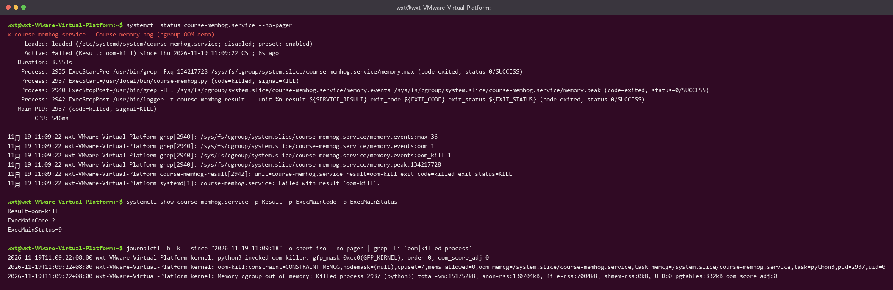
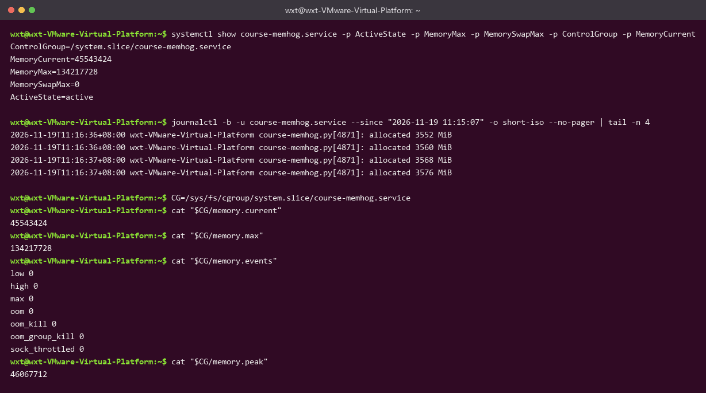

# Lab11：服务内存限额与 OOM 日志分析

> **前置实验**：Lab2（journal 查询）、Lab3（4W1R）、Lab5（rsyslog、Alloy、Loki 与 Grafana）、Lab7（事件时间线）、Lab10（资源耗尽与修复验证）。  
> **建议用时**：90～120 分钟。  
> **提交材料**：1 份 Markdown 报告、2 张截图。  
> **截止时间**：**2026 年 11 月 26 日（星期四）24:00（北京时间）**，即 11 月 27 日 00:00。

---

## 一、实验背景与目标

### 1.1 实验问题

Lab10 中，文件写入失败并不意味着整台虚拟机的所有文件系统都已没有剩余空间。判断写入是否受限，需要先确定写入路径所属的文件系统，再检查该文件系统的容量。

内存资源也存在类似的统计范围。一台虚拟机即使仍有可用内存，运行在其中的某个服务也可能达到单独配置的内存上限。此时，服务的运行结果与整机的可用内存读数可能并不一致。

本次实验使用一个持续分配内存的 Python 程序，观察服务异常退出的过程，并根据实际日志回答以下问题：

1. 服务退出时，整台虚拟机是否必须已经耗尽内存？
2. 哪些证据能够确认进程由 OOM 机制终止，而不只是收到一般的终止信号？
3. 内存限制作用于整个操作系统，还是作用于指定服务所在的控制组？
4. 在不提高内存限额的条件下，能否通过修改程序的数据保留方式，使服务持续运行？

实验采用**两次运行、一次修改**的方式。第一次保留故障现象和证据；第二次保持服务的资源限额不变，只修改程序的数据保留方式，比较前后的结果。

### 1.2 学习目标

完成本实验后，应能够：

- 区分整机可用内存、服务内存限额和服务当前内存用量。
- 使用 `systemctl` 检查 systemd 服务配置、运行状态与退出结果。
- 使用 `journalctl` 将服务输出与内核 OOM 记录关联到同一次运行。
- 读取 cgroup v2 的内存事件计数、峰值和当前用量，并正确解释各项指标。
- 使用已有的 rsyslog → Alloy → Loki → Grafana 链路核对一次服务退出摘要。
- 在控制变量不变的前提下完成修复验证，并根据证据说明结论的适用范围。

### 1.3 实验路线与证据要求

| 阶段 | 核心任务 | 必须取得的证据 |
| :--- | :--- | :--- |
| 任务一 | 运行原程序，观察异常退出 | 整机内存基线、服务退出状态、运行起始时间 |
| 任务二 | 分析配置和日志，确认故障原因 | 配置值、进程 PID、内核 OOM 记录、控制组计数 |
| 任务三 | 核对集中日志采集结果 | 本机 syslog 摘要、Grafana/Loki 查询结果 |
| 任务四 | 修改现有程序并验证 | 相同内存限额、持续分配日志、当前内存用量、OOM 计数 |
| 任务五 | 整理完整证据链 | 事件时间线、4W1R、故障与修复对比 |

**证据使用原则**：报告中的时间、PID、内存数值和日志内容必须来自本人虚拟机的实际运行结果。文档中的预期值、字段示例和计算示范不能替代实测证据。

### 1.4 文件与运行环境

本实验继续使用课程仓库已经提供的三个脚本：

| 文件 | 用途 | 是否需要修改 |
| :--- | :--- | :--- |
| `homework/Lab11/setup.sh` | 安装实验服务、内存分配程序和退出证据记录规则 | 否 |
| `homework/Lab11/restore.sh` | 停止服务并恢复实验前的系统状态 | 否 |
| `homework/Lab11/lablib.sh` | 为上述脚本提供环境检查和备份等公共功能 | 否 |

`setup.sh` 会按原有逻辑安装 `/usr/local/bin/course-memhog.py` 和 `course-memhog.service`。**本实验不要求新建任何 `.sh` 或 `.py` 文件，也不要求提交代码文件。**任务四直接修改已经安装的 `/usr/local/bin/course-memhog.py`；完成验证后，使用现有的 `restore.sh` 清理实验环境。

实验默认沿用 Lab1 的 Ubuntu 24.04 虚拟机，以及 Lab5 已配置的日志采集环境。命令分别在 Windows 本地 Git Bash 和 Ubuntu 虚拟机 SSH 终端执行，文档会标明所在环境。

---

## 二、实验准备

### 2.1 创建个人报告目录

**操作位置：Windows，课程仓库根目录的 Git Bash。**

将 `学号姓名` 替换为自己的个人目录名称：

```bash
cd 学号姓名
mkdir -p Lab11/imgs
cp ../homework/Lab11/Lab11.md Lab11/Lab11.md
```

第一条命令进入个人提交目录；第二条创建报告和图片目录；第三条将课程实验文档复制为个人报告。后续所有报告内容均填写在个人副本中，不修改课程仓库的实验模板。

> **检查点**：个人目录中应存在 `Lab11/Lab11.md` 和 `Lab11/imgs/`。此时不需要创建任何截图，也不需要编写脚本。

### 2.2 上传既有脚本

首先为虚拟机创建快照，以便在环境异常时恢复。

**操作位置：Ubuntu 虚拟机 SSH 终端。**

```bash
mkdir -p ~/Lab11
```

**操作位置：Windows，课程仓库根目录的 Git Bash。**

将用户名、虚拟机 IP 替换为实际值：

```bash
scp ./homework/Lab11/setup.sh ./homework/Lab11/restore.sh ./homework/Lab11/lablib.sh 用户名@虚拟机IP:~/Lab11/
```

`scp` 的前三个路径指向 Windows 仓库中已有的脚本，最后一个参数指定 Ubuntu 虚拟机上的接收目录。该操作仅传输现有文件。

返回 **Ubuntu SSH 终端**，执行：

```bash
cd ~/Lab11
ls -1
```

预期可以看到：

```text
lablib.sh
restore.sh
setup.sh
```

若缺少文件，应检查 Windows 终端所在目录、传输命令中的文件路径以及 SSH 连接信息。

### 2.3 核对运行条件并安装服务

继续在 **Ubuntu SSH 终端**执行：

```bash
stat -f -c %T /sys/fs/cgroup
```

这条命令查询 `/sys/fs/cgroup` 挂载点的文件系统类型。`stat -f` 表示检查文件系统，`-c %T` 表示只输出文件系统类型。本实验的预期输出为：

```text
cgroup2fs
```

cgroup（control group，控制组）是 Linux 内核按进程组管理和限制资源的机制。本实验的 `MemoryMax` 内存限额、`memory.current` 当前用量和 `memory.events` OOM 事件计数，都通过服务所属的控制组落实和记录。

`cgroup2fs` 表明该系统挂载的是 **cgroup v2**。cgroup v2 使用统一层级，并提供本实验后续要读取的 `memory.max`、`memory.current`、`memory.events` 和 `memory.peak` 等接口。cgroup v1 的目录组织、接口文件名和部分统计含义与 v2 不同，不能套用本文的读取路径和解释方法。

因此，若结果不是 `cgroup2fs`，后续命令可能找不到对应文件，即使读到其他接口中的数值，也不能按本实验的 cgroup v2 规则解释。此时应停止实验，先核对虚拟机内核与 cgroup 挂载方式；不要继续启动服务或用其他数值代替。

随后执行现有准备脚本：

```bash
sudo bash setup.sh
```

在原实验环境中，脚本会检查运行条件、保存需要恢复的原状，安装内存分配程序及 systemd 服务单元，最后重新加载服务配置。成功安装后，服务**尚未启动**。正常情况下，脚本末尾会提示已安装 `course-memhog.service`，并显示 `MemoryMax=128M`、`MemorySwapMax=0`。

此处不需要直接执行 Python 程序。**必须通过 `systemctl start course-memhog.service` 运行它**，才能使用服务单元规定的内存限制。

> **检查点**：准备脚本运行成功，且尚未手动启动 `course-memhog.service`。若脚本失败，保留实际错误信息，并参考第九节排查。

---

## 三、任务一：观察一次服务异常退出

本任务先获得故障现象，不立即展开全部技术解释。记录原始结果后，再在任务二中分析其原因。

### 3.1 记录启动前的内存基线

**操作位置：Ubuntu SSH 终端。**

```bash
free -h
```

```bash
systemctl show course-memhog.service -p ActiveState -p MemoryMax -p MemorySwapMax
```

`free -h` 查看整台虚拟机的物理内存和 swap 统计，`-h` 以 KiB、MiB、GiB 等易读单位显示。本任务只需记录 `Mem:` 行 `available` 列的实测值，它没有统一的固定数值。`available` 表示操作系统估计还可供新程序使用的整机内存，包含部分可回收的缓存等，不能与表示完全未使用内存的 `free` 列混用。

`systemctl show` 用于保存服务启动前的状态和资源限额基线。此时预期为：

- `ActiveState=inactive`：服务尚未启动，后续日志可归入本次运行。
- `MemoryMax=134217728`：服务内存硬上限为 128 MiB。
- `MemorySwapMax=0`：该服务控制组可使用的 swap 上限为 0。

这里先记录实际读数，并与整机 `available` 一起作为对照基线。三个服务属性的配置来源、作用范围及其与 OOM 的关系，在 4.1 节结合故障现场进一步分析。

**实验记录 1：启动前状态**

| 检查项 | 本机实测值 |
| :--- | :--- |
| cgroup 文件系统类型 | `cgroup2fs` |
| 整机内存 `available` | `4.5Gi`（`Mem:` 行 `total 5.7Gi`、`used 1.2Gi`） |
| `ActiveState` | `inactive` |
| `MemoryMax` | `134217728` |
| `MemorySwapMax` | `0` |

根据当前观察，在启动服务前回答：

**问题 1**：`available` 和 `MemoryMax` 是否描述同一个资源范围？仅根据这两项读数，能否断定服务一定不会发生内存不足？

> 答：两者不是同一个资源范围。`available` 是整机层面的估算值，表示内核认为还能交付给新进程使用的内存（本次为 `4.5Gi`，`total` 为 `5.7Gi`）；`MemoryMax=134217728` 字节（128 MiB）是 `course-memhog.service` 所属控制组的内存硬上限，只约束该服务内的进程。整机仍有 4.5 GiB 可用，并不代表该服务可以随意增长：只要该控制组自身达到 128 MiB，内核就可以在这个控制组范围内终止进程。因此仅凭这两项读数不能断定服务不会内存不足，还需要看服务实际保留了多少数据。

### 3.2 启动服务并记录退出结果

在**同一个 Ubuntu SSH 会话**中执行：

```bash
START="$(date '+%F %T')"
```

```bash
echo "$START"
```

```bash
sudo systemctl start course-memhog.service
```

`START` 保存本次运行的查询起点。journal 可能包含以前的实验记录，后续查询必须按这次运行的时间范围筛选。将 `echo` 输出的时间写入报告；如果 SSH 重连，Shell 变量不会自动保留，需要用记录的时间重新赋值。

启动后等待约 5～10 秒，查询服务状态：

```bash
systemctl status course-memhog.service --no-pager
```

```bash
systemctl show course-memhog.service -p Result -p ExecMainCode -p ExecMainStatus
```

这两条命令分别从便于阅读的终端摘要和可逐项记录的服务属性，检查服务的运行结果。原程序按预期触发 OOM 时，常见输出如下；具体值仍以本人虚拟机的实测结果为准。

| 命令或属性 | 查看内容 | 原程序异常退出后的预期值 | 为什么要查看 |
| :--- | :--- | :--- | :--- |
| `systemctl status course-memhog.service --no-pager` | 服务的活动状态、主进程 PID、退出摘要和最近日志；`--no-pager` 表示直接输出全部内容，不进入分页查看器 | 通常显示 `Active: failed`，并可能显示 `code=killed, signal=KILL` | 先确认服务是否已经退出，取得主进程和最近日志的线索 |
| `Result` | systemd 对本次单元运行结果的概括 | 常见为 `signal`，表示主进程因信号结束 | 将服务最终结果写入记录，供后续与 syslog 退出摘要对应 |
| `ExecMainCode` | systemd 记录的主进程结束方式 | 常见为 `1`，表示主进程被信号终止 | 区分正常退出、退出码结束和信号终止等结束方式 |
| `ExecMainStatus` | 主进程的具体退出状态；发生信号终止时表示信号编号 | 常见为 `9`，对应 `SIGKILL` | 记录具体信号，并与 `status` 中的 `KILL` 摘要相互核对 |

`status` 适合阅读一次服务的整体状态，`show` 适合准确摘录指定字段。三项 `show` 属性共同描述“服务结果、主进程结束方式、具体退出状态”。这些输出可以确认服务是否仍在运行，并提供退出方式的线索；发生 OOM 的约束范围和被终止进程仍需在任务二通过内核日志与 PID 对应关系确认。**不能只凭 `failed` 或 `SIGKILL` 就认定发生 OOM。**

如果服务仍在运行，可以稍后再次查询。若服务尚未启动成功或显示其他失败原因，保留错误信息并参考第九节。

**实验记录 2：首次运行**

| 检查项 | 本机实测值 |
| :--- | :--- |
| 本次查询起点 `START` | `2026-11-19 11:09:18` |
| 服务最终状态 | `failed`；`Active: failed (Result: oom-kill) since Thu 2026-11-19 11:09:22 CST`，`Duration: 3.553s`，`Main PID: 2937 (code=killed, signal=KILL)` |
| `Result` | `oom-kill` |
| `ExecMainCode` | `2`（被信号终止） |
| `ExecMainStatus` | `9`（`SIGKILL` 的信号编号） |

> **阶段结论要求**：本任务只描述观察到的事实，不要求提前给出完整故障归因。服务退出后继续保留现场，不运行 `restore.sh`，也不要立即重新启动服务。

---

## 四、任务二：从配置与日志确定故障原因

任务一获得了服务异常退出的现象。接下来按照**配置 → 程序行为 → 服务日志 → 内核日志 → 控制组计数**的顺序收集证据。

### 4.1 查明服务执行了哪个程序、受什么限制

**操作位置：Ubuntu SSH 终端。**

```bash
systemctl cat course-memhog.service --no-pager
```

查找 `[Service]` 段中的 `ExecStart`、`MemoryMax`、`MemorySwapMax`、`OOMPolicy`，并观察是否包含 `ExecStartPre` 和 `ExecStopPost`。`ExecStart` 指定主程序，内存相关属性规定服务的资源管理方式。`ExecStartPre` 在主程序之前执行；`ExecStopPost` 可在服务退出后执行预设的记录操作。

接着核对已经加载的属性：

```bash
systemctl show course-memhog.service -p ActiveState -p MemoryMax -p MemorySwapMax -p OOMPolicy
```

`systemctl cat` 查看磁盘上的服务单元配置，下面的 `systemctl show` 则读取 systemd **当前已经加载的运行属性**。3.1 节保存的是启动前基线；本小节在首次异常退出后复核这些属性，并结合 `ExecStart`、`OOMPolicy` 和后续日志分析故障原因。四项属性分别用于确认服务状态和本次资源管理条件。

| 属性 | 查看内容 | 首次异常退出后的预期值 | 为什么要查看 |
| :--- | :--- | :--- | :--- |
| `ActiveState` | 服务当前的活动状态 | `failed` | 确认当前读取的是首次异常退出后的服务状态；若仍为 `active`，说明退出尚未发生或查询时机不同 |
| `MemoryMax` | 服务控制组的内存硬上限，加载值以字节显示 | 配置为 `128M`，加载值为 `134217728` 字节 | 确认实际生效的限额，作为解释控制组 OOM 和任务四对照验证的依据 |
| `MemorySwapMax` | 服务控制组可使用的 swap 上限 | `0` | 确认该组不能使用 swap，排除两次运行之间 swap 条件变化的影响 |
| `OOMPolicy` | 服务内部发生 OOM 终止时，systemd 对单元采取的处理策略 | `stop` | 说明服务发生 OOM 后 systemd 如何处理该单元；该属性本身不能证明本次已经发生 OOM |

`128M` 对应 `128 × 1024 × 1024 = 134217728` 字节。这里同时查看配置文本与已加载属性，是为了验证写入磁盘的配置已由 systemd 读取并生效。若两者不一致，应先执行配置加载检查，不能直接把配置文本当作当前运行条件。任务四还要用相同的属性证明程序修改前后内存限制没有变化。

**实验记录 3：服务配置**

- `ExecStart` 的实际值：`/usr/local/bin/course-memhog.py`
- `MemoryMax` 的配置值及加载值：配置 `MemoryMax=128M`，加载值 `134217728` 字节（`128 × 1024 × 1024`）
- `MemorySwapMax` 的实际值：`0`
- `OOMPolicy` 的实际值：`stop`

单元中还包含两条与本实验取证直接相关的指令：`ExecStartPre` 用 `grep -Fxq 134217728 .../memory.max` 在启动前校验限额，`ExecStopPost` 在退出阶段把 `memory.events` 与 `memory.peak` 写入本服务 journal，并通过 `logger` 发送 `course-memhog-result` 摘要。

### 4.2 根据现有源码推断内存变化

查看 `setup.sh` 安装的**现有 Python 程序**：

```bash
cat /usr/local/bin/course-memhog.py
```

重点检查以下内容：

- `bytearray(8 * 1024 * 1024)`：每次创建一个约 8 MiB 的字节数组。
- `chunks.append(...)`：新创建的数据块被保存在容器中。
- `print` 与 `flush=True`：完成分配后立即输出累计分配量。
- `time.sleep(0.2)`：各轮分配之间约间隔 0.2 秒。

先不要修改文件。任务四将在同一个已安装文件上修改数据保留方式，其余循环和分配逻辑保持不变。

注意：程序日志打印的是**成功创建的数据块的累计大小**，并非控制组的准确内存用量。解释器、内存管理开销和其他组内开销也会被计入控制组内存，因此不能使用 `128 ÷ 8` 精确推算进程被终止前的最后一次成功分配。

### 4.3 从服务 journal 提取实际分配记录

执行：

```bash
sudo journalctl -b -u course-memhog.service --since "$START" -o short-iso --no-pager
```

参数含义如下：

| 参数 | 作用 |
| :--- | :--- |
| `-b` | 限定当前系统启动周期 |
| `-u course-memhog.service` | 按服务单元筛选 |
| `--since "$START"` | 限定本次实验的时间起点 |
| `-o short-iso` | 显示包含日期、时间和时区的日志时间格式 |
| `--no-pager` | 直接输出，不进入分页查看器 |

找到本次运行最早的 `allocated` 记录，以及最后两条连续的 `allocated` 记录。记录它们的时间、累计 MiB 数和日志前缀中的 PID。

下面仅为字段格式示例，**不是本次实验的答案**：

```text
…14:10:03… course-memhog.py[4120]: allocated 104 MiB
…14:10:03… course-memhog.py[4120]: allocated 112 MiB
```

如果第二条是最后一条分配记录，只能确定程序已成功完成累计 112 MiB 的数据块分配。下一次申请可能尚未成功，也可能在打印之前就发生了终止。不要将最后一条输出直接视为进程被终止时的精确内存用量。

**实验记录 4：分配过程**

| 记录项 | 时间 | PID | 日志原文或累计量 |
| :--- | :--- | :--- | :--- |
| 最早一条 `allocated` | `2026-11-19T11:09:18+08:00` | 2937 | `course-memhog.py[2937]: allocated 8 MiB` |
| 倒数第二条 `allocated` | `2026-11-19T11:09:22+08:00` | 2937 | `course-memhog.py[2937]: allocated 112 MiB` |
| 最后一条 `allocated` | `2026-11-19T11:09:22+08:00` | 2937 | `course-memhog.py[2937]: allocated 120 MiB` |

最后一条只说明程序已成功完成累计 120 MiB 的数据块创建，第 16 次申请（128 MiB）没有留下打印记录，因此不能用 `120 MiB` 或 `128 ÷ 8` 推算进程被终止时的精确占用量。

### 4.4 用内核 journal 判断退出原因

查询与同一次运行有关的内核日志：

```bash
sudo journalctl -b -k --since "$START" -o short-iso --no-pager | grep -Ei 'oom|out of memory|killed process'
```

这里把查询来源从 `-u`（服务日志）切换为 `-k`（内核日志）。命令末尾的 `grep` 只保留包含 OOM 或进程终止关键词的行。若没有匹配，先去掉 `| grep ...`，检查原始内核日志，再确认 `START` 是否仍指向本次运行。

重点寻找以下信息：

| 关键字段 | 可支持的判断 |
| :--- | :--- |
| `Killed process` 后的数字 | 内核终止的是哪个 PID |
| `constraint=CONSTRAINT_MEMCG` | 此次 OOM 的约束范围与内存控制组有关 |
| `oom_memcg=...` | 触发内存约束的控制组路径 |
| `Memory cgroup out of memory` | 内核记录了控制组范围的内存不足事件 |

例如，内核记录可能包含如下字段（节选）：

```text
oom-kill:constraint=CONSTRAINT_MEMCG,…,oom_memcg=/system.slice/course-memhog.service,…,task=python3,pid=4120,…
Memory cgroup out of memory: Killed process 4120 (python3) …
```

`python3` 是解释器的进程名，服务日志中可能以脚本文件名显示，因此两类日志的进程名称不必完全一致。关联时应综合核对：

1. 日志是否属于同一次启动及相近时间范围。
2. 服务分配日志中的 PID 与内核终止记录中的 PID 是否相同。
3. 内核记录中的控制组路径是否对应 `course-memhog.service`。
4. 服务退出结果是否与该内核事件一致。

**不能仅根据 `SIGKILL` 推断 OOM**：其他操作也可能发送同样的信号。能够区分受控制组约束的 OOM 与整机范围故障的，是内核日志中的约束和控制组字段。

**实验记录 5：故障归因**

| 检查项 | 本次实际证据 |
| :--- | :--- |
| 服务分配日志中的 PID | `2937`（`course-memhog.py[2937]: allocated ...`） |
| 内核终止记录中的 PID | `2937`（`Killed process 2937 (python3)`） |
| 内核 OOM 约束字段 | `constraint=CONSTRAINT_MEMCG`，日志前缀为 `Memory cgroup out of memory` |
| 内核控制组路径 | `oom_memcg=/system.slice/course-memhog.service`、`task_memcg=/system.slice/course-memhog.service` |
| 服务 `Result` | `oom-kill` |
| 主进程退出方式和状态 | `Main process exited, code=killed, status=9/KILL`；`ExecMainCode=2`、`ExecMainStatus=9` |

粘贴能够同时支持进程标识和约束范围判断的**内核原始日志**：

> 日志：
>
> ```text
> 2026-11-19T11:09:22+08:00 wxt-VMware-Virtual-Platform kernel: oom-kill:constraint=CONSTRAINT_MEMCG,nodemask=(null),cpuset=/,mems_allowed=0,oom_memcg=/system.slice/course-memhog.service,task_memcg=/system.slice/course-memhog.service,task=python3,pid=2937,uid=0
> 2026-11-19T11:09:22+08:00 wxt-VMware-Virtual-Platform kernel: Memory cgroup out of memory: Killed process 2937 (python3) total-vm:151752kB, anon-rss:130704kB, file-rss:7004kB, shmem-rss:0kB, UID:0 pgtables:332kB oom_score_adj:0
> ```

**问题 2**：本次服务退出是否可以归因为控制组范围内的 OOM？请引用至少两项相互独立、能够对应到同一次运行的证据进行说明。

> 答：可以归因为控制组范围内的 OOM。以下四项证据分别来自不同记录来源，且都指向同一次运行（`START=2026-11-19 11:09:18`，进程 PID 2937）：
>
> 1. **内核日志（独立来源一）**：`constraint=CONSTRAINT_MEMCG` 表明本次 OOM 由内存控制组限额触发，而不是整机内存耗尽；同一行的 `oom_memcg=/system.slice/course-memhog.service` 把约束范围定位到本服务的控制组。
> 2. **内核日志中的进程标识**：`Memory cgroup out of memory: Killed process 2937 (python3)` 给出被终止的 PID；它与服务 journal 中 `course-memhog.py[2937]: allocated ...` 的 PID 完全相同，且两条记录都落在 `11:09:22` 同一秒内。
> 3. **控制组计数（独立来源二）**：退出阶段保存的 `memory.events` 中 `oom 1`、`oom_kill 1`，说明该控制组确实记录了一次 OOM 事件和一个被终止的进程；`memory.peak:134217728` 等于配置的 `MemoryMax`，说明该组用量确实顶到了自己的硬上限。
> 4. **systemd 结果**：`Result=oom-kill`、`ExecMainCode=2`、`ExecMainStatus=9`，与内核记录的时间、PID 完全吻合，也与 syslog 中的 `result=oom-kill exit_code=killed exit_status=KILL` 一致。
>
> 需要强调的是，`signal=KILL` 本身不足以证明 OOM：任何进程都可能被 `kill -9`。真正把这次退出与“控制组内存限额”连接起来的，是内核日志中的 `CONSTRAINT_MEMCG` 与 `oom_memcg` 字段；PID 一致则排除了“内核终止了别的进程”这一可能。

**截图 1：故障证据。** 在一张图中呈现服务退出结果以及本次内核 OOM 记录。应能辨认服务名称、进程名、PID 和触发约束的关键信息；允许将两段终端输出拼为一张图。



### 4.5 用控制组事件计数复核

**这一步要解决的问题**：4.4 节已经通过内核日志找到被终止的 PID 和 OOM 约束范围，本节再读取内核为控制组维护的计数器，检查该组是否确实记录了 OOM 事件和进程终止。这里的数值由内核统计，不能根据程序的 `allocated` 输出推算。

**第一步：理解统计值为什么保存在 journal 中。**

控制组运行期间，内核会在该组的 `memory.events` 和 `memory.peak` 文件中更新统计值。服务退出后，systemd 可能回收控制组目录，这些文件也随之消失。现有服务单元中的 `ExecStopPost` 会在退出阶段、目录被回收前执行读取操作，并把结果写入 `course-memhog.service` 的 journal。因此，本节查询的是**退出时保存下来的统计副本**，不需要重新启动服务，也不要求直接访问已经消失的控制组目录。

**第二步：从服务 journal 中筛出统计记录。**

```bash
sudo journalctl -b -u course-memhog.service --since "$START" --no-pager | grep -E 'memory\.(events|peak):'
```

`journalctl -u course-memhog.service --since "$START"` 限定本次服务和运行起点，末尾的 `grep` 只保留包含 `memory.events:` 或 `memory.peak:` 的行。这样可以过滤掉与本节无关的分配日志。

**第三步：逐行读取输出。**

下面仅展示字段格式和读法，数字不是本次实验的答案：

```text
… /memory.events:oom 1
… /memory.events:oom_kill 1
… /memory.peak:125829120
```

| 输出字段 | 它回答的问题 | 如何读取并填写实验记录 6 |
| :--- | :--- | :--- |
| `memory.events:oom 1` | 这个控制组发生过几次 OOM 事件？ | 冒号后的 `1` 是事件次数，将实际数字填入 `oom` 行，单位为“次”。原程序发生一次典型 OOM 时通常为 1，但仍以实测为准 |
| `memory.events:oom_kill 1` | 这个控制组中有几个进程被 OOM killer 终止？ | 冒号后的 `1` 是被终止的进程数量，将实际数字填入 `oom_kill` 行，单位为“个进程”。它应与 4.4 节内核终止记录相互印证 |
| `memory.peak:125829120` | 这个控制组从创建到回收，内存用量最高达到多少？ | 冒号后的数字以字节为单位。除以 `1024 × 1024` 可换算为 MiB；此例为 `125829120 ÷ 1048576 = 120 MiB`。将实测字节数及换算结果填入 `memory.peak` 行 |

`memory.peak` 是整个控制组的实际内存峰值，包含 Python 解释器和其他组内开销。它通常接近配置的 128 MiB 上限，但不要求恰好等于 `134217728` 字节，也不能用最后一条 `allocated` 的累计量代替。

**第四步：区分零值与缺失。**

- 输出中明确出现 `oom 0` 或 `oom_kill 0`，才表示对应计数为 0。
- 命令没有任何输出，表示本次没有取得统计记录，实验记录中应填写“未取得”，保留 4.3、4.4 节已有的服务和内核日志证据，并按第九节排查。
- 如果只有部分字段，只填写实际出现的字段，其余字段写“未取得”。不要根据预期结果补成 0 或 1。

**实验记录 6：控制组统计**

粘贴包含上述字段的原始日志行：

> 原始输出：
>
> ```text
> 11月 19 11:09:22 wxt-VMware-Virtual-Platform grep[2940]: /sys/fs/cgroup/system.slice/course-memhog.service/memory.events:low 0
> 11月 19 11:09:22 wxt-VMware-Virtual-Platform grep[2940]: /sys/fs/cgroup/system.slice/course-memhog.service/memory.events:high 0
> 11月 19 11:09:22 wxt-VMware-Virtual-Platform grep[2940]: /sys/fs/cgroup/system.slice/course-memhog.service/memory.events:max 36
> 11月 19 11:09:22 wxt-VMware-Virtual-Platform grep[2940]: /sys/fs/cgroup/system.slice/course-memhog.service/memory.events:oom 1
> 11月 19 11:09:22 wxt-VMware-Virtual-Platform grep[2940]: /sys/fs/cgroup/system.slice/course-memhog.service/memory.events:oom_kill 1
> 11月 19 11:09:22 wxt-VMware-Virtual-Platform grep[2940]: /sys/fs/cgroup/system.slice/course-memhog.service/memory.events:oom_group_kill 0
> 11月 19 11:09:22 wxt-VMware-Virtual-Platform grep[2940]: /sys/fs/cgroup/system.slice/course-memhog.service/memory.events:sock_throttled 0
> 11月 19 11:09:22 wxt-VMware-Virtual-Platform grep[2940]: /sys/fs/cgroup/system.slice/course-memhog.service/memory.peak:134217728
> ```

| 指标 | 本次实测值 | 单位 |
| :--- | :--- | :--- |
| `oom` | `1` | 次 |
| `oom_kill` | `1` | 个进程 |
| `memory.peak` | `134217728` 字节，即 `134217728 ÷ 1048576 = 128 MiB` | 字节或 MiB（注明换算） |

本次 `memory.peak` 恰好等于硬上限，说明该控制组的用量确实被顶到 `memory.max` 之后才发生终止；`max 36` 表示有 36 次分配尝试触发了限额路径。这三个数值由内核统计，与程序打印的 `allocated 120 MiB` 不是同一指标。

> **阶段结论要求**：任务二完成后，应能分别回答“程序如何持续增加内存保留量”“内存限制作用于何处”“哪个进程被终止”。这三个问题的证据来源不同，报告中不要将它们混为单一结论。

---

## 五、任务三：在集中平台核对同一次退出

任务二通过本机日志完成了故障归因。本任务验证 Lab5 建立的日志采集链路是否能够记录这次服务的退出摘要。

### 5.1 确认采集组件状态

**操作位置：Ubuntu SSH 终端。**

```bash
systemctl is-active rsyslog alloy loki grafana-server
```

```bash
curl -sS http://127.0.0.1:3100/ready
```

原实验环境中，四个服务都应返回 `active`，Loki 就绪接口通常返回 `ready`。这些输出只能说明组件处于运行或就绪状态，不能单独证明指定日志已经成功进入 Loki。

本实验使用的采集路径为：

```text
服务退出 → ExecStopPost/logger → /var/log/syslog
                                    ↓
                                  Alloy → Loki → Grafana
```

该链路采集的是退出阶段通过 `logger` 发送的**服务结果摘要**，并不表示全部内核 journal 或 cgroup 文件已被采集到 Loki。内核的详细 OOM 证据仍以任务二在本机查询的记录为准。

### 5.2 先在本机核对 syslog

执行：

```bash
sudo grep -F 'course-memhog-result' /var/log/syslog | tail -n 5
```

查找本次运行对应的记录。原实验的退出摘要包含下列字段，尖括号代表实际运行值：

```text
course-memhog-result: unit=course-memhog.service result=<服务结果> exit_code=<结束方式> exit_status=<状态或信号>
```

根据时间和服务名，找到与任务一的 `Result`、`ExecMainCode`、`ExecMainStatus` 相对应的摘要。某些状态可能以文本形式显示（如 `KILL`），与 `systemctl show` 中的数字表示方式不同。应说明对应关系，不应直接假定两者的字面值相同。

**实验记录 7：本机 syslog**

> 本机查询结果：
>
> ```text
> 2026-11-19T11:09:22.048334+08:00 wxt-VMware-Virtual-Platform course-memhog-result: unit=course-memhog.service result=oom-kill exit_code=killed exit_status=KILL
> ```
>
> 对应的时间与服务结果：时间为 `2026-11-19T11:09:22.048334+08:00`，`result=oom-kill` 与 3.2 节的 `Result=oom-kill` 一致；`exit_code=killed` 对应 `ExecMainCode=2`（被信号终止）；`exit_status=KILL` 对应 `ExecMainStatus=9`，即 `SIGKILL` 的文本表示。文本与数字两种写法含义相同，字面值不同。
>
> 说明：`/var/log/syslog` 中混有少量二进制字节，直接 `grep` 只会提示“匹配到二进制文件”。加 `-a` 参数（把文件当作文本处理）才能看到原文。本次实验中该摘要出现了多条：除 `11:09:22` 这次 OOM 外，还有 `09:37:12` 的一次历史运行，以及停止修复版服务时产生的 `result=success exit_code=killed exit_status=TERM` 记录。本记录只取与 3.2 节 `START` 对应、且 `result=oom-kill` 的那一条，其余按时间和 `result` 排除。

### 5.3 在 Grafana 中查询相同事件

**操作位置：Windows 浏览器。**

打开 Lab5 使用的 Grafana，进入 **Explore → Loki 数据源 → Code**。将时间范围调整到覆盖首次启动和退出的实际时间，在 LogQL 输入框中执行：

```logql
{job="syslog"} |= "course-memhog-result" |= "unit=course-memhog.service"
```

其中，`{job="syslog"}` 指定课程中配置的日志流，`|=` 表示要求消息正文包含指定字符串。两个正文过滤条件同时成立时，查询结果才会匹配。

展开结果，检查：

1. `host` 是否与本人的虚拟机对应。
2. 记录时间是否落在首次故障发生的时间范围内。
3. 服务名、退出原因和状态是否与本机 syslog 中的摘要对应。

重复实验可能产生多条摘要。**不能只凭记录中出现了服务名，就认定该条日志属于本次运行**。

**实验记录 8：平台核对**

| 项目 | 实际结果 |
| :--- | :--- |
| Grafana 查询时间范围 | `2026-11-19 11:08:00` ~ `2026-11-19 11:12:00`（覆盖首次启动 11:09:18 与退出 11:09:22） |
| 使用的 LogQL | `{job="syslog"} |= "course-memhog-result" |= "unit=course-memhog.service"` |
| 命中记录的 `host` | `wxt-VMware-Virtual-Platform`（`filename=/var/log/syslog`，`job=syslog`） |
| 本次退出摘要原文 | `2026-11-19T11:09:22.048334+08:00 wxt-VMware-Virtual-Platform course-memhog-result: unit=course-memhog.service result=oom-kill exit_code=killed exit_status=KILL`（Loki 记录时间 `11:09:22.172`，命中 1 条） |
| 与本机记录的对应依据 | 摘要正文与 5.2 节 syslog 行逐字符一致，时间戳均为 `11:09:22.048334`；`host` 标签与虚拟机主机名相同；`result=oom-kill` 与 3.2 节 `Result` 相同，`exit_status=KILL` 与 `ExecMainStatus=9` 对应。时间落在首次运行区间内，可排除历史运行。 |

如果查询为空，应分别记录：本机 syslog 是否存在该行、Grafana 的时间范围是否正确、组件状态如何，以及问题可能位于哪一段采集链路。查询为空本身并不否定任务二已经取得的本机 OOM 证据。

本任务只需文字记录，不要求额外截图。

---

## 六、任务四：保持内存限额不变，修改程序并验证

### 6.1 确定对照条件

首次运行的异常已通过日志确认。为了判断程序修改是否有效，第二次运行需要保持以下条件不变：

- 服务单元仍为 `course-memhog.service`。
- `MemoryMax` 仍为原实验配置的 `128M`（加载值为 `134217728` 字节）。
- `MemorySwapMax` 不变。
- 每轮新建的数据块大小不变，仍为 8 MiB。
- 每轮之间的休眠间隔不变，仍为约 0.2 秒。

**本次只修改程序能够同时保留的数据块数量。**如果同时提高内存上限并改变程序逻辑，就无法单独评价数据保留方式的修改效果。

在修改前，确认已经完成任务二、三的所有记录并保存故障截图。再次启动服务会生成新的日志，也可能更新 `systemctl show` 的运行结果。

### 6.2 直接编辑已经安装的 Python 程序

**操作位置：Ubuntu SSH 终端。**

本实验不创建额外的 Python 文件，也不复制出修复版脚本。直接编辑 `setup.sh` 已安装的程序：

```bash
sudo vim /usr/local/bin/course-memhog.py
```

进行**两处修改**：

**修改一：**在现有导入语句附近增加：

```python
from collections import deque
```

**修改二：**将原来的：

```python
chunks = []
```

替换为：

```python
chunks = deque(maxlen=4)
```

保留原有的 `while True` 循环、`chunks.append(...)`、`print(...)` 和 `time.sleep(0.2)`，不要修改每轮分配量、打印内容或休眠时间。

`deque` 是 Python 标准库中的双端队列。`maxlen=4` 限定其中最多同时保留四个元素。当队列已满时，再追加一个元素会移除最旧的元素。在本程序中，如果旧数据块不再被其他对象引用，其占用的内存即可由 Python 释放或复用；实际内核计入的组内用量仍以测量结果为准。

在 Vim 中按 **i** 进入插入模式，完成上述两处修改后按 **Esc** 返回普通模式，输入 **`:wq`** 并按 **Enter** 保存退出。可以用方向键移动光标；修改时注意保留 Python 原有缩进。

检查修改后的关键位置：

```bash
grep -nE 'collections|chunks =|chunks.append|sleep\(' /usr/local/bin/course-memhog.py
```

这条命令只查看**同一个已安装的 Python 文件**，不生成新脚本。核对 `deque` 的导入、`maxlen=4` 的初始化及原循环关键操作是否仍存在。

### 6.3 启动修改后的程序

在**同一个 SSH 会话**中执行：

```bash
FIX_START="$(date '+%F %T')"
```

```bash
echo "$FIX_START"
```

```bash
sudo systemctl start course-memhog.service
```

`FIX_START` 标记第二次运行的起始时间，不应与第一次的 `START` 混用。将 `echo` 输出的时间填入实验记录 9，供任务五限定首次运行的日志范围。等待至少 10 秒，且观察时间应超过首次运行从开始分配到退出的时间，然后再进行验证。

首先核对服务是否仍在运行，以及限额是否改变：

```bash
systemctl show course-memhog.service -p ActiveState -p MemoryMax -p MemorySwapMax -p ControlGroup
```

然后查看此次运行的最新分配记录：

```bash
sudo journalctl -b -u course-memhog.service --since "$FIX_START" -o short-iso --no-pager | tail -n 8
```

这两项检查需要结合使用：

- `ActiveState=active` 表明查询时服务处于活动状态，但不能单独说明它已经持续正常处理内存分配。
- 多条不断增加的 `allocated` 记录说明程序确实继续完成了新的分配。
- 新记录应位于 `FIX_START` 之后，且属于第二次运行。

如果需要确认实际观察时长，可以去掉 `| tail -n 8`，读取此次运行第一次和最近一次 `allocated` 的时间戳，计算差值。

### 6.4 读取修复后的控制组内存用量

在服务仍然运行时，在同一个 SSH 会话中依次执行以下命令：

```bash
CG=/sys/fs/cgroup/system.slice/course-memhog.service
```

```bash
cat "$CG/memory.current"
```

```bash
cat "$CG/memory.max"
```

```bash
cat "$CG/memory.events"
```

`CG` 是本实验环境中预期的控制组目录。若 6.3 节 `ControlGroup` 的实际输出不同，应以实际路径为准，将 `/sys/fs/cgroup` 与该路径组合后再读取文件。

各项指标的含义：

| 指标 | 解释 | 单位 |
| :--- | :--- | :--- |
| `memory.current` | 读取时刻控制组当前计入的内存用量 | 字节 |
| `memory.max` | 内核使用的控制组内存硬上限 | 字节 |
| `memory.events` 中的 `oom_kill` | 本次控制组生命周期内被 OOM killer 终止的进程数量 | 个进程 |

程序打印的 `allocated` 数值是**累计成功创建的数据块总量**。`memory.current` 是**读取瞬间组内被计入的实际内存用量**。前者可以持续增长，而后者不必按相同幅度增长。不能把这两个值直接当作同一个指标比较。

**实验记录 9：修复验证**

| 对照项 | 原程序首次运行 | 修改后第二次运行 |
| :--- | :--- | :--- |
| `MemoryMax` | `134217728` 字节（128 MiB） | `134217728` 字节（128 MiB） |
| `MemorySwapMax` | `0` | `0` |
| 第二次查询起点 `FIX_START` | 不适用 | `2026-11-19 11:15:07` |
| 每轮申请大小 | `bytearray(8 * 1024 * 1024)`，8 MiB | 未修改，仍为 `bytearray(8 * 1024 * 1024)` |
| 数据块保留方式 | `chunks = []`，`append` 后继续持有，只增不减 | `chunks = deque(maxlen=4)`，只保留最近 4 块 |
| 可确认的运行时长 | `3.553s`（11:09:18 → 11:09:22） | `90s`（11:15:07 → 11:16:37，超过首次故障所需时间） |
| 最后一次观察到的累计 `allocated` | `120 MiB` | `3576 MiB` |
| 运行状态 / 退出结果 | `failed`，`Result=oom-kill` | `ActiveState=active`，观察期内未退出（同一版本停止前 `Result=success`） |
| `memory.current`（运行中） | 不适用，若未实时采样则填写“未取得” | `45543424` 字节（约 43.4 MiB）；`ControlGroup=/system.slice/course-memhog.service` |
| `oom_kill` | `1` | `0`（同组 `oom 0`、`max 0`，`memory.peak=46067712` 约 43.9 MiB） |

**问题 3**：第二次运行是否满足以下验证条件？逐项给出实际证据。

1. 两次运行的内存硬上限与 swap 限额相同。
2. 第二次程序继续输出新的分配记录，观察时长超过首次故障发生所需的时间。
3. 第二次运行的当前内存用量低于所配置的硬上限。
4. 第二次运行期间没有发现新的 OOM 终止；如果取得了 `oom_kill`，应核对其值。

> 验证结果：四项条件均满足，原故障未复现。
>
> 证据说明：
>
> 1. **限额相同**：修改前后 `MemoryMax` 都是 `134217728`，`MemorySwapMax` 都是 `0`，`systemctl cat` 中的单元文件未被改动（`Python` 文件是唯一修改对象）。
> 2. **仍在持续分配**：`FIX_START=2026-11-19 11:15:07`，`11:16:37` 时仍有 `allocated 3576 MiB` 的新记录，观察 90 秒远超过首次运行 3.553 秒即发生终止的时长；期间已成功追加约 447 个数据块。
> 3. **当前用量远低于上限**：运行中读取 `memory.current=45543424`（约 43.4 MiB），`memory.max=134217728`，只用到上限的约三分之一。该值高于 4 × 8 = 32 MiB 的业务数据，差额来自 Python 解释器与分配器开销。
> 4. **无新的 OOM**：同一时刻 `memory.events` 为 `oom 0`、`oom_kill 0`、`max 0`，`memory.peak=46067712`（约 43.9 MiB）也未接近上限。
>
> 注意：第 2 项说明“累计创建量”仍在增长，第 3 项说明“同时保留量”被限制住了，两者不是同一指标。

在这些条件得到证据支持时，可以得出：**在本次观察窗口及相同限额条件下，修改后的程序未复现原故障，并持续完成内存分配。**这不等于已经证明该程序在任意负载、任意时长下都不会出现内存问题。

**截图 2：修复证据。** 一张图中应展示修改后服务处于运行状态、配置限额未变、`memory.current`、`memory.max` 和 `oom_kill`。累计分配量与观察时长在报告中单独记录即可。



### 6.5 清理环境

完成第二次运行及报告记录后，执行已有的恢复脚本：

```bash
cd ~/Lab11
```

```bash
sudo bash restore.sh
```

```bash
systemctl is-active course-memhog.service
```

原脚本用于停止服务、恢复安装前的文件状态并重新加载 systemd 配置。首次安装前不存在该服务的环境中，清理后可能显示 `inactive`，也可能提示服务单元不存在。以实际结果为准。

**实验记录 10：清理结果**

> `restore.sh` 的执行结果：
>
> ```text
> [Lab11] 已删除实验新建的 /etc/systemd/system/course-memhog.service
> [Lab11] 已删除实验新建的 /usr/local/bin/course-memhog.py
> [Lab11] 已移除 Lab11 的 course-memhog 服务与脚本。
> [Lab11] journal、dmesg 中的 OOM 记录保留，供报告和复盘使用。
> ```
>
> 清理后的服务状态：`systemctl is-active course-memhog.service` 返回 `inactive`，两个文件均已不存在，`systemctl list-unit-files` 中也查不到 `course-memhog` 单元。journal 与 syslog 中的 OOM 记录保留，供本报告引用。

---

## 七、任务五：整理事件时间线与完整证据链

本任务不再运行新的程序，而是使用任务一至任务四已经取得的证据，对故障过程进行结构化整理。

分析时按照“**限定运行范围 → 排列事件事实 → 建立跨来源关联 → 用对照运行验证**”的顺序推进：

1. **限定同一次运行。**以首次运行的 `START`、服务单元和主进程 PID 为筛选条件，排除历史日志及第二次修复验证产生的记录。
2. **还原事件顺序。**先摘录可以直接观察到的事实：首次成功分配、最后一次成功分配、内核终止进程、systemd 记录服务退出。此步只回答各事件在何时发生。
3. **建立因果关联。**检查程序是否持续保留数据块，服务是否配置了 `MemoryMax`，内核记录是否包含 `CONSTRAINT_MEMCG` 和本服务的 `oom_memcg`，以及被终止 PID 是否与服务分配日志一致。只有时间、PID 和控制组路径能够对应，才能把“内存持续增长”“达到服务限额”和“进程被 OOM killer 终止”组织为同一次故障。
4. **检查修复证据。**确认第二次运行只改变数据保留方式，内存与 swap 限额保持不变，再用持续增长的 `allocated`、`memory.current` 和 `oom_kill` 检查原故障是否复现。

前两步整理事实，第三步形成故障归因，第四步检验修改效果。时间相邻只能提供关联线索，具体因果关系还需要配置、PID、约束字段和控制组路径等证据支持。

### 7.1 按时间线组织第一次运行

沿用 Lab7 的事件时间线方法，从本次运行的服务 journal、内核 journal 中提取如下四个时刻。

填表时可以先定位内核的 `Killed process` 记录，取得终止时间和 PID；再据此向前查找同一 PID 的分配日志，向后查找该服务的退出结果。这样可以减少重复实验日志造成的误选。若最早分配记录不容易确定，再返回服务 journal，按 `START` 和服务名筛选本次运行的第一条 `allocated`。

在 **Ubuntu SSH 终端**执行下面的命令，直接取得填表所需的两类原始日志。命令使用首次运行的 `START` 和第二次运行的 `FIX_START` 限定时间范围，避免混入修复后的记录。若 Shell 变量已经丢失，先按照实验记录 2 和实验记录 9 中保存的实际时间重新赋值。

第一条命令读取首次运行的服务日志：

```bash
sudo journalctl -b -u course-memhog.service --since "$START" --until "$FIX_START" -o short-iso --no-pager
```

第二条命令读取同一时间范围内的内核 OOM 与进程终止记录：

```bash
sudo journalctl -b -k --since "$START" --until "$FIX_START" -o short-iso --no-pager | grep -Ei 'oom|out of memory|killed process'
```

按下表从两条命令的输出中提取信息。每行先复制原始日志，再填写摘要；时间取该条日志开头的时间戳，不能取执行查询命令的时间。

| 时间线行 | 在命令输出中怎样定位 | 表格填写方法 |
| :--- | :--- | :--- |
| 1：最早一次成功分配 | 在第一条命令的输出中，从前往后找第一条包含 `course-memhog.py[PID]: allocated` 的记录 | “实际时刻”填该日志的时间戳；“来源”填服务 journal；“关键原文或摘要”保留完整日志，至少包含 PID 和累计 MiB 数 |
| 2：最后一次成功分配 | 仍在第一条输出中，从后往前找最后一条 `allocated`。其 PID 应与第一条相同，且后面不能再有本次运行的分配记录 | 填写该行的时间戳和原文。最后一行表示最后一次**已成功打印**的分配，不填写未经日志证实的下一次申请 |
| 3：进程被终止 | 在第二条命令的输出中，先找 `Killed process 数字 (python3)`，核对其中的数字是否等于分配日志方括号内的 PID；再找相邻的 `oom-kill` 记录 | “实际时刻”填内核记录的时间；“来源”填内核 journal；摘要至少保留 `Killed process`、PID、`constraint=CONSTRAINT_MEMCG` 和 `oom_memcg` 的实际控制组路径（本实验预期为 `/system.slice/course-memhog.service`） |
| 4：服务退出结果 | 回到第一条命令的输出，在内核终止时间之后查找 `Main process exited`、`Failed`、`Stopped` 或 `course-memhog-result` 等实际出现的记录 | 填写对应日志的时间、来源和原文；摘要中保留服务名及实际的 `result`、`exit_code`、`exit_status` 或 `Result`。不要改用第二次运行后的 `systemctl show` 结果 |

若第一条输出中还有 `memory.events:` 或 `memory.peak:`，它们是退出阶段保存的控制组统计，可用于复核故障归因，但不能当作 `allocated` 分配记录。若内核输出包含多次 OOM，只选取 PID、控制组路径和时间均与首次服务运行对应的一组记录。

表中“来源”应写明实际查询来源，“关键原文或摘要”应保留能够复核的字段，例如累计分配量、PID、`CONSTRAINT_MEMCG` 和 `Result`。不要只填“发生了 OOM”之类结论性短语。

| 顺序 | 实际时刻 | 来源 | 关键原文或摘要 |
| :--- | :--- | :--- | :--- |
| 1 | `2026-11-19T11:09:18+08:00` | 服务 journal | `course-memhog.py[2937]: allocated 8 MiB`（最早一次成功分配） |
| 2 | `2026-11-19T11:09:22+08:00` | 服务 journal | `course-memhog.py[2937]: allocated 120 MiB`（最后一条已打印的分配，此后无同 PID 的分配记录） |
| 3 | `2026-11-19T11:09:22+08:00` | 内核 journal | `oom-kill:constraint=CONSTRAINT_MEMCG,...,oom_memcg=/system.slice/course-memhog.service,task_memcg=/system.slice/course-memhog.service,task=python3,pid=2937,uid=0`；`Memory cgroup out of memory: Killed process 2937 (python3) anon-rss:130704kB` |
| 4 | `2026-11-19T11:09:22+08:00` | 服务 journal / systemd | `course-memhog.service: A process of this unit has been killed by the OOM killer.`；`Main process exited, code=killed, status=9/KILL`；`Failed with result 'oom-kill'`；`course-memhog-result: result=oom-kill exit_code=killed exit_status=KILL` |

`START` 只是日志查询起点，并不等于程序第一次成功分配的时间。若多个事件在日志中显示为同一秒，应保留实际时间；不能为使顺序更明显而编造毫秒数。

### 7.2 使用 4W1R 概括故障

沿用 Lab3 的 4W1R 方法，将时间线中的事实压缩为一行故障摘要。每一格都应能回指到前面的原始证据：

- **When**：填写本次故障的实际时间或时间范围，不能使用查询起点 `START` 代替事件发生时刻。
- **Where**：同时填写虚拟机标识和 `oom_memcg` 中的控制组路径，说明约束作用范围。
- **Who**：填写内核终止的进程名及 PID，并与服务分配日志中的 PID 核对。
- **What**：概括“程序持续保留数据块、控制组达到内存限额、内核执行 OOM 终止”的关系；其中内存限额来自服务配置，OOM 范围与终止动作来自内核日志。
- **Result**：填写 systemd 记录的服务状态和退出结果，可与本机 syslog、Grafana 中的退出摘要核对。

填写完成后，从每个字段反查其原始记录，确认能够指出具体查询来源、时间和关键字段。若无法找到依据，应保留空缺或写明“未取得”，不要根据预期示例补齐。

| When（时间） | Where（虚拟机、控制组） | Who（进程、PID） | What（触发条件和内核动作） | Result（服务结果） |
| :--- | :--- | :--- | :--- | :--- |
| 2026-11-19 11:09:18 ~ 11:09:22（约 3.553 秒） | `wxt-VMware-Virtual-Platform`，控制组 `/system.slice/course-memhog.service` | `python3`（脚本 `course-memhog.py`），PID `2937` | 程序每 0.2 秒分配 8 MiB 并保存在 `chunks` 中不释放，控制组用量升至 `MemoryMax=134217728`；内核以 `constraint=CONSTRAINT_MEMCG` 在该控制组内执行 OOM kill | `failed (Result: oom-kill)`，`Main process exited, code=killed, status=9/KILL`；syslog 与 Grafana 摘要均为 `result=oom-kill exit_code=killed exit_status=KILL` |

### 7.3 给出完整故障结论

最终结论应把各个环节连成一条可检验的证据链：

```text
程序持续保留数据块
→ 服务控制组内存增长并受到 MemoryMax 约束
→ 内核在该控制组范围内执行 OOM 终止
→ 对应 PID 的进程退出，systemd 记录服务结果
→ 仅修改数据保留方式后，在相同限额下持续运行且未复现 OOM
```

书写时逐项检查箭头两端是否有证据连接：源码支持数据保留方式，`systemctl cat/show` 支持限额，内核日志支持约束范围和进程终止，systemd 状态支持服务结果，第二次运行支持修复效果。最后一次 `allocated` 只能说明成功分配的累计量，单次 `ActiveState=active` 只能说明查询瞬间的状态，两者都不能独自承担完整结论。

根据已有证据，以一个完整段落说明以下关系：

- 原程序如何持续保留内存数据块。
- 实际限制设置在哪个服务或控制组范围内。
- 哪一项内核日志将进程终止与该限制联系起来。
- 服务的最终退出结果是什么。
- 采取何种程序修改，以及第二次运行如何验证修改效果。

**实验结论**

> 答：`course-memhog.py` 用 `chunks.append(...)` 把每轮新建的 8 MiB 字节数组持续保存在列表中，列表只增不减，因此进程的**保留量**随时间线性上升，而不仅仅是累计创建量上升（源码见 4.2 节）。这个增长受到的不是整机内存的约束，而是 `course-memhog.service` 自己所属控制组的 `MemoryMax=128M`（加载值 `134217728`，另有 `MemorySwapMax=0` 禁止用 swap 缓冲）——启动前整机 `available` 仍有 `4.5Gi`，服务却依然失败了，说明限额的作用范围是控制组而不是操作系统。当控制组用量触顶时，内核日志给出了把两者联系起来的关键证据：`oom-kill:constraint=CONSTRAINT_MEMCG` 且 `oom_memcg=/system.slice/course-memhog.service`，随后 `Memory cgroup out of memory: Killed process 2937 (python3)`，该 PID 与服务分配日志中的 `course-memhog.py[2937]` 完全一致；控制组的 `memory.events` 也记下 `oom 1`、`oom_kill 1`，`memory.peak` 恰为 `134217728`。systemd 最终把该单元记为 `failed`、`Result=oom-kill`，主进程 `code=killed, status=9/KILL`，这一结果与 syslog、Loki/Grafana 中的退出摘要逐字段对应。修复时没有提高任何限额，只把 `chunks = []` 改为 `chunks = deque(maxlen=4)`，使容器仅保留最近 4 块（约 32 MiB）业务数据；在同样的 `MemoryMax=134217728`、`MemorySwapMax=0` 条件下再次运行 90 秒，累计分配达到 `3576 MiB` 仍在继续，而 `memory.current` 稳定在 `45543424` 字节（约 43.4 MiB），`memory.events` 中 `oom 0`、`oom_kill 0`。因此可以判断：**在本次观察窗口与相同限额条件下，仅仅限制数据的保留规模就足以让服务持续运行，原故障未复现**；但这只说明该程序在该限额下的行为，不能外推为任意负载、任意时长都不会出现内存问题，也不能说明整机内存不足与本次故障有关。

---

## 八、报告质量要求

本实验主要评价是否建立了**可复核的证据链**，而不是命令执行数量。

提交前逐项检查：

- [ ] 原程序和修复版使用相同的服务内存限制。
- [ ] 首次运行的日志查询使用明确记录的起始时间。
- [ ] 服务日志、内核日志中的 PID 和时间能够互相对应。
- [ ] 故障原因不仅依据 `SIGKILL`，还引用内核 OOM 约束相关字段。
- [ ] cgroup 统计中的缺失数据与真实的零值没有混淆。
- [ ] Grafana 中的日志对应本次服务退出，或明确记录了查询失败所在环节。
- [ ] 修复版本的日志能够证明程序仍在持续工作，而非仅在某一瞬间显示 `active`。
- [ ] 明确区分累计分配量、当前内存用量和历史峰值。
- [ ] 两张截图均来自本人实验，能看清要求的字段。
- [ ] 已执行现有 `restore.sh` 并记录清理结果。

**报告中不应使用预期示例代替实测结果。**未获取的数据填写“未取得”，并说明查询过程及保留的其他证据。不得补写未实际观察到的 PID、时间或内存数值。

---

## 九、常见问题与排查

| 现象 | 优先排查步骤 |
| :--- | :--- |
| `setup.sh` 提示找不到 `lablib.sh` | 确认三个已有脚本都已上传到虚拟机的 `~/Lab11`，并在该目录执行准备脚本。 |
| 检查 cgroup 时未得到 `cgroup2fs` | 核对虚拟机内核与 cgroup 挂载方式；不应在不满足前提时继续实验。 |
| 服务在 `ExecStartPre` 阶段失败 | 查询 `journalctl -u course-memhog.service`，检查启动前的限额验证是否通过；此时不应默认 Python 已开始分配内存。 |
| `systemctl start` 返回成功，但后来出现 `failed` | 启动命令的返回结果与主进程之后的运行结果不是同一回事，应结合状态和日志分析。 |
| `START` 或 `FIX_START` 变为空 | SSH 重连后 Shell 变量丢失。使用报告中记录的起点重新赋值，例如 `START="2026-11-17 14:10:00"`（仅为格式示例）。 |
| 过滤后的内核日志为空 | 先去掉 `grep` 查看原始内核日志；核对本次时间窗口和服务日志中是否确实发生了异常退出。 |
| `Result=signal`，没有显示 `oom-kill` | 保留实际结果，结合内核日志中的 `CONSTRAINT_MEMCG`、`oom_memcg`、PID 等字段判断，不修改记录。 |
| 退出后无法访问原控制组目录 | 使用退出阶段保存到服务 journal 的 `memory.events` 和 `memory.peak`；未成功保存时写明缺失。 |
| 本机 syslog 有摘要，但 Grafana 无结果 | 先检查 Grafana 的时间范围、Loki 数据源、`job` 标签，再检查 Alloy 和 Loki 的运行及就绪状态。 |
| 修复后服务仍退出 | 确认编辑的是 `/usr/local/bin/course-memhog.py`，检查 `deque` 导入、缩进及初始化语句，核对服务配置与第二次内核日志。 |
| 修改后的文件无法保存 | 需要对系统目录中的现有程序使用 `sudo vim`；不要在用户目录另行创建 `.py` 副本。 |
| 需要重新进行首次故障实验 | 先保存已有证据，执行现有 `restore.sh`，再执行现有 `setup.sh` 以重新安装原程序，并重新记录起始时间。 |

---

## 十、原理补充（操作完成后阅读）

### 10.1 systemd 服务单元、进程和控制组的区别

`course-memhog.service` 是服务单元名称；`/usr/local/bin/course-memhog.py` 是被该单元启动的程序文件；PID 是内核为某一次具体进程运行分配的标识。服务重新启动后，进程 PID 通常会变化，但服务名称保持不变。服务所属的控制组路径通常也保持相同的命名结构。

本实验预期的控制组路径为：

```text
/system.slice/course-memhog.service
```

systemd 使用该控制组对服务中的进程进行资源管理。`MemoryMax=128M` 不是限制整台虚拟机只能使用 128 MiB，而是限制该服务控制组的内存用量。内核在控制组范围内记录实际用量及相关事件。

### 10.2 服务内存限额与 OOM

`MemoryMax` 对应服务的内存硬上限。当控制组内存用量接近限制时，内核可能尝试回收可回收的内存。若分配需求仍无法得到满足，可能发生控制组范围的 OOM，并触发 OOM killer 终止进程。

需要区分三个层次：

1. **资源约束**：哪个控制组被配置了多大的限额。
2. **内核动作**：内核是否在该控制组范围内执行 OOM 终止。
3. **服务结果**：systemd 最终怎样记录主进程退出与服务状态。

这三个层次分别由服务配置、内核日志和 systemd 状态记录支持。只有多项证据能够对应到同一次运行，故障结论才较为充分。

### 10.3 累计分配量、实时用量和峰值

程序中的 `allocated` 表示截至某一轮成功创建的数据块总量。若每轮申请 8 MiB，且第 50 轮成功，则程序累计创建的数据块大小为 400 MiB。这不意味着当前仍有 400 MiB 的数据块被保留。

对于 `deque(maxlen=4)`，在循环持续执行且不存在额外引用的情况下，容器通常只保留最近四个数据块，即约 32 MiB 的业务数据。程序解释器、对象管理开销等仍占用内存，因此 `memory.current` 可能高于 32 MiB。`memory.peak` 则记录控制组生命周期内出现过的最高用量；它与某个时刻的 `memory.current` 也不是同一个指标。

本实验的修复依据是**限制持续保留的数据规模**，而不是让累计创建的数据总量停止增长。

### 10.4 硬限额之前的内存压力（选读）

cgroup v2 还提供 `memory.high` 等机制，用于在达到硬上限之前施加内存回收或节流压力。相应的 `memory.events` 中可能出现 `high` 计数增加，而 `oom_kill` 仍为 0。

部分环境可能启用 `systemd-oomd`，根据持续的内存压力在用户态作出终止决策。它与内核因 `memory.max` 触发的控制组 OOM 并非同一种触发过程，需要根据日志来源和约束字段区分。本实验的主要取证对象是内核控制组 OOM 事件。

---

## 十一、提交要求

在课程仓库的个人目录中，最终提交结构必须为：

```text
学号姓名/
└── Lab11/
    ├── Lab11.md
    └── imgs/
        ├── lab11-oom.png
        └── lab11-fix.png
```

提交内容包括：

1. **`Lab11.md`**：填写任务一至任务五的全部实验记录、证据分析、三道问答题、时间线和实验结论。
2. **`imgs/lab11-oom.png`**：展示首次故障的服务退出结果与内核 OOM 记录。
3. **`imgs/lab11-fix.png`**：展示第二次运行时的服务状态、相同限额、当前内存用量与 OOM 计数。

不需要提交 `setup.sh`、`restore.sh`、`lablib.sh` 或 `/usr/local/bin/course-memhog.py`；这些文件仅用于实验环境。

PR 标题统一使用：

```text
[学号姓名]Lab11作业提交
```

**截止时间**：2026 年 11 月 26 日（星期四）24:00（北京时间），即 2026 年 11 月 27 日 00:00。推送时间及迟交计分规则按照[课程仓库 README 第 4 节](../../README.md#4-截止时间与迟交规则)执行。
