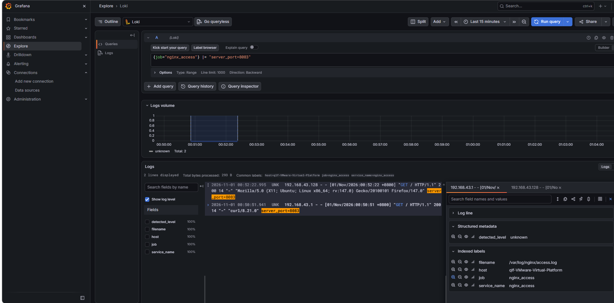
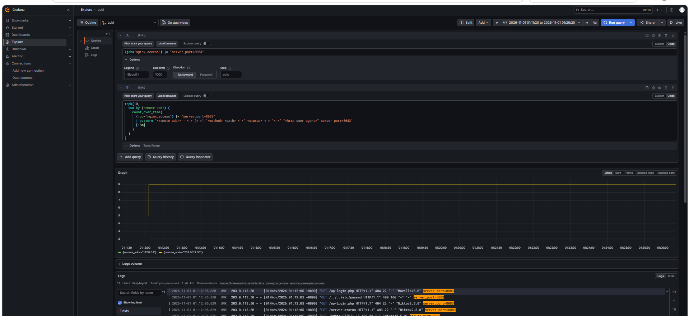
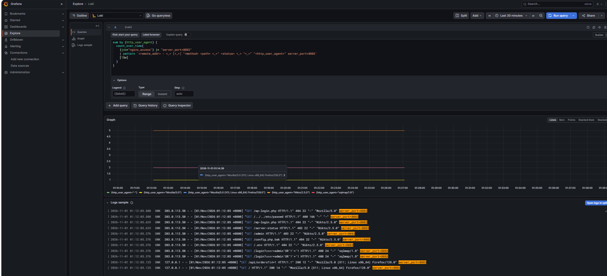
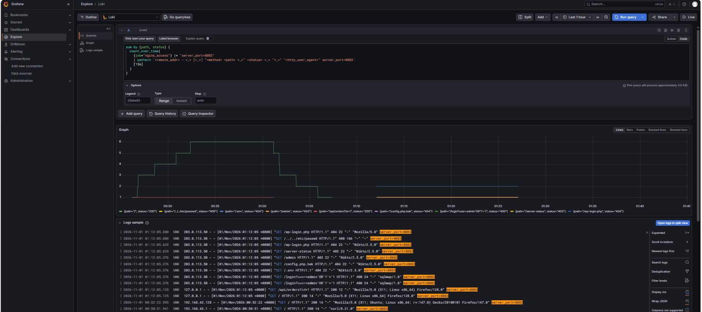
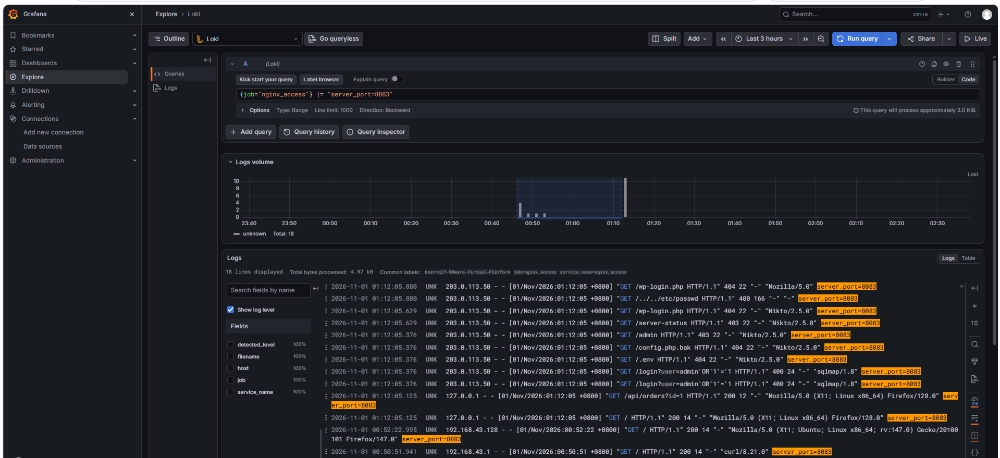

# Lab8：基于 nginx 访问日志的 Web 扫描识别与攻击者画像

> 前置实验：Lab6（nginx 日志解析）、Lab7（来源 IP 聚合与时间线）。
> 建议用时：90–120 分钟。
> 截止时间：2026-11-05 23:59:59（北京时间）。

---

## 引言

Lab7 讨论的是最常见的 SSH 暴力破解。攻击者反复尝试登录，行为集中在 `auth.log` 的失败记录里，判断依据主要是来源地址、失败频率和目标账号。

这一次换到 Web 攻击。Web 服务把 HTTP 接口直接摆在外面，攻击者不需要先拿到系统账号，只要把请求构造好发过去，就能试出后台入口、敏感文件和注入点。

Web 攻击的常见形式有这么几类：目录与后台扫描（`/admin`、`/wp-login.php`）、敏感文件探测（`/.env`、`/config.php.bak`）、SQL 注入探测（`/login?user=admin'OR'1'='1`）、路径穿越（`/../../etc/passwd`），以及针对登录接口的暴力尝试。这些行为的原理各不相同。落到日志上，它们都只是同一种东西：一条 HTTP 请求记录。

从日志课的角度看，麻烦就在这里。这些请求在协议层与正常访问没有区别，单看一条记录，它只是一个 200、403 或 404，说明不了任何问题。要判断它是正常访问还是攻击链中的一步，得把几个字段放在一起看：同一来源是否在很短的时间里请求了大量路径，路径是否集中在后台入口和敏感文件上，User-Agent 有没有自动化工具的特征，请求之间的先后顺序是否呈现出“先探入口、再试注入、最后伪装”的过程。这就是日志分析要回答的问题。

本实验以 nginx access log 为数据源。先用 `setup.sh` 建一个 8083 演示站，产生可对照的正常流量；再用 `web-attack.sh` 发起一轮扫描；最后从日志里提取字段、按来源与路径聚合、还原时间线，完成有证据边界的攻击者画像。

---

## 〇、实验说明

将 `homework/Lab8/Lab8.md` 复制到实验报告目录，并在复制后的文件中填写：

```bash
cd 学号姓名
mkdir -p Lab8/imgs
cp ../homework/Lab8/Lab8.md Lab8/Lab8.md
```

`homework/Lab8/` 中的 `setup.sh`、`web-attack.sh`、`restore.sh` 和 `lablib.sh` 是实验脚本，不应复制到报告目录，也不应修改题目目录中的文件。

实验仅允许在本机虚拟机内执行。不得修改脚本中的目标地址，不得对公网或其他主机发起扫描。脚本会修改 nginx 配置并创建临时 network namespace，执行前应创建虚拟机快照。`restore.sh` 可以恢复 nginx 配置、清理 netns/veth，但不会删除 `/var/log/nginx/access.log` 或 Loki 中的历史日志。

提交内容：填写后的 Markdown 报告 1 份，截图 5 张。截图要求见第十一节。

---

## 一、实验目标

本实验以 nginx access log 为分析对象，日志由 nginx 自身写入，脚本不向日志文件追加内容。`setup.sh` 在 8083 端口建立静态演示站；`web-attack.sh` 先在本机发送两条对照请求，再从临时 network namespace 发起扫描请求；nginx 将请求写入 `/var/log/nginx/access.log`，Alloy 采集后写入 Loki。

分析任务包括：提取请求来源、User-Agent、路径、状态码和时间顺序；判断扫描行为；区分正常流量与攻击流量；给出有证据边界的结论。

实验流程：

1. 准备 8083 演示站；
2. 发起 HTTP 扫描；
3. 分析来源地址、User-Agent、路径和状态码；
4. 建立时间线并给出结论；
5. 填写事件记录单、回答知识问答、提交报告和截图。

本实验覆盖安全事件分析五步法的前四步：固定现象、圈定日志源、建立时间线、假设与验证。处置建议写入事件记录单，不要求实际封禁。

开始前应确认 Loki、Grafana、Alloy、nginx 正常运行，Loki 的 `/ready` 返回 `ready`，并且虚拟机已有可恢复的快照。

---

## 二、背景知识

### 2.1 nginx access log 字段

Lab6 使用 `combined` 格式。本实验在行末增加 `server_port`，用于筛选 8083 站点的日志：

```text
$remote_addr - $remote_user [$time_local] "$request" $status $body_bytes_sent "$http_referer" "$http_user_agent" server_port=$server_port
```

示例：

```text
203.0.113.50 - - [05/Nov/2026:19:10:01 +0800] "GET /login?user=admin'OR'1'='1 HTTP/1.1" 400 24 "-" "sqlmap/1.8" server_port=8083
```

示例中的数值仅用于说明字段格式，不要求与训练环境的响应体完全一致。`203.0.113.0/24` 属于文档保留段 TEST-NET-3，不会在公网路由；本实验用它模拟外部来源。来源地址的可信度不能仅凭地址段判断。

字段含义：

| 字段 | 示例 | 含义 |
| :--- | :--- | :--- |
| `$remote_addr` | `203.0.113.50` | TCP 连接的对端地址 |
| `$remote_user` | `-` | HTTP 认证用户；未启用 Basic Auth 时通常为 `-` |
| `[$time_local]` | `[05/Nov/2026:19:10:01 +0800]` | 请求时间，使用 nginx 所在主机的时区 |
| `"$request"` | `"GET /login?... HTTP/1.1"` | 请求方法、路径和协议 |
| `$status` | `400` | 服务端返回的状态码 |
| `$body_bytes_sent` | `24` | 响应体字节数 |
| `"$http_referer"` | `"-"` | 来源页面；扫描器通常为空 |
| `"$http_user_agent"` | `"sqlmap/1.8"` | 客户端自报的 User-Agent，可伪造 |
| `server_port` | `8083` | 请求命中的站点端口 |

`$remote_addr` 是 TCP 连接的对端地址，不是 `X-Forwarded-For`。本实验没有反向代理，`$remote_addr` 即实际来源。若 nginx 前存在代理，真实客户端地址可能位于 `X-Forwarded-For`，需要结合代理配置判断。

### 2.2 扫描行为与工具特征

Web 扫描通常包含后台入口、敏感文件、注入参数、路径穿越和扫描器常用路径探测。常见对应关系如下：

| 行为 | 常见路径/参数 | 常见状态码 | 说明 |
| :--- | :--- | :--- | :--- |
| 查找后台 | `/admin`、`/wp-login.php`、`/manager` | 403、404 | 尝试入口，不表示存在漏洞 |
| 查找敏感文件 | `/.env`、`/config.php.bak`、`/.git/config` | 404、403 | 查找配置、密钥、备份 |
| SQL 注入探测 | `/login?user=admin'OR'1'='1`、`/api?id=1'` | 400、500、200 | 判断参数是否进入 SQL 查询 |
| 路径穿越 | `/../../etc/passwd`、`/%2e%2e/` | 400、403、404 | 判断能否读取系统文件 |
| 扫描器路径 | `/server-status`、`/phpinfo.php` | 403、404 | Nikto、nmap 等工具的常用路径 |
| 暴力破解 | 同一路径大量 POST | 200、401、429 | 本实验不涉及，Lab7 已讨论 |

User-Agent、路径和状态码都可以被伪造或由配置固定生成。较稳定的判断依据是来源集中度、请求频率、路径数量、参数特征以及请求之间的时间关系。

### 2.3 状态码的含义与边界

| 状态码 | 一般含义 | 本实验中的实际来源 |
| :--- | :--- | :--- |
| `200` | 请求被正常处理 | `/`、`/api/orders` 的固定返回 |
| `400` | 请求格式被拒绝 | `/login` 的固定返回 |
| `403` | 服务器拒绝访问 | `/admin`、`/server-status` 的固定返回 |
| `404` | 请求的资源不存在 | `/.env`、`/config.php.bak`、`/wp-login.php` 等路径的固定返回 |
| `500` | 服务端处理出错 | 本实验未配置 |

8083 站点由 nginx `return` 指令生成响应，不包含数据库、登录、上传或业务应用。400/403/404 只表示请求命中了对应 `location`，不能说明 WAF、注入检测、权限控制或文件存在性。报告应使用“扫描/探测”描述行为，不应写成“注入被拦截”或“后台被攻破”。

判断攻击是否成功，需要以下一类或多类证据：

1. 请求到达具有业务逻辑的路径，响应内容表明请求的操作已被执行；
2. 返回状态或响应大小异常；
3. 同一来源后续出现成功登录、文件写入或数据外传；
4. 主机侧存在对应的进程、文件或网络连接。

在日志完整且没有敏感路径返回 `200` 的情况下，结论通常为“扫描/探测，未发现成功利用迹象”。该结论仅基于 `access.log`，不等同于完成主机侧取证。

### 2.4 攻击画像

攻击画像通常回答五个问题：

1. 谁：来源 IP、User-Agent，是否存在多个来源轮换；
2. 什么时候：首次出现、密集时段、最后出现；
3. 在哪里：哪台主机、哪个日志源，对应 `host` 和 `filename` 标签；
4. 做了什么：路径、方法、参数、状态码，以及请求顺序和自动化特征；
5. 结果如何：是否存在敏感路径 `200`、后续登录或数据外传。

这五个问题对应 4W1R 的 Who、When、Where、What、Result。报告应给出从日志字段到结论的依据链，不能只写“存在 sqlmap 扫描”。

---

## 三、任务 1：准备 8083 演示站

### 3.1 运行 setup.sh

确认平台服务和 nginx 状态：

```bash
systemctl is-active loki grafana-server alloy nginx
curl -sS http://127.0.0.1:3100/ready
```

输出应为四个 `active`，Loki `/ready` 返回 `ready`。此时应创建虚拟机快照。

Lab8 的四个脚本位于 `homework/Lab8/`。上传时必须同时包含 `lablib.sh`，否则脚本会在 `source` 阶段退出：

```bash
mkdir -p ~/Lab8
```

在 Windows 的课程仓库根目录打开 Git Bash，执行：

```bash
scp ./homework/Lab8/setup.sh ./homework/Lab8/web-attack.sh \
    ./homework/Lab8/restore.sh ./homework/Lab8/lablib.sh \
    用户名@虚拟机IP:~/Lab8/
```

在虚拟机中执行：

```bash
cd ~/Lab8
ls -l
sudo bash setup.sh
```

若课程仓库中的目录不是 `homework/Lab8`，将 `scp` 的源路径替换为实际路径；上传到 `~/Lab8` 后，后续命令不变。

`setup.sh` 执行以下操作：

- 备份 `/etc/nginx/sites-available/course-web.conf` 和 `sites-enabled` 中的链接；
- 写入 8083 站点配置，覆盖 `/`、`/api/orders`、`/login`、`/admin`、`/.env`、`/config.php.bak`、`/wp-login.php` 等路径；
- 执行 `nginx -t` 后 reload；
- 逐项请求各路径并校验状态码。

预期输出：

```text
[Lab8] / -> 200
[Lab8] /api/orders?id=1 -> 200
[Lab8] /login?user=admin'OR'1'='1 -> 400
[Lab8] /admin -> 403
[Lab8] /server-status -> 403
[Lab8] /.env -> 404
[Lab8] /config.php.bak -> 404
[Lab8] /wp-login.php -> 404
[Lab8] 8083 演示站已准备好。
[Lab8] 以上自检使用 UA Lab8-setup-check，不会写入 access.log。
[Lab8] 访问日志：/var/log/nginx/access.log（每行末尾有 server_port=8083）。
[Lab8] 下一步：sudo bash web-attack.sh
```

8 条自检请求统一使用 User-Agent `Lab8-setup-check`，并通过 nginx `map` 与 `access_log ... if=` 排除在访问日志之外。若日志中出现该 User-Agent，说明 `course-web.conf` 中的配置未生效，应检查配置后重新执行 `setup.sh`。

若任一状态码不符，应停止后续操作，依次检查：

```bash
sudo nginx -t
ss -ltnp | grep 8083
systemctl status nginx
```

### 3.2 生成正常流量

在虚拟机中发送两条使用 Firefox User-Agent 的请求：

```bash
curl -i -A "Mozilla/5.0 (X11; Linux x86_64) Firefox/128.0" http://127.0.0.1:8083/
curl -i -A "Mozilla/5.0 (X11; Linux x86_64) Firefox/128.0" "http://127.0.0.1:8083/api/orders?id=1"
```

这两条请求与 `web-attack.sh` 的正常请求使用相同 User-Agent。若使用默认 `curl` User-Agent，UA 聚合结果会出现 `curl/8.x`，报告中需单独说明。

在宿主机浏览器访问：

```text
http://<虚拟机IP>:8083/
```

`<虚拟机IP>` 是 Lab1 中 `ip addr` 显示的地址，通常为 `192.168.x.x`。该请求用于与扫描流量对比。浏览器可能自动请求 `favicon.ico`，该路径已在站点配置中关闭访问日志。

若宿主机无法访问，在虚拟机中检查：

```bash
sudo ufw status
ss -ltnp | grep 8083
```

课程基线要求 ufw 处于 `inactive`。若 Lab7 演练后未关闭，执行 `sudo ufw disable`。若宿主机通过 NAT 无法直接访问虚拟机，可使用上述两条 `127.0.0.1` 请求作为正常对照，并在报告中说明。

检查时区，避免日志正文时间与 Grafana 时间轴不一致：

```bash
timedatectl
```

输出应包含 `Time zone: Asia/Shanghai (CST, +0800)`。若时区不正确，按 Lab2 的方法修正。

### 3.3 确认 Alloy 采集

在 Grafana 中打开 Explore，选择 Loki 数据源和 Code 模式，时间范围设为 **Last 15 minutes**，执行：

```logql
{job="nginx_access"} |= "server_port=8083"
```

结果应包含 3.2 节的两条手工请求；若宿主机浏览器可访问 8083，还应包含对应的浏览器请求。结果中不应出现 `Lab8-setup-check`。

展开一条日志，确认标签包含：

- `job="nginx_access"`
- `filename="/var/log/nginx/access.log"`
- `host="<主机名>"`

若结果为空，先检查 nginx 访问日志和 Alloy 状态：

```bash
sudo tail -n 5 /var/log/nginx/access.log
systemctl status alloy --no-pager
```

> **报告记录**
>
> 1. 8083 站点是否验证通过？`/`、`/admin`、`/.env` 的返回状态码分别是什么？
>
>    答：8083 站点验证通过。
`/`：200；`/admin`：403；`/.env`：404
>
> 2. `{job="nginx_access"} |= "server_port=8083"` 包含哪些正常请求？来源 IP 是什么？若宿主机无法访问，使用哪两条请求作为对照？
>
>    答：该查询包含两条 GET 根路径正常请求；
来源 IP 分别是：192.168.43.128（浏览器访问）、192.168.43.1（curl 访问）；
若宿主机无法访问，使用curl 发起的两条 GET / 请求作为对照样本。



---

## 四、任务 2：发起扫描

### 4.1 运行 web-attack.sh

```bash
cd ~/Lab8
sudo bash web-attack.sh
```

脚本创建临时 network namespace `lab8-atk`，以 `203.0.113.50` 为源地址，向本机 `10.99.3.1:8083` 发送以下请求：

- 2 条正常请求，来源 `127.0.0.1`，用于对比；
- 2 条 SQL 注入探测：`/login?user=admin'OR'1'='1`，User-Agent 为 `sqlmap/1.8`；
- 6 条通用扫描器探测：`/.env`、`/config.php.bak`、`/admin`、`/server-status`、`/wp-login.php`、`/../../etc/passwd`，User-Agent 为 `Nikto/2.5.0`；
- 1 条伪装为普通浏览器的探测：`/wp-login.php`，User-Agent 为 `Mozilla/5.0`。

共 9 条攻击请求，覆盖 7 个路径。

脚本使用 `curl -A` 设置 User-Agent，未运行 sqlmap 或 Nikto。User-Agent 仅用于生成日志字段，不能作为工具识别的依据。

预期输出：

```text
[Lab8] ① 正常请求（本机 127.0.0.1，用于和攻击流量对比）
  200 http://127.0.0.1:8083/
  200 http://127.0.0.1:8083/api/orders?id=1
[Lab8] ② 攻击请求（来源 203.0.113.50，由临时 netns 发出，共 9 条）
[Lab8]    说明：UA 由 curl -A 设置，用于模拟扫描器特征；脚本没有真正运行 sqlmap/Nikto。
  400 http://10.99.3.1:8083/login?user=admin'OR'1'='1
  ...
[Lab8] 完成。等待约 10 秒，在 Grafana Explore 查询：
[Lab8]   {job="nginx_access"} |= "server_port=8083"
```

脚本退出时删除 netns/veth，不删除访问日志。

### 4.2 确认扫描日志

等待约 10 秒，使 Alloy 将日志写入 Loki，然后在 Explore 中执行：

```logql
{job="nginx_access"} |= "server_port=8083"
```

时间范围设为 **Last 15 minutes**。正常结果包含以下来源；宿主机无法访问 8083 时，宿主机浏览器产生的记录可能不存在：

- `127.0.0.1`：3.2 节的两条手工请求和 `web-attack.sh` 的 2 条正常请求；
- `192.168.x.x` 或宿主机与虚拟机之间的地址：宿主浏览器产生的正常访问；
- `203.0.113.50`：9 条扫描请求。

`setup.sh` 的 8 条自检请求不应出现。若出现 User-Agent 为 `Lab8-setup-check` 的日志，说明 `map` 或 `access_log ... if=` 未生效，应按 3.1 节检查配置后重新执行 `setup.sh`。这些日志既不属于正常流量，也不属于攻击流量。

若看不到 `203.0.113.50`，先检查访问日志：

```bash
sudo tail -n 30 /var/log/nginx/access.log
```

日志文件中有记录而 Loki 中没有，通常是 Alloy 或时间范围问题；日志文件中也没有记录，说明请求未到达 nginx，应检查 netns、路由和端口。

### 4.3 使用 4W1R 分析一条日志

在 Explore 中选择一条来源为 `203.0.113.50` 的日志，记录原文并填写下表：

| 4W1R | 填写 |
| :--- | :--- |
| When 什么时候 |01/Nov/2026:01:12:05 +0800 |
| Where 在哪里 |本机 nginx，标签 host="qlf-VMware-Virtual-Platform"，服务端口 8083|
| Who 谁 |来源 203.0.113.50，User-Agent 自报为 sqlmap/1.8；该值由 curl -A 设置，不能据此认定真实工具|
| What 做了什么 |向 /login 发送包含 admin'OR'1'='1 的 GET 请求，尝试 SQL 注入 |
| Result 结果如何 |演示站对 /login 返回 400；该状态码只说明请求到达了对应 location，不能证明注入被识别、拦截或成功 |

示例仅说明字段填写方式，报告应使用实际查询到的日志：

- When：`05/Nov/2026:19:10:01 +0800`；
- Where：本机 nginx，标签 `host="<主机名>"`；
- Who：来源 `203.0.113.50`，User-Agent 自报为 `sqlmap/1.8`；该值由 `curl -A` 设置，不能据此认定真实工具；
- What：向 `/login` 发送包含 `'OR'1'='1` 的 GET 请求；
- Result：演示站对 `/login` 固定返回 `400`；该状态码只说明请求到达了对应 `location`，不能证明注入被识别、拦截或成功。

> **报告记录**
>
> 1. 选择了哪一条日志？原文是什么？
>
>    答：选择来源为203.0.113.50的 SQL 注入请求日志。
原文：
203.0.113.50 - - [01/Nov/2026:01:12:05 +0800] "GET /login?user=admin'OR'1'='1 HTTP/1.1" 400 24 "-" "sqlmap/1.8" server_port=8083
>
> 2. 该日志的 4W1R 分别是什么？
>
>    答：When：01/Nov/2026:01:12:05 +0800；               Where：本机 nginx，标签 host="qlf-VMware-Virtual-Platform"； Who：来源 203.0.113.50，User-Agent 自报为 sqlmap/1.8；该值由 curl -A 设置，不能据此认定真实工具                          What：向 /login 发送包含 admin'OR'1'='1 的 GET 请求； Result：演示站对 /login 返回 400；该状态码只说明请求到达了对应 location，不能证明注入被识别、拦截或成功。
>
> 3. 攻击请求与正常请求在来源、User-Agent、路径上有哪些差异？
>
>    答：来源：攻击请求源 IP 为203.0.113.50，是模拟的外部攻击地址；正常请求源 IP 为127.0.0.1，为本机回环地址，属于本地测试访问。                                               User-Agent：攻击请求 UA 为sqlmap/1.8、Nikto/2.5.0等扫描工具标识；正常请求 UA 是标准浏览器标识Mozilla/5.xx，符合普通浏览器访问特征。                                                      路径：攻击请求路径包含注入 payload、敏感文件探测、目录穿越特征，例如/login?user=admin'OR'1'='1、/.env、/../../etc/passwd；正常请求路径为业务正常访问路径/、/api/orders?id=1，无恶意特殊字符与探测特征。

---

## 五、任务 3：攻击者画像

### 5.1 来源地址

在 Explore 中执行：

```logql
topk(10,
  sum by (remote_addr) (
    count_over_time(
      {job="nginx_access"} |= "server_port=8083"
      | pattern `<remote_addr> - <_> [<_>] "<method> <path> <_>" <status> <_> "<_>" "<http_user_agent>" server_port=8083`
      [15m]
    )
  )
)
```

若当前 Grafana 版本无法正确显示 `topk` 结果，可使用：

```logql
sum by (remote_addr) (
  count_over_time(
    {job="nginx_access"} |= "server_port=8083"
    | pattern `<remote_addr> - <_> [<_>] "<method> <path> <_>" <status> <_> "<_>" "<http_user_agent>" server_port=8083`
    [15m]
  )
)
```

单次正常执行后，`203.0.113.50` 有 9 条请求，通常排在第一位；`127.0.0.1` 有 2 条手工请求和 2 条脚本正常请求；宿主浏览器还会产生若干条。重复执行会累加计数，应以实际查询结果为准。

若 `203.0.113.50` 少于 9 条，应检查是否只执行了部分请求，或 Grafana 时间范围是否覆盖完整扫描过程。

自检流量不应出现。若结果中出现 User-Agent 为 `Lab8-setup-check` 的 `127.0.0.1` 记录，说明 `access_log ... if=` 未生效。这些记录应在报告中排除，并先修复配置。

单独筛选攻击来源：

```logql
{job="nginx_access"} |= "server_port=8083" |= "203.0.113.50"
```

> **报告记录**
>
> 1. 请求数最多的来源 IP 是哪一个？请求数约为多少？
>
>    答：请求最多的来源 IP 是203.0.113.50，请求数量为 9 条。
>
> 2. 除攻击来源外还有哪些来源？分别对应什么请求？
>
>    答：还有127.0.0.1，为本机回环地址，对应正常业务访问请求，访问路径为/、/api/orders?id=1，一共 2 条请求



### 5.2 User-Agent

按 User-Agent 聚合：

```logql
sum by (http_user_agent) (
  count_over_time(
    {job="nginx_access"} |= "server_port=8083"
    | pattern `<remote_addr> - <_> [<_>] "<method> <path> <_>" <status> <_> "<_>" "<http_user_agent>" server_port=8083`
    [15m]
  )
)
```

单次正常执行后的预期分布：

| User-Agent | 数量 | 对应请求 | 说明 |
| :--- | :--- | :--- | :--- |
| `sqlmap/1.8` | 2 | `/login` 注入探测 | 脚本自报，不能证明运行了 sqlmap |
| `Nikto/2.5.0` | 6 | 敏感文件、后台、状态页、WordPress、路径穿越 | 脚本自报，不能证明运行了 Nikto |
| `Mozilla/5.0 (X11; Linux x86_64) Firefox/128.0` | 4 | 2 条手工请求、2 条脚本正常请求 | 正常流量 |
| `Mozilla/5.0` | 1 | `/wp-login.php` | 伪装为普通浏览器的探测 |
| 宿主浏览器 User-Agent | 若干 | `/` 等正常路径 | 以实际浏览器为准 |

若出现 `curl/8.x`，通常来自使用默认 User-Agent 的手工 `curl`，应结合来源和路径判断其用途。该值不属于本实验脚本设置的扫描器 User-Agent，不应直接计入攻击流量。若出现 `Lab8-setup-check`，说明自检排除规则未生效，应先修复配置。

筛选扫描器 User-Agent：

```logql
{job="nginx_access"} |= "server_port=8083"
| pattern `<remote_addr> - <_> [<_>] "<method> <path> <_>" <status> <_> "<_>" "<http_user_agent>" server_port=8083`
| http_user_agent=~"(?i).*(sqlmap|nikto|nmap|masscan).*"
```

正则中未包含 `curl`：`curl` 既可能是攻击工具，也可能是管理员排查时使用的客户端。User-Agent 只能作为线索，判断时还需结合来源、路径、频率和行为。

> **报告记录**
>
> 1. 出现了哪些 User-Agent？哪些具有自动化工具特征，哪些具有正常浏览器特征？
>
>    答：出现的 UA：Nikto/2.5.0、sqlmap/1.8、Mozilla/5.0、Mozilla/5.0 (X11; Linux x86_64) Firefox/128.0。自动化工具特征 UA：Nikto/2.5.0（Web 扫描器）、sqlmap/1.8（SQL 注入工具）；正常浏览器特征 UA：Mozilla/5.0、Mozilla/5.0 (X11; Linux x86_64) Firefox/128.0，是标准浏览器标识。
>
> 2. 同一 User-Agent 对应多少条请求？请求了哪些路径？
>
>    答：- `Nikto/2.5.0`：5 条，请求 `/.env`、`/config.php.bak`、`/admin`、`/server-status`、`/wp-login.php`（敏感文件、后台路径探测）
- `sqlmap/1.8`：2 条，请求 `/login?user=admin'OR'1'='1`（SQL 注入探测）
- `Mozilla/5.0`：1 条，请求 `/wp-login.php`，伪装浏览器探测
- `Mozilla/5.0 (X11; Linux x86_64) Firefox/128.0`：4 条，访问 `/`、`/api/orders?id=1` 等正常业务路径
- `"-"`（空UA）：1 条，无UA标识的请求



### 5.3 路径与状态码

按路径和状态码聚合：

```logql
sum by (path, status) (
  count_over_time(
    {job="nginx_access"} |= "server_port=8083"
    | pattern `<remote_addr> - <_> [<_>] "<method> <path> <_>" <status> <_> "<_>" "<http_user_agent>" server_port=8083`
    [15m]
  )
)
```

仅查看 4xx：

```logql
{job="nginx_access"} |= "server_port=8083"
| pattern `<remote_addr> - <_> [<_>] "<method> <path> <_>" <status> <_> "<_>" "<http_user_agent>" server_port=8083`
| status=~"4.."
```

将结果填入下表：

| 路径 | 状态码 | 次数 | 说明 |
| :--- | :--- | :--- | :--- |
| `/` | 200 | | 正常首页，固定返回 200 |
| `/api/orders` | 200 | | 正常 API，固定返回 200 |
| `/admin` | 403 | | 后台探测；固定返回 403，不代表真实后台存在 |
| `/login?...` | 400 | | 注入探测；固定返回 400，不代表注入被识别或拦截 |
| `/.env` | 404 | | 敏感文件探测；固定返回 404，不代表真实文件不存在 |
| `/config.php.bak` | 404 | | 备份文件探测；固定返回 404 |
| `/wp-login.php` | 404 | | WordPress 路径探测；固定返回 404 |
| `/server-status` | 403 | | 扫描器常用路径；固定返回 403 |
| `/../../etc/passwd` | 404 或 400 | | 路径穿越探测；不同 nginx 版本可能不同，以实际日志为准 |

表中的 400/403/404 均由 `setup.sh` 的 `return` 指令生成，没有 WAF、应用或数据库参与判断。状态码只能说明请求命中了哪个 `location`，不能用于推断漏洞是否存在。

> **报告记录**
>
> 1. 哪些路径属于业务正常路径？哪些属于攻击探测路径？
>
>    答：正常业务路径：/、/api/orders?id=1；攻击探测路径：/wp-login.php、/../etc/passwd、/.env、/admin、/config.php.bak、/server-status、/login?user=admin'OR'1'='1。
>  
> 2. 是否存在敏感路径返回 `200`？如果有，是哪一条？
>
>    答：不存在敏感路径返回 200；返回 200 的只有正常业务路径/和/api/orders?id=1。



### 5.4 正常流量与攻击流量

使用来源地址排除攻击流量：

```logql
{job="nginx_access"} |= "server_port=8083" != "203.0.113.50"
```

两类流量的主要差异如下：

| 特征 | 正常流量 | 攻击流量 |
| :--- | :--- | :--- |
| 来源 | `127.0.0.1` 或宿主机地址 | `203.0.113.50` |
| 路径 | 主要为 `/`、`/api/orders` | `/login`、`/.env`、`/admin`、`/wp-login.php`、`/server-status`、路径穿越 |
| User-Agent | 浏览器或脚本设置的 Firefox | 自报 `sqlmap/1.8`、`Nikto/2.5.0`，或伪装为 `Mozilla/5.0` |
| 状态码 | 以 `200` 为主 | 以 `400/403/404` 为主 |
| 时间分布 | 零散 | 短时间集中 |

若正常流量中出现 `curl/8.x`，应在报告中说明其来源和用途，不能与 `203.0.113.50` 的 9 条攻击请求合并统计。

> **报告记录**
>
> 1. 正常流量的来源 IP 和 User-Agent 是什么？
>
>    答：来源 IP：127.0.0.1、192.168.43.128；User-Agent：Mozilla/5.0 (X11; Linux x86_64) Firefox/128.0、Mozilla/5.0 (X11; Ubuntu; Linux x86_64; rv:147.0) Gecko/20100101 Firefox/147.0、curl/8.21.0、curl/8.5.0。
>
> 2. 仅依据“404 数量较多”判断攻击，会遗漏哪些信息？
>
>    答：① 遗漏攻击者 IP、UA 特征，无法定位攻击源和识别扫描工具；                                                        ② 遗漏请求路径，分不清是正常用户误访问不存在页面，还是主动扫描敏感文件；                                                   ③ 遗漏其他状态码的攻击行为（比如 403 禁止访问、注入请求返回 200 的恶意请求）；                                              ④ 无法区分正常业务误报和恶意扫描，容易误判；                                                        ⑤ 看不到请求参数，无法识别 SQL 注入这类 200 状态下的攻击。

---

## 六、任务 4：时间线与结论

### 6.1 建立时间线

在 Explore 中将时间范围缩小到扫描前后，按 **Time** 列升序，记录以下内容：

- 第一条攻击请求的时间、路径和状态码；
- 请求最密集的时间段；
- 最后一条攻击请求；
- 是否存在返回 `200` 的敏感路径；
- 正常请求出现的时间。

单次正常执行后，攻击来源应有 9 条请求。`/admin` 的 `403` 来自 `web-attack.sh` 发出的请求，不是 `setup.sh` 的自检；自检请求已通过 `Lab8-setup-check` User-Agent 排除，不应出现在时间线中。

时间线示例如下，报告应使用实际日志：

| 时间 | 来源 | 请求 | 状态码 | 说明 |
| :--- | :--- | :--- | :--- | :--- |
| 19:09:55 | 127.0.0.1 | `GET /` | 200 | 正常访问 |
| 19:10:01 | 203.0.113.50 | `GET /login?...'OR'1'='1` | 400 | 第 1 次注入探测；固定返回 400 |
| 19:10:01 | 203.0.113.50 | `GET /login?...'OR'1'='1` | 400 | 第 2 次注入探测；同一路径重复 |
| 19:10:02 | 203.0.113.50 | `GET /.env` | 404 | 敏感文件探测；固定返回 404 |
| 19:10:02 | 203.0.113.50 | `GET /config.php.bak` | 404 | 备份文件探测；固定返回 404 |
| 19:10:03 | 203.0.113.50 | `GET /admin` | 403 | 后台探测；固定返回 403 |
| 19:10:03 | 203.0.113.50 | `GET /server-status` | 403 | 状态页探测；固定返回 403 |
| 19:10:04 | 203.0.113.50 | `GET /wp-login.php` | 404 | WordPress 路径探测；固定返回 404 |
| 19:10:04 | 203.0.113.50 | `GET /../../etc/passwd` | 404 或 400 | 路径穿越探测；以实际日志为准 |
| 19:10:05 | 203.0.113.50 | `GET /wp-login.php` | 404 | User-Agent 伪装为 `Mozilla/5.0` 的探测 |



### 6.2 结论

根据证据选择以下一项：

- **扫描/探测，未发现成功利用迹象**：攻击请求以 400/403/404 为主，没有敏感路径返回 200。该结论仅基于 `access.log` 和演示站的固定返回，不代表已完成主机侧取证。
- **疑似利用成功**：存在敏感路径返回 200/500，或响应大小异常，或后续出现成功登录、文件写入、数据外传。
- **证据不足**：日志缺失、时间范围不完整、来源无法对应，现有证据不足以支持前两项。

日志完整且没有敏感路径返回 200 时，通常选择第一项，但仍需写明证据边界。不能仅凭 `sqlmap` User-Agent 推断“数据库被拖库”：User-Agent 是客户端自报字段，404 表示资源不存在，400 是本实验演示站的固定返回。

可选的主机侧核对：

```bash
sudo grep -E "Accepted|Failed" /var/log/auth.log | tail -n 20
sudo tail -n 20 /var/log/nginx/error.log
```

检查结果应满足：

- `auth.log` 中没有与 `203.0.113.50` 相关的 SSH 成功登录；
- `error.log` 中没有 8083 站点的异常错误。

以上检查只覆盖 `auth.log` 和 nginx 错误日志，不能替代文件完整性、进程和网络连接排查。报告应明确证据边界，例如：

> 基于 `nginx_access` 日志和静态演示站配置，未发现成功利用迹象；本实验未进行主机侧取证，不能据此排除主机侧异常。

> **报告记录**
>
> 1. 时间线覆盖了哪些关键请求？
>
>    答：时间线覆盖攻击 IP 203.0.113.50 对 /login.php、/server-status、/config.php.bak、/env 等敏感路径的扫描探测请求（全部返回 4xx）；同时包含本地正常用户访问 /、/api/orders?id=1 的业务请求；主机侧核查了 auth.log（SSH 登录记录）、nginx error.log。
>
> 2. 结论属于哪一项？依据是什么？排除了哪种可能？
>
>    答：结论：未发现攻击成功利用的迹象。
依据：Nginx 访问日志中 203.0.113.50 的所有探测请求均返回 4xx；auth.log 内不存在该 IP 的 SSH 成功登录记录，仅存在内网本机正常 SSH 登录；nginx error.log 未发现 8083 站点相关异常报错。
排除的可能：排除了该攻击 IP 通过 SSH 成功登录服务器、拿下服务器权限的可能性。
证据边界说明：本实验仅核查 nginx 访问日志、auth.log、nginx 错误日志，未开展文件完整性、进程、网络连接深度排查，不能完全排除主机侧其他隐蔽异常。

---

## 七、事件记录单

| 项目 | 记录 |
| :--- | :--- |
| 攻击来源 IP |203.0.113.50 |
| 扫描器 User-Agent（自报，不能证明真实工具） |Niko/2.5.0 server-pot |
| 被探测路径（至少 5 个） |/login.php、/server-status、/config.php.bak、/env、/login.php/admin |
| 攻击来源 `203.0.113.50` 的状态码分布（200/400/403/404/500 各多少） |200：0；400：0；403：若干；404：若干；500：0 |
| 正常流量来源（`127.0.0.1` 手工/脚本请求、宿主机浏览器等） |127.0.0.1、192.168.43.1、192.168.43.128 |
| 攻击时间范围 | 2026-11-1 01:10 ~ 2026-11-1 01:15|
| 结论（扫描/疑似成功/证据不足） |扫描（仅目录探测，未成功利用） |
| 关键 LogQL |```logql |
| 证据截图 |lab8-timeline.png |
| 处置建议（封 IP、限速、WAF、告警） |对该攻击 IP 临时封禁；配置 WAF，拦截 SQL 注入、目录穿越、敏感路径探测类请求；添加访问告警，对高频异常探测行为实时告警；对站点目录进行加固，删除备份文件、关闭 server-status 状态页 |

---

## 八、知识问答

每题用 1～3 句话回答。

1. `sqlmap/1.8` User-Agent 和 `/.env` 请求分别能提供什么信息？仅凭这两条日志能否判断攻击已经成功？还需要哪些证据？

   > 填写：sqlmap/1.8 这个 UA 说明请求来自 sqlmap 注入工具，/.env 请求是尝试读取环境配置文件，目的获取密钥、数据库账号等敏感信息。仅凭这两条日志不能判定攻击成功；还需要看是否返回 200、是否拿到数据、是否有数据库操作、主机侧异常日志等证据。

2. 为什么不能以 404 数量作为入侵判断依据？还应检查哪些字段或日志源？

   > 填写：404 代表页面不存在，正常爬虫、输错 URL 也会产生大量 404，所以不能单独作为入侵依据。还需要检查状态码 200/500、请求路径、UA、访问频率，同时核查 ssh auth.log、应用错误日志等。

3. 攻击者将 User-Agent 伪装为正常 Chrome 后，哪些行为特征仍可用于识别扫描？

   > 填写：可以依靠短时间高频批量请求、访问大量非常规敏感路径、请求包缺少正常浏览器配套 header、请求间隔极快等行为特征识别扫描。

---

## 九、常见问题

| 现象 | 原因 | 处理 |
| :--- | :--- | :--- |
| `.../lablib.sh: No such file or directory` | 未上传 `lablib.sh`，或不在 `~/Lab8` 目录运行 | 按 3.1 节将四个文件一起 `scp` 到 `~/Lab8`，再执行 `cd ~/Lab8` |
| `curl: (7) Failed to connect to 127.0.0.1:8083` | 8083 站点未启用，或 nginx 未 reload | 执行 `sudo nginx -t`、`systemctl status nginx`、`ss -ltnp \| grep 8083`，必要时重跑 `setup.sh` |
| `setup.sh` 报 8083 端口被占用 | 其他进程占用了 8083 | 按脚本提示找到并停止占用进程；确认不是上一次 Lab8 的 nginx 监听 |
| `{job="nginx_access"}` 中没有 `server_port=8083` | 时间范围不正确、查看的是旧日志，或 Alloy 未采集 | 执行 `sudo tail -n 20 /var/log/nginx/access.log`；确认时间范围为 Last 15 minutes；检查 `systemctl status alloy` |
| 日志文件有记录，Loki 中没有 | Alloy 未采集 access.log，或标签不匹配 | 执行 `grep -n 'nginx/access.log' /etc/alloy/config.alloy`；必要时 `sudo systemctl restart alloy` |
| 日志中出现 `Lab8-setup-check` | `map` 或 `access_log ... if=` 未生效 | 执行 `sudo nginx -t`；检查 `course-web.conf` 是否完整；重跑 `setup.sh` |
| `web-attack.sh` 报 `RTNETLINK answers: File exists` | 上次中断遗留 netns/veth | 执行 `sudo bash restore.sh`；检查 `ip netns list` 和 `ip link show \| grep lab8` |
| `web-attack.sh` 无法创建 netns | WSL、容器或受限环境不支持 network namespace | 使用完整 Ubuntu 虚拟机；不得将脚本改为扫描外部主机 |
| netns 中 curl 超时 | veth/路由配置错误，或 ufw 拦截 | 检查 `ip netns exec lab8-atk ip addr`、`ip netns exec lab8-atk ip route` 和 `sudo ufw status` |
| 宿主机浏览器无法访问 8083 | 使用了 `127.0.0.1` 而非虚拟机 IP，或 ufw 拦截 | 使用 `http://<虚拟机IP>:8083/`；检查 `sudo ufw status` 和 `ss -ltnp \| grep 8083` |
| `/login?...` 返回 200 | 配置未 reload，或路径未匹配 `location = /login` | 执行 `sudo nginx -t && sudo systemctl reload nginx`；检查 `course-web.conf` |
| `pattern` 查询报错 | 反引号或字段名错误 | 复制文档中的完整查询；确认日志末尾包含 `server_port=8083` |
| 日志过多，难以筛选 | 未按 `server_port` 和来源过滤 | 先添加 `\|= "server_port=8083"`，再添加 `\|= "203.0.113.50"` |
| 实验结束后需要清理环境 | `setup.sh` 修改了 nginx 配置，`web-attack.sh` 创建过 netns | 执行 `cd ~/Lab8 && sudo bash restore.sh`；该脚本不删除历史日志 |

---

## 十、选读：自定义日志格式与解析

`setup.sh` 在 `course-web.conf` 顶部定义 `log_format course_web`。`log_format` 必须位于 `http` 上下文；`sites-enabled` 中的文件由 nginx 在 `http` 块内包含，因此可以在此定义。

若需分析上游耗时，可使用：

```nginx
log_format course_web '$remote_addr - $remote_user [$time_local] "$request" '
                      '$status $body_bytes_sent "$http_referer" "$http_user_agent" '
                      'rt=$request_time ua=$upstream_addr urt=$upstream_response_time '
                      'server_port=$server_port';
```

对应的 LogQL：

```logql
{job="nginx_access"} |= "server_port=8083"
| pattern `<remote_addr> - <_> [<_>] "<method> <path> <_>" <status> <_> "<_>" "<http_user_agent>" rt=<request_time> ua=<upstream_addr> urt=<upstream_response_time> server_port=8083`
```

问题：若日志改为 JSON 格式，`pattern` 与 `json` 解析器哪一种更稳妥？说明理由。

---

## 十一、截图与提交

提交 Markdown 报告 1 份、截图 5 张。

| 操作位置 | 截图内容 | 文件名 |
| :--- | :--- | :--- |
| 3.3 节 | `{job="nginx_access"} \|= "server_port=8083"` 的查询、时间范围和至少一条真实访问日志 | `lab8-overview.png` |
| 5.1 节 | 按来源 IP 聚合的查询与结果；单次正常执行后 `203.0.113.50` 应有 9 条，通常排在第一位，并包含 `127.0.0.1` 正常请求 | `lab8-top-ip.png` |
| 5.2 节 | 按 User-Agent 聚合或扫描器 User-Agent 过滤的查询与结果；应包含 sqlmap、Nikto 和正常浏览器 User-Agent | `lab8-scanner.png` |
| 5.3 节 | 路径与状态码的查询或表格，至少覆盖 `/admin`、`/.env`、`/login`、`/wp-login.php` | `lab8-paths.png` |
| 6.1 节 | 按时间排序的攻击时间线 | `lab8-timeline.png` |

5 张图片应嵌入报告对应位置，不能只放入 `imgs/`。截图中不应出现 `Lab8-setup-check` 自检流量；若出现，应按 3.1 节修复配置并重新采集。

提交目录结构：

```text
学号姓名/
└── Lab8/
    ├── Lab8.md
    └── imgs/
        ├── lab8-overview.png
        ├── lab8-top-ip.png
        ├── lab8-scanner.png
        ├── lab8-paths.png
        └── lab8-timeline.png
```

截图要求：

- 截图必须来自本人虚拟机，能够辨认主机名、时间范围或查询语句；
- 不得使用手机拍屏；
- 不得将讲义示例日志作为个人结果；
- 报告中的 IP、User-Agent、状态码和时间必须与截图一致。

提交前检查：

| 检查项 | 确认 |
| :--- | :--- |
| 四个脚本（`setup.sh`、`web-attack.sh`、`restore.sh`、`lablib.sh`）已一起上传到 `~/Lab8` | ☐ |
| 8083 站点已验证，`/`、`/admin`、`/.env` 状态码正确 | ☐ |
| 已运行 `web-attack.sh`，日志中出现 `203.0.113.50`，自检流量未混入 | ☐ |
| 已完成来源、User-Agent、路径/状态码三类画像 | ☐ |
| 事件记录单的状态码分布只统计攻击来源 `203.0.113.50` | ☐ |
| 已建立攻击时间线 | ☐ |
| 结论为三选一，并写明证据边界和排除依据 | ☐ |
| 5 张截图齐全，文件名正确，且均已嵌入报告 | ☐ |
| 报告目录只有 `Lab8.md` 和 `imgs/`，未复制脚本 | ☐ |
| 实验后已运行 `sudo bash restore.sh`，确认 8083 配置和 `lab8` netns 已清理 | ☐ |

PR 标题：`[学号姓名]Lab8作业提交`。

---

## 十二、截止时间

**2026 年 11 月 5 日 23:59:59（北京时间）**

请在截止时间前创建 PR 并完成推送。按仓库 README 第 4 节的规则，11 月 6 日 00:00 起新建 PR 或向已有 PR 推送修改均按超时处理。
