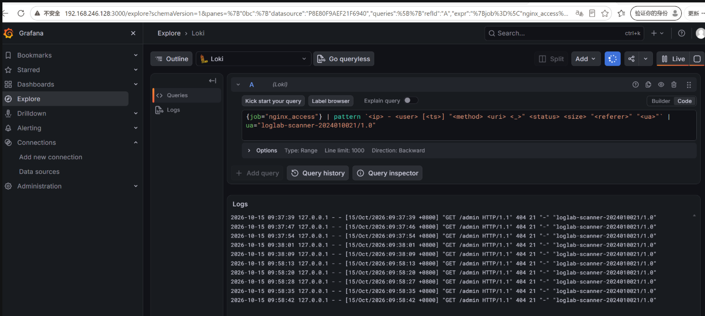
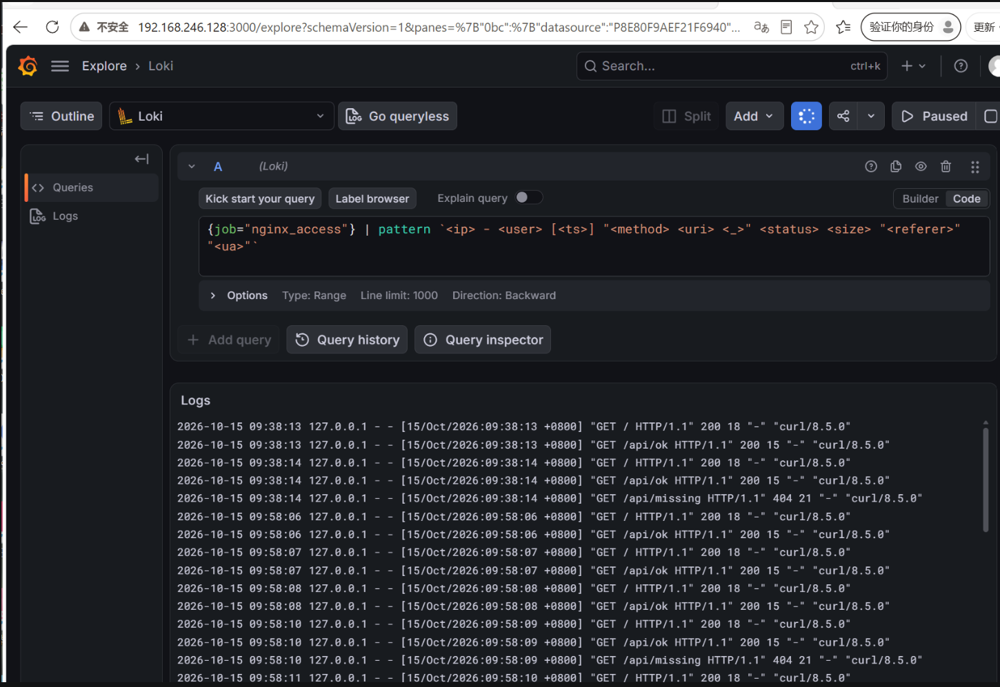
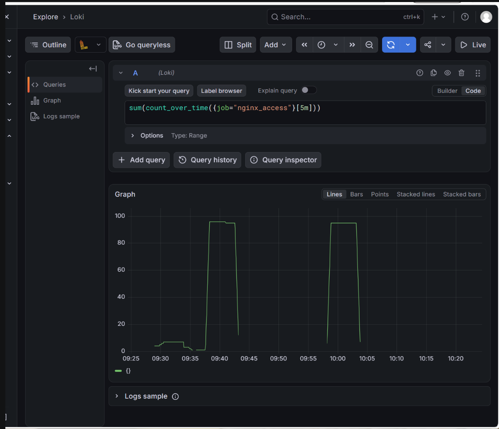
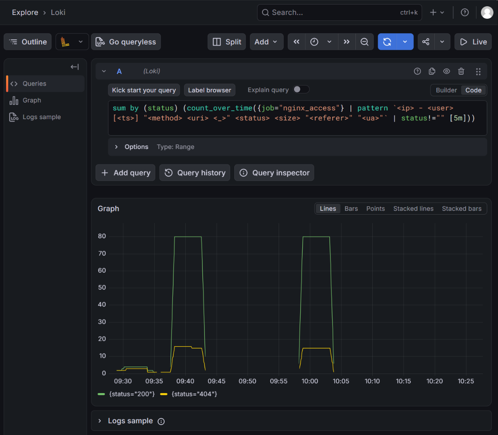
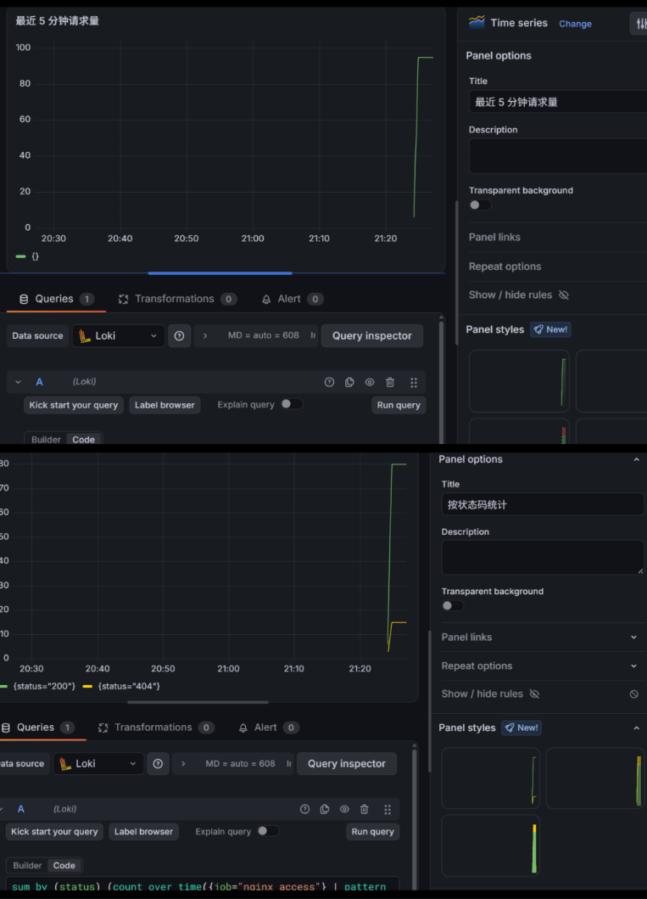

# Lab6：nginx 日志解析、统计与可视化

本实验承接 [Lab5：日志采集平台搭建与验证](../Lab5/Lab5.md)，继续使用同一台 Ubuntu 虚拟机。开始前应已具备以下条件：

- Loki、Alloy、Grafana 已配置好，Loki 的 `/ready` 返回 `ready`；
- 能在 Grafana Explore 中用 `{job="syslog"}` 和 `|=` 查到本人日志，知道怎样选择数据源和时间范围；
- 已保留 Lab5 安装的 nginx，以及 Alloy 中的 `nginx_access`、`nginx_error` 采集路径；
- 没有在 Lab5 结束后运行平台恢复脚本，Lab4 的分流和轮转配置也仍然保留，并已创建“Lab5 平台可用”快照。

**Lab5 遗留的问题：`|=` 只能判断正文是否包含某段文字，分不清它在日志里是什么字段。** 正文出现 `404`，不代表请求的状态码就是 404；查到几十行日志，也不知道请求量怎样随时间变化。

**Lab6 要学的新东西：** 在不重装平台、不新增采集规则的前提下，先用 nginx 在 8080 端口产生真实访问日志，再依次学习**读懂 combined 字段 → 用 pattern 按字段查询 → 用 count_over_time 按时间窗口统计 → 把验证过的查询保存成 Dashboard**。本实验建议预留 2～3 小时。

---

## 一、实验目标与完成顺序

将本文件复制到自己的“学号姓名”文件夹下，保存为 `Lab6/Lab6.md`，并在 `Lab6/` 中创建 `imgs/` 目录。**填写区和图片引用都在对应任务旁边，每做完一项就就地记录。**

| 任务 | 难度 | 完成内容 | 操作与填写位置 |
| :--- | :---: | :--- | :--- |
| 认识新的日志来源 | ★ | 区分访问日志与错误日志，了解状态码和本次分析顺序 | 第二节 |
| 任务 1：准备 nginx 演示站 | ★★ | 复用 Lab5 平台，配置 8080 站点，验证返回码和访问日志 | 第三节 |
| 任务 2：产生并查询本人流量 | ★★ | 产生 200、404 和带本人标记的请求，在 Explore 中查到 | 第四节 |
| 任务 3：拆解一条访问日志 | ★★ | 按 combined 格式对本人日志逐字段标注 | 第五节 |
| 任务 4：解析字段并统计 | ★★★ | 比较时间窗口，用 pattern 提取状态码并分组统计 | 第六节 |
| 任务 5：保存 Dashboard | ★★★ | 将验证过的查询做成一个面板，保存后重新打开 | 第七节 |
| 简短总结 | ★ | 回答 3 道知识问答题 | 第八节 |

**提交内容：1 份填写完整的 Markdown 报告、1 条本人访问日志的字段拆解、流量与查询记录、时间窗口及状态码统计说明、1 个面板的实际查询、3 道简答题、5 张截图。**

标为“选读”的内容不要求执行、填写或截图；遇到问题先查第九节，完成后按第十一、十二节核对文件和截止时间。`setup.sh`、`restore.sh` 和 `nginx-demo.conf` 由课程 `homework/Lab6/` 提供，按 3.2 节传到虚拟机后使用，不必复制到自己的报告目录，也不要修改题目目录中的文件。

---

## 二、从“查到日志”到“读懂并统计日志”

### 2.1 为什么这次使用 nginx

Lab5 用 `logger` 写的是自己设计的测试正文，适合验证链路。现在需要一种**随着实际操作自动产生、格式相对固定、能与操作结果逐项对照**的日志，才能练习字段解析。

nginx 是常见的 Web 服务器和反向代理软件，可以记录 HTTP 访问。Apache HTTP Server、Caddy 等也能提供 Web 服务和访问日志；本次使用 nginx，是因为 Lab5 已经安装了它并配置好采集路径，其 combined 日志格式也适合练习字段拆解。**不是为了再换一套日志平台，也不是只有 nginx 能完成这类实验。**

| Lab5 已经准备好的内容 | 本次怎么使用 | 还要不要安装或配置 |
| :--- | :--- | :--- |
| nginx 软件包 | 返回 HTTP 响应、产生 access.log | 不重装，只增加课程演示站配置 |
| Alloy 的 nginx 文件采集规则 | 读取 `/var/log/nginx/access.log` 和 `error.log` | 不修改，出现新日志后由原规则采集 |
| Loki | 存储日志、执行 LogQL 查询和统计 | 不重装、不新建另一套存储 |
| Grafana 的 Loki 数据源 | Explore 查询，Dashboard 展示 | 复用原数据源，只新建看板 |

数据仍然走同一条路径，只是日志的产生者从 `logger` 换成了 nginx：

```text
curl 发 HTTP 请求 → nginx → /var/log/nginx/access.log
                                      │
                                      ▼
                                    Alloy → Loki ← Grafana
                                                   ├─ Explore：验证查询
                                                   └─ Dashboard：保存查询和展示方式
```

本次请求都发给自己的虚拟机 `127.0.0.1:8080`，不需要访问外部网站，也不需要把演示站开放到公网。

### 2.2 access.log 与 error.log 分别记录什么

| 对照项目 | access.log | error.log |
| :--- | :--- | :--- |
| 主要内容 | 在启用访问日志的配置下，记录处理过的 HTTP 请求 | 记录 nginx 的运行错误与诊断信息，具体内容取决于错误级别和事件 |
| 一行通常对应什么 | 一次请求 | 一条错误或诊断事件，不一定与请求一一对应 |
| 适合回答的问题 | 谁在什么时候访问了什么、返回什么状态码、响应体多大 | 为什么连接后端失败、配置哪里有问题、哪些运行环节异常 |
| 本次用途 | 作为解析、请求量统计和状态码统计的数据源 | 查看格式差异，不要求一定有错误记录 |

> **404 不等于 error.log 一定增加一行。**
> 本次演示站会主动用 `return 404` 返回一个响应，这是我们写在配置中的预期行为，不一定产生对应的 error.log 记录。不能把“错误日志为空”直接理解为“没有访问”，也不能把每条访问日志都当成一条故障。

### 2.3 先认识 HTTP 状态码

HTTP 响应会带上状态码，nginx 的访问日志也会记录它。只看第一位，可以先判断大类：

| 区段 | 大体含义 | 常见例子 | 排查时注意什么 |
| :---: | :--- | :--- | :--- |
| 2xx | 请求成功处理 | `200 OK` | 表示 HTTP 层面的处理结果，不保证业务内容一定正确 |
| 3xx | 重定向或缓存协商相关结果 | `301`、`302`、`304` | 不要把 304 当成错误，也不是所有 3xx 都意味着重新访问另一个网址 |
| 4xx | 请求无法按要求完成，属于客户端错误类响应 | `400`、`403`、`404` | 检查路径、权限和请求内容，也要考虑服务端路由或权限配置 |
| 5xx | 服务端处理请求时出错 | `500`、`502`、`504` | 检查程序、代理、上游服务和超时等环节 |

本次只主动产生 200 和 404，不要求制造 502。以后遇到 502 时，应结合 error.log 检查代理与上游通信；仅凭一个状态码不能确定责任，更不能确定是否遭受攻击。

大量 404 可能来自失效链接、路由配置、用户输错地址，也可能与扫描有关。**日志提供线索，结论需要结合路径、时间、来源和其他证据。**

### 2.4 本次新增知识放在哪一步学习

不要一开始就把整条统计查询当成一个必须背诵的长命令。它由已经学过的部分逐步增加而来：

| 层次 | 回答的问题 | 本次在哪里验证 |
| :--- | :--- | :--- |
| `{job="nginx_access"}` | 查询哪个来源？ | 第四节，复用 Lab5 的流选择器 |
| `\|= "文本"` | 正文是否含有本人标记？ | 第四节，复用 Lab5 的行过滤 |
| combined 字段表 | 每一段文字分别表示什么？ | 第五节，先人工读懂一条日志 |
| `pattern` | 能否按模板提取出状态码等字段？ | 6.3 节，先展开原始日志检查字段 |
| `count_over_time`、`sum` | 一个时间窗口里有多少行，怎样合计？ | 6.1、6.4 节，得到统计曲线 |
| Dashboard | 如何保存已验证的查询和展示方式？ | 第七节，不在面板里重新猜查询 |

与 Lab5 一样，本平台没有解析日志正文里的事件时间。后面的查询范围和曲线横轴使用**采集时间**；这也是本次必须实际访问演示站、产生新日志，而不是随意复制历史样本的原因。

---

## 三、任务 1：复用平台，准备 nginx 演示站

### 3.1 先确认 Lab5 平台仍然可用

```bash
systemctl is-active loki grafana-server alloy
```

一个命令检查三个服务，正常应依次输出三行 `active`。如果其中某项没有运行，先按 Lab5 的排错步骤处理。

```bash
curl -sS http://127.0.0.1:3100/ready
```

继续检查 Loki 的就绪接口，期望返回 `ready`。平台没有恢复前，不要继续配置站点或反复新建 Grafana 数据源。

也可以在浏览器打开原来的 Grafana，确认仍能选择 Loki 数据源；上次日志如果已经超出时间范围，要调整范围，不能仅凭当前没有旧日志就判断平台坏了。

> **记录**：三个服务和 Loki 就绪检查的结果是什么？是否可以进入原来的 Grafana？
>
> 答：`systemctl is-active` 依次输出 `active`、`active`、`active`，三个服务均正常。Loki `/ready` 初始返回 "Ingester not ready"，等待约 30 秒后返回 `ready`。可以正常进入原来的 Grafana。

### 3.2 执行站点配置脚本

与 Lab5 相同，先在虚拟机中准备存放脚本的目录：

```bash
mkdir -p ~/Lab6
```

在 **Windows 的课程仓库根目录**右键选择 **Open Git Bash here**，把本次的三个文件一起传到虚拟机的同一目录。`setup.sh` 运行时要读取同目录的 `nginx-demo.conf`，`restore.sh` 也放在这里备用：

```bash
scp ./homework/Lab6/setup.sh ./homework/Lab6/restore.sh ./homework/Lab6/nginx-demo.conf 你的用户名@虚拟机IP:~/Lab6/
```

把用户名和虚拟机 IP 替换为自己的。上传完成后，回到连接 Ubuntu 的终端执行：

```bash
cd ~/Lab6
sudo bash setup.sh
```

`setup.sh` 不是重新安装平台的脚本。它沿用 Lab5 环境，完成以下操作：

| 操作 | 为什么做 |
| :--- | :--- |
| 检查 nginx 与 Alloy | 确认前置软件可用；缺失时应先补齐 Lab5 环境 |
| 备份并写入 `/etc/nginx/sites-available/loglab-demo.conf`，建立启用链接 | 增加一个 8080 端口的课程演示站，首次修改前的状态保存在 `/opt/loglab-state/Lab6/` |
| 执行 `nginx -t`，通过后重启 nginx | 先检查配置语法，避免错误配置直接中断服务，顺序与 Lab4 一致 |
| 访问四个演示路径 | 检查站点是否按预期响应，同时产生第一批访问日志 |
| 保留 Lab5 的 Alloy 配置 | nginx 文件路径已经配置，不再创建第二份采集规则 |

查看课程提供的站点配置：

```bash
cat nginx-demo.conf
```

文件内容如下：

```nginx
server {
    listen 8080;
    server_name _;
    access_log /var/log/nginx/access.log combined;
    error_log /var/log/nginx/error.log;

    location = / {
        return 200 "loglab nginx demo\n";
    }
    location = /api/ok {
        return 200 '{"status":"ok"}';
    }
    location / {
        return 404 '{"error":"not found"}';
    }
}
```

不要求背诵 nginx 的全部语法，先读懂这几项：

| 配置 | 含义 |
| :--- | :--- |
| `listen 8080` | 在 8080 端口接受 HTTP 请求；Grafana 仍在 3000，Loki 仍在 3100 |
| `access_log ... combined` | 把请求按 combined 格式写入指定文件，第五节会逐字段拆解 |
| `error_log ...` | 指定错误日志文件 |
| `location = /`、`location = /api/ok` | 精确匹配这两个路径，直接返回 200 |
| `location /` | 接收其余匹配到这个通用前缀的路径，本配置中返回 404 |

本次不运行后端业务程序，也没有配置反向代理。因此 `/api/ok` 的名字虽然像接口，实际响应仍是 nginx 按配置直接返回的固定文本。

### 3.3 对照响应与本地日志

**curl 是在命令行里发送 HTTP 请求的工具**，前面检查网络和 Loki 就绪时已经用过。浏览器打开网页做的事，curl 都能在终端里完成：给它一个地址，它就向该地址发送请求，再把服务器的响应显示出来。

一次 HTTP 请求-响应只需要认识三样东西：

| 概念 | 本次要知道的 |
| :--- | :--- |
| 请求方法 | `GET` 表示“获取这个地址的内容”，本次全部用 GET |
| 响应头 | 响应开头的一组状态信息，第一行 `HTTP/1.1 200` 中末尾的数字就是状态码 |
| 响应体 | 服务器返回的实际内容，例如一段文字或一个网页 |

先请求首页：

```bash
curl -i http://127.0.0.1:8080/
```

`-i` 让 curl 同时显示响应头和响应体。期望看到 `HTTP/1.1 200`，以及正文 `loglab nginx demo`。

```bash
curl -i http://127.0.0.1:8080/api/ok
```

期望返回 200，正文包含 `{"status":"ok"}`。

```bash
curl -i http://127.0.0.1:8080/api/missing
```

这个路径没有对应的精确匹配规则，会由通用规则返回 404。

```bash
curl -i http://127.0.0.1:8080/admin
```

同样期望返回 404。路径叫 `/admin` 并不表示站点真的存在一个管理后台。

```bash
sudo tail -n 5 /var/log/nginx/access.log
```

`tail -n 5` 只显示最后五行。对照刚才访问的路径与日志中的状态码，确认**请求发生、服务响应、文件记录**三件事能够对应起来。

> **记录**
>
> ① 四个路径的实际返回码分别是什么？
>
> 答：/ 返回 200，/api/ok 返回 200，/api/missing 返回 404，/admin 返回 404。
>
> ② access.log 中是否出现了对应的访问记录？
>
> 答：access.log 中出现了对应的访问记录，每个请求都有一行日志，状态码与 curl 返回一致。

保留本节的响应和日志输出。第五节完成字段拆解后，与字段表一起整理为 `imgs/lab6-fields.png`，不额外增加截图数量。

---

## 四、任务 2：产生并查询带本人标记的流量

单次请求只够验证连通性。要观察统计结果，需要在一段时间内产生一批知道来源和数量的数据。

### 4.1 用一个循环产生可解释的请求

下面的循环只访问自己的演示站。先将 User-Agent 中的学号替换为自己的，再在虚拟机终端完整执行：

```bash
for i in $(seq 1 40); do
  curl -s -o /dev/null http://127.0.0.1:8080/
  curl -s -o /dev/null http://127.0.0.1:8080/api/ok
  [ $((i % 4)) -eq 0 ] && curl -s -o /dev/null http://127.0.0.1:8080/api/missing
  [ $((i % 7)) -eq 0 ] && curl -s -o /dev/null -A "loglab-scanner-你的学号/1.0" http://127.0.0.1:8080/admin
  sleep 1
done
```

这是一段完整的循环，不是几条可以任意跳着运行的独立命令。拆开来看：

| 写法 | 含义 |
| :--- | :--- |
| `seq 1 40` | 依次产生 1～40，循环执行 40 轮 |
| 每轮前两条 `curl` | 分别访问 `/` 与 `/api/ok`，产生两次 200 请求 |
| `$((i % 4))`、`-eq 0` | 计算余数；每逢 4 的倍数，再访问一次 `/api/missing` |
| `&&` | 左边条件成立，才执行右边的命令 |
| `-o /dev/null` | 丢弃 curl 收到的响应体，不把终端刷满；不影响 nginx 记录请求 |
| `-A "..."` | 设置本次请求的 User-Agent，让日志中出现本人标记 |
| `sleep 1` | 每轮暂停一秒，让数据分布在一段时间里，而不是同时集中发出 |

在请求都正常完成且没有额外访问的情况下，一轮完整循环产生：

- 80 条 200 请求：40 次 `/` 加 40 次 `/api/ok`；
- 10 条 `/api/missing` 的 404 请求；
- 5 条带自定义 User-Agent 的 `/admin` 请求，也是 404；
- 合计 **95 条请求**，运行时间约 40 秒至 1 分钟，实际还受每次请求耗时影响。

**95 是这一段循环的预期数量，不是 access.log 的总行数。** 脚本检查、第三节手动请求、其他访问和重复运行也会产生日志；后面的统计还受时间窗口影响，不能要求每个统计点都恰好等于 95。

> **记录**：循环运行了几轮？实际使用的带学号 User-Agent 是什么？是否出现请求失败？
>
> 答：实际运行了两轮（第一轮因 SSH 断开中断，重连后重新跑了一轮）。带学号的 User-Agent 为 loglab-scanner-2024010021/1.0。请求均成功，无失败。

### 4.2 在 Explore 中先查来源，再查本人标记

进入 Grafana → **Explore**，选择原来的 **Loki** 数据源，切到 **Code**，时间范围先选 **Last 15 minutes**。等待十几秒让日志完成采集，先查整个来源：

```logql
{job="nginx_access"}
```

这与 Lab5 的 `{job="syslog"}` 是同一种流选择器，只是换成了 Lab5 已经在 Alloy 配置中定义好的另一个 `job`。期望看到刚才产生的访问日志。

再看指定路径：

```logql
{job="nginx_access"} |= "/api/missing"
```

这里仍然只是检查正文是否包含这段文本，还没有按字段解析路径。它适合先快速找到样本。

最后查本人标记，把学号替换为实际值：

```logql
{job="nginx_access"} |= "loglab-scanner-你的学号/1.0"
```

展开一条结果，观察正文中的 `/admin`、状态码以及结尾的 User-Agent。下一节将说明这些位置为什么分别对应这些字段。

> **User-Agent 只是客户端提供的字符串。**
> 本次用它识别自己产生的实验流量，不是认定攻击的证据。客户端可以自由设置这个字段，不能因为名称里写着 `scanner`，就认定发生了真实扫描或确定了访问者身份。

> **记录**
>
> ① 查询本人流量的实际 LogQL 是什么？
>
> 答：{job="nginx_access"} |= "loglab-scanner-2024010021/1.0"

>
> ② 选中请求的路径、状态码和 User-Agent 分别是什么？
>
> 答：路径为 /admin，状态码为 404，User-Agent 为 loglab-scanner-2024010021/1.0。

保存 `imgs/lab6-explore.png`，保留实际循环命令和 Explore 查询本人标记的结果；可以合理拼图。网页部分应能看到查询、时间范围和带本人学号的日志。



---

## 五、任务 3：逐字段读懂一条访问日志

### 5.1 combined 格式规定了哪些位置

第三节的配置写了 `access_log ... combined`，也就是使用 nginx 内置的 combined 格式。下面是等价的格式定义，**只用于阅读，不要再复制到配置中重复定义同名格式**：

```nginx
log_format combined '$remote_addr - $remote_user [$time_local] '
                    '"$request" $status $body_bytes_sent '
                    '"$http_referer" "$http_user_agent"';
```

变量前面的 `$` 表示这里由 nginx 填入实际值；中间的空格、方括号和双引号是分隔符。

下面是一条说明格式用的示例，不是你的实验结果：

```text
127.0.0.1 - - [17/Aug/2026:15:20:31 +0800] "GET /api/missing HTTP/1.1" 404 21 "-" "curl/8.5.0"
```

| 顺序 | 变量或固定内容 | 示例中的值 | 含义 |
| :---: | :--- | :--- | :--- |
| 1 | `$remote_addr` | `127.0.0.1` | 客户端地址；本例请求从虚拟机本机发起 |
| 2 | 固定的 `-` | `-` | 保留的占位符，这个格式中固定写为 `-` |
| 3 | `$remote_user` | `-` | HTTP 认证用户名；没有值时显示 `-` |
| 4 | `[$time_local]` | `[17/Aug/2026:15:20:31 +0800]` | 请求时间，包含年份和时区 |
| 5 | `"$request"` | `"GET /api/missing HTTP/1.1"` | 请求行：方法、请求 URI、协议版本 |
| 6 | `$status` | `404` | 返回给客户端的 HTTP 状态码 |
| 7 | `$body_bytes_sent` | `21` | 发送的响应体字节数，不包括响应头 |
| 8 | `"$http_referer"` | `"-"` | 请求提供的来源页；未提供时为 `-` |
| 9 | `"$http_user_agent"` | `"curl/8.5.0"` | 请求提供的客户端软件标识，也可以像第四节那样自行设置 |

> **为什么不能简单按空格切成九段？**
> 时间字段里有空格，请求行里有空格，User-Agent 也可能包含多个词。格式中的引号和方括号规定了边界，不能把每个空格都当成字段结束。
>
> 这种“外观是文本，但字段和分隔方式相对固定”的日志叫**半结构化日志**。下一节的 `pattern` 就是按这些边界提取字段，而不是随意取第几个空格后的内容。

### 5.2 选择本人日志并填写字段表

```bash
sudo tail -n 5 /var/log/nginx/access.log
```

从自己的输出中选一条日志，建议选带本人 User-Agent 的 `/admin` 请求。如果最近五行里没有，可以在第四节的 Explore 结果中复制那条原文；不要拿本节示例代替自己的结果。

> **记录**：粘贴一条本人实际访问日志原文。
>
> 原文：127.0.0.1 - - [15/Oct/2026:21:20:xx +0800] "GET /admin HTTP/1.1" 404 21 "-" "loglab-scanner-2024010021/1.0"


**表中“本人日志中的值”全部来自你刚粘贴的这行原文，不需要再用其他工具查询。** 对照 5.1 节的格式定义，按顺序把原文拆开填入：开头到第一个空格是 `remote_addr`；两个 `[` `]` 之间是 `time_local`；第一对双引号内是 `request`；其后的两个数字分别是 `status` 和 `body_bytes_sent`；最后两对双引号内分别是 `http_referer` 和 `http_user_agent`；`remote_user` 通常就是两处固定的 `-`。每取一段填入对应行，含义列用自己的话写。拿不准某段属于哪个字段时，回到 5.1 节的示例逐位对照。

**下面用一个演示例子说明整个填法，其中学号 `20250001` 要换成你自己的。** 跑完第四节循环后，先用 grep 把带本人标记的那条日志找出来：

```bash
sudo grep 'loglab-scanner-20250001' /var/log/nginx/access.log | tail -n 1
```

假设输出是下面这条：

```text
127.0.0.1 - - [14/Oct/2026:12:30:07 +0800] "GET /admin HTTP/1.1" 404 21 "-" "loglab-scanner-20250001/1.0"
```

**这条仅为演示，报告里必须使用自己查到的原文。** 拆解时先找三对双引号和一对方括号，把引号、方括号框住的内容整体取出，再处理剩下的空格分隔部分：

| 取值顺序 | 怎么取 | 取到的内容 | 填入哪一行 |
| :--- | :--- | :--- | :--- |
| 1 | 行首到第一个空格 | `127.0.0.1` | remote_addr |
| 2 | 紧随其后的两个独立 `-` | 第一个是固定占位符，第二个是 remote_user | 固定占位符、remote_user |
| 3 | `[` 到 `]` 之间整体取出，其中的空格不是分隔符 | `14/Oct/2026:12:30:07 +0800` | time_local（含时区） |
| 4 | 第一对双引号内整体取出 | `GET /admin HTTP/1.1` | request（方法、URI、协议） |
| 5 | 双引号外紧随其后的两个数字 | `404`、`21` | status、body_bytes_sent |
| 6 | 最后两对双引号内 | `-` 和 `loglab-scanner-20250001/1.0` | http_referer、http_user_agent |

把这六步取到的内容对应抄进下面的表，含义列用自己的话补充说明。

| 字段 | 本人日志中的值 | 含义 |
| :--- | :--- | :--- |
| remote_addr | 127.0.0.1|客户端 IP，从本机发起请求 |
| 固定占位符 - |- | combined 格式固定占位符|
| remote_user |- |未提供 HTTP 认证用户名 |
| time_local（含时区） |15/Oct/2026:21:20:xx +0800 |请求时间，东八区 |
| request（方法、URI、协议） |GET /admin HTTP/1.1|GET 方法访问 /admin 路径，HTTP 1.1 |
| status |404 |服务器返回 404 Not Found |
| body_bytes_sent |21 |响应体 21 字节 |
| http_referer |- |未提供来源页 |
| http_user_agent |loglab-scanner-2024010021/1.0 |本次实验设置的客户端标识 |

再对照看一下错误日志：

```bash
sudo tail -n 5 /var/log/nginx/error.log
```

它可能为空，也可能有以前的诊断信息；格式通常包含时间、级别、进程号和说明，不是上面的九字段 combined 格式。不要求为了截图特意制造故障。

> **记录**：error.log 是否有内容？如果为空，能否据此判断没有发生访问？为什么？
>
> 答：error.log 基本为空（或只有少量历史信息）。不能据此判断没有发生访问，因为 404 是 nginx 配置中主动 return 的预期响应，不属于运行错误，不会写入 error.log。

把 3.3 节的响应验证、本人 access log 原文和本节填写的字段表整理为 `imgs/lab6-fields.png`。可以用终端与报告预览拼图，保证字段表能与选中的原文对应。



---

## 六、任务 4：从日志行得到字段和统计结果

下面继续在 **Explore → Loki → Code** 中操作。每次先确认查询能返回正确结果，再把它用于统计或面板。

### 6.1 先数日志行，理解时间窗口

最简单的统计是：每个日志流最近五分钟有多少行？

```logql
count_over_time({job="nginx_access"}[5m])
```

`count_over_time` 是在一个时间窗口中数日志行；`[5m]` 表示五分钟。本实验中每行访问日志对应一次已记录的请求，因此可以用行数统计请求量。

不同文件或主机标签可能形成多个流，所以上面的查询可能返回多条序列。要把选中来源的结果加起来，在外面加 `sum`：

```logql
sum(count_over_time({job="nginx_access"}[5m]))
```

将查询类型设为 **Range**，运行后查看曲线。这里的 Range 查询表示“在显示时间范围内的多个时间点重复计算”，不是只计算一次。

**每个点的意思是：以这个点的时刻为终点，统计往前五分钟的请求量。** 例如横轴某点为 10:05，它代表该点之前五分钟的记录数，而不是从开机到 10:05 的累计数。

| 容易混淆的设置 | 控制什么 |
| :--- | :--- |
| 右上角 `Last 15 minutes` | 图上显示哪一段时间 |
| 查询里的 `[5m]` | 图上每个点向前统计多长时间 |
| `Range` 查询 | 在显示范围里的多个时间点计算，形成序列 |

再改成一分钟窗口：

```logql
sum(count_over_time({job="nginx_access"}[1m]))
```

在相同显示范围下比较两条查询。窗口变小，旧请求会更早移出窗口，变化通常更明显；五分钟窗口可能较长时间维持在一个数值，**平段不一定是错误**。

> **请求数不是每秒请求率。**
> 上面得到的是一个窗口内的请求行数，不是 QPS。相邻时间点的窗口还会重叠，同一条日志可能被多个点计入，所以不能把曲线上所有点再相加，当作这段时间的总请求数。

> **记录**
>
> ① `[5m]` 和 `[1m]` 的实际查询分别是什么？
>
> 答：[5m] 窗口：sum(count_over_time({job="nginx_access"}[5m]))                        [1m] 窗口：sum(count_over_time({job="nginx_access"}[1m]))
      
>
> ② 两条查询各选一个时间点，记下读数，并说明它统计的是哪个时间区间。为什么读数不一定等于 95？
>
> 答：在流量高峰时段，[5m] 窗口读数约 95（一轮循环的全部请求都在窗口内），[1m] 窗口读数约 40-50（只统计最近 1 秒内的请求）。读数不一定等于 95，因为滑动窗口可能只覆盖了一轮循环的一部分，也可能包含 setup.sh 产生的首批日志或重复运行的请求。

保存 `imgs/lab6-count.png`，保留查询、显示时间范围和请求量曲线；可以拼接两个窗口的结果，报告中必须写清窗口对应的含义。



### 6.2 为什么不能只搜索空格包围的 404

先试一个沿用 Lab5 知识的查询：

```logql
{job="nginx_access"} |= " 404 "
```

它检查整行正文是否出现“空格、404、空格”，并不知道 404 属于哪个字段。对照第五节的格式：**响应体大小恰好为 404 字节时，也可能包含这段文本**。

这个方法可以帮助快速找候选日志，但不适合作为精确状态码统计的依据。要回答“状态码是多少”，应先提取 `status` 字段，而不是猜正文中的某串数字的位置。

### 6.3 用 pattern 提取字段，先检查再统计

在 Explore 中执行：

```logql
{job="nginx_access"}
  | pattern `<ip> - <user> [<ts>] "<method> <uri> <_>" <status> <size> "<referer>" "<ua>"`
```

`pattern` 是 LogQL 的模板解析器。模板与第五节的格式一一对应：

| 模板写法 | 含义 |
| :--- | :--- |
| `<ip>`、`<status>` 等 | 提取这一段，并给它起一个字段名 |
| `<_>` | 匹配但不保留这一段；本模板跳过协议版本 |
| 空格、`-`、`[`、`]`、`"` | 作为分隔内容，与日志里的边界对应 |
| 包住整个模板的反引号 | LogQL 的字符串写法；模板内部有双引号，外层使用反引号更容易阅读 |

运行后展开一条本人日志，找到提取出的 `ip`、`method`、`uri`、`status` 等值，与第五节手工填写的字段表对照。**只有字段正确，才进入下一步聚合。**

解析成功后，字段以查询时提取的标签形式参与后续处理，可以按字段过滤：

```logql
{job="nginx_access"}
  | pattern `<ip> - <user> [<ts>] "<method> <uri> <_>" <status> <size> "<referer>" "<ua>"`
  | status = "404"
```

此时判断的是 `status` 字段，不是整行里任意位置的 404。

> **没有修改存储标签，也没有重写旧日志。**
> Lab5 的 `job`、`host`、`filename` 是采集时就附加并随日志存储的标签；这里的 `status` 等字段是在本次查询中提取出来的。原来的 Alloy 配置和日志正文都没有因此改变。
>
> HTTP 状态码通常是低基数字段，并不是绝对不能做存储标签。本课程先选择查询时解析，是为了保持 Lab5 配置不变，并学习“从正文得到字段”的过程。若换成完整 URI、IP 等取值很多的字段，还要特别关注标签组合或查询序列数量。

如果看不到正确字段，先停止统计，逐字符对照原文与模板，尤其检查引号、方括号、固定的 `-` 和空格。不属于 combined 格式的旧日志，不一定能被这条模板正确解析。

> **记录**：选中的本人日志被提取出的 `method`、`uri`、`status`、`ua` 分别是什么？与手工拆解是否一致？
>
> 答：提取出的 method 为 GET，uri 为 /admin，status 为 404，ua 为 loglab-scanner-2024010021/1.0，与手工拆解完全一致。

### 6.4 按状态码分组统计

现在把“提取字段”和“统计时间窗口”接起来：

```logql
sum by (status) (
  count_over_time(
    {job="nginx_access"}
      | pattern `<ip> - <user> [<ts>] "<method> <uri> <_>" <status> <size> "<referer>" "<ua>"`
      | status != ""
      | __error__ = ""
    [5m]
  )
)
```

从里到外读，而不是从第一行往下硬背：

1. `{job="nginx_access"}` 选择访问日志来源；
2. `pattern` 从正文提取状态码等字段；
3. `status != ""` 排除没有提取到状态码的行；
4. `__error__ = ""` 只保留查询管道中没有错误标记的行；
5. `count_over_time(...[5m])` 统计每个五分钟窗口的行数；
6. `sum by (status)` 把状态码相同的结果合计，最终按状态码显示序列。

本次正常完成循环后，应能在产生流量的时间范围内看到 200 与 404 的两条曲线，图例可显示 `{status="200"}`、`{status="404"}`。这里展示的是**各状态码的窗口内请求数随时间变化**，不是整个显示时间范围的一次性占比。

`__error__` 是查询管道的错误标签，**不是 HTTP 错误状态码**。排除管道错误不会把正常解析的 HTTP 404 请求排除掉。

过滤错误只是保护统计，不能代替检查数据质量。如果大量行没有提取出 `status`，应先修正模板或确认日志格式，不能把它们全部过滤后就认定统计完整。

> **记录**
>
> ① 按状态码分组的实际查询是什么？观察到了哪些状态码？
>
> 答：sum by (status) (count_over_time({job="nginx_access"} | pattern `<ip> - <user> [<ts>] "<method> <uri> <_>" <status> <size> "<referer>" "<ua>"` | status!="" [5m]))    观察到两个状态码：200（绿色曲线，约 80 条）和 404（黄色曲线，约 15 条）。


>
> ② 为什么 `|= " 404 "` 不能精确判断状态码，而解析后的 `| status = "404"` 可以针对这个字段判断？
>
> 答：|= " 404 " 只是检查整行正文中是否出现 "空格 404 空格" 这段文本，如果响应体大小恰好是 404 字节或其他位置出现 404 也会被匹配，无法区分它是不是状态码字段。而 pattern 解析后 | status = "404" 是针对提取出的 status 字段做精确判断，只有状态码字段值为 404 的行才会被选中，不会误匹配其他位置的数字。

保存 `imgs/lab6-status.png`，保留完整的分组查询、时间范围、200 与 404 等实际状态码的图例和曲线。解析字段的展开结果可以一起拼入截图。



### 6.5 再回到日志本身：筛出错误类请求

前面两条查询返回数值。除了统计，排查问题时还经常需要回到具体日志，看看错误请求到底是什么。在 Explore 中验证：

```logql
{job="nginx_access"}
  | pattern `<ip> - <user> [<ts>] "<method> <uri> <_>" <status> <size> "<referer>" "<ua>"`
  | status != ""
  | status >= 400
  | __error__ = ""
```

`status >= 400` 是数值比较，筛出状态码为 4xx 或 5xx 的请求；`__error__ = ""` 放在比较之后，也会排除无法完成数值比较等管道错误。

本次只有主动生成的 404，没有 500 或 502，也应能得到结果。不必为了让面板“更像故障现场”而额外破坏环境。

这条查询没有 `count_over_time`，所以返回的是**日志行**，不是曲线。确认能查到自己的 `/api/missing`、`/admin` 请求即可，不另交截图。

---

## 七、任务 5：把验证过的查询保存为 Dashboard

Explore 适合临时验证查询；Dashboard 把查询和展示方式保存下来，以后可以重新打开。本次只做一个面板：把 6.1 节验证过的请求量查询保存进去。面板标题填“最近 5 分钟请求量”，展示类型 **Time series**，查询类型 **Range**。保留 `[5m]` 是为了让面板与 Explore 中的验证结果一致；自动窗口和状态码占比放在第十节选读。

### 7.1 按顺序创建面板并保存

以 Grafana 13 的界面为例，菜单名称随版本可能略有变化，按顺序执行：

1. 进入 **Dashboards → New → New dashboard**；
2. 点击画布中的蓝色加号（**Add new element**），或把 **Panel** 卡片拖入看板，再选择 **Configure visualization**（旧版本直接点击 **Add visualization** 按钮）；
3. 在 **Queries** 标签中选择已经存在的 **Loki** 数据源，不再创建第二份数据源；
4. 查询编辑器切到 **Code**，粘贴下面的查询，查询类型选择 **Range**：

   ```logql
   sum(count_over_time({job="nginx_access"}[5m]))
   ```

5. 展示类型选 **Time series**，标题填“最近 5 分钟请求量”，运行查询确认有曲线；
6. 点击 **Save dashboard**，名称填写 `Lab6-你的学号`。

**不要在看板里边写边猜查询。** 面板无数据时，先把同一条查询放回 Explore，用相同时间范围验证；Explore 也无结果就先排查查询或采集，而不是不断切换图表类型。

### 7.2 重新打开，验证保存成功

离开当前页面，回到 Dashboard 列表，重新打开 `Lab6-你的学号`，按顺序确认：

1. 面板仍然存在，标题、查询和展示类型没有丢失；
2. 显示时间范围设为 **Last 1 hour**，包含第四节产生流量的时段；
3. 曲线能正常显示。

**保存 Dashboard，不是保存一张静态图片或复制一份日志。** 重新打开时，Grafana 仍会根据查询和当前时间范围向 Loki 请求数据。过了一段时间后，最近一小时没有实验数据，面板变空可能是正常现象；可以重新运行一轮第四节的循环，产生新数据。

> **记录**：Dashboard 的实际名称是什么？重新打开后是否还能看到面板？
>
> 答：Dashboard 名称为 Lab6-2024010021。重新打开后面板仍然存在，标题、查询和 Time series 展示类型没有丢失，曲线正常显示。

在下面填写**实际使用、可以复制运行**的面板配置：标题、实际 LogQL，以及它回答的问题。

> 答：面板配置：标题 "最近 5 分钟请求量"，查询 sum(count_over_time({job="nginx_access"}[5m]))，回答的是最近 5 分钟窗口内 nginx 访问日志的请求量随时间变化趋势。

保存 `imgs/lab6-dashboard.png`，保留 Dashboard 名称、时间范围、面板标题和实际曲线。这张截图用于证明看板已保存，不代替报告里的查询文本。



### 7.3 保留后续实验要使用的环境

完成后保留 nginx 演示站、访问日志、Lab5 平台和本次 Dashboard，并创建新的可用快照。不要在下课时运行 `restore.sh` 清理演示站。

到这里，Lab4、Lab5、Lab6 的任务已经接起来了：

| 实验 | 解决的问题 | 留下的能力 |
| :--- | :--- | :--- |
| Lab4 | 消息写到哪里，轮转后为什么还能继续写？ | 本地分流、权限和轮转配置 |
| Lab5 | 怎样从文件到平台，再在网页查到本人日志？ | 采集、存储查询和数据源验证 |
| Lab6 | 怎样读懂日志、按字段统计并持续查看？ | 字段解析、时间窗口、可重新打开的看板 |

后续分析访问行为、排查服务故障时，可以继续使用“找原始日志 → 核对字段 → 统计变化 → 回看具体请求”的顺序。不能只看一条曲线就跳过原始证据。

---

## 八、知识问答

每题用 1～3 句话回答，无需另做实验。

1. access.log 和 error.log 分别适合回答什么问题？本次主动返回 404 后，为什么不能要求 error.log 一定也增加一条记录？

   > 填写：access.log 记录每次 HTTP 请求的方法、路径、状态码和响应大小，适合回答 "谁在什么时候访问了什么、返回了什么"；error.log 记录 nginx 运行错误和诊断信息，适合排查服务端故障。本次主动 return 404 是配置中预期的正常响应，不属于运行错误，因此 error.log 不一定增加记录。

2. 把半结构化日志解析成字段，怎样减少检索误判并支持分组统计？请结合“正文中包含 404”和“status 字段等于 404”说明，不要把查询时解析说成已经为正文建立了索引。

   > 填写：用 pattern 把半结构化文本按固定模板切分成命名字段后，检索可以针对具体字段判断（如 status="404"），而不是在整行正文中模糊搜索数字，避免误匹配响应体大小等位置的 404；同时提取出的字段可以被 sum by (status) 分组聚合。这种解析是在查询时临时完成的，并没有把字段写回存储标签或修改原始日志。

3. Explore 查询与 Dashboard 有什么关系？保存一个 Dashboard 后，为什么重新打开时仍需要检查数据源和时间范围？

   > 填写：Explore 是临时验证查询的地方，Dashboard 把验证过的查询和展示方式保存下来，方便以后直接打开查看。重新打开 Dashboard 时，Grafana 会按保存的查询向 Loki 重新请求数据，因此如果时间范围不包含产生流量的时段，面板就会显示空；需要确认数据源仍指向 Loki，并把时间范围调整到有日志的时段。

---

## 九、常见问题

| 现象 | 原因 | 处理 |
| :--- | :--- | :--- |
| 前置检查有服务不是 `active`，或 Loki 没有就绪 | Lab5 平台没有保持可用 | 先按 Lab5 排错，不要重建数据源或反复运行站点脚本代替修复 |
| 8080 无法访问 | nginx 未启动、配置校验失败或端口被占用 | 先看 `sudo nginx -t` 与 `systemctl status nginx`，再用 `ss -lntp \| grep 8080` 检查监听情况 |
| 有 HTTP 响应，但 access.log 没有对应请求 | 请求落到别的站点，或日志路径、站点配置不符合预期 | 核对请求端口为 8080，并检查课程配置已经启用以及 access_log 的路径 |
| 本地有新日志，`{job="nginx_access"}` 没有数据 | Alloy 没运行、读不了文件、尚未发现或范围不匹配 | 按 Lab5 方法测试 `sudo -u alloy head -n 1 /var/log/nginx/access.log`，检查用户组与服务日志，稍等后重查 |
| `error.log` 为空或没有 `nginx_error` 标签 | 没有产生被记录的错误事件 | 本次主动返回 404 不保证有错误日志，不必为了验收制造故障 |
| 查不到本人 User-Agent | 循环未替换学号、请求未成功，或查询文字与实际不一致 | 先在本地 access.log 找本人标记，再核对 Explore 查询和时间范围 |
| pattern 后看不到 status，或字段错位 | 原文格式与模板不一致 | 回到 6.3 节，不做聚合，先展开一行逐字符对照分隔符 |
| 统计报管道错误 | 解析或数值转换存在问题 | 先检查原始行；在可能出错的处理之后过滤 `__error__`，不能只过滤掉错误就忽略格式问题 |
| 五分钟请求量出现一段平线 | 一批请求暂时都仍处于滑动窗口内 | 不一定是故障；对照 `[1m]`，或间隔一段时间再产生一轮流量 |
| 曲线读数不等于 95 | 查询窗口未覆盖整轮，或包含准备请求、重复循环和其他访问 | 对照产生流量的时段与窗口，不把 access.log 总行数当成单轮请求数 |
| 日志查询能返回内容，Time series 却无法正常显示 | 把日志结果当成数值序列 | 原始日志使用 Logs；请求量使用经过验证的统计查询 |
| 保存后重新打开面板为空 | 时间范围没有包含流量，或修改未保存 | 调整到产生数据的时段，并确认面板和 Dashboard 已保存 |
| 想撤销本次站点配置 | 需要回退演示站 | 先阅读 10.3 节；正常完成实验后应保留站点和平台 |

---

## 十、选读内容

**本节不要求执行、填写或截图**，供感兴趣时查阅。

### 10.1 为什么“状态码曲线”不等于“状态码占比”

主任务使用 Range 查询和 `[5m]`，得到多个时间点的窗口统计。若要回答“整个选定时间范围内，各状态码分别占多少”，就应计算这个范围的一次性总量，而不是直接把滑动窗口曲线的各点相加。

在 Grafana 支持的版本中，可以将 6.4 节查询里的 `[5m]` 换成 `[$__range]`，查询类型改为 **Instant**，在所选时间范围的终点计算一次，再选择 **Pie chart** 展示状态码占比。`$__range` 由 Grafana 替换为当前选中的时间范围长度，不是直接向 Loki API 发送时能原样使用的变量。

另一个变量 `$__auto` 可以让 Grafana 的 Loki 查询自动选择窗口值，但它会改变每个点的统计窗口。使用它时要同时调整标题和解释，不能继续把面板一律称为“最近五分钟请求量”。因此本次主任务保留明确的 `[5m]`。

### 10.2 查询时解析与采集时处理怎样选择

本次用 `pattern`，是因为 combined 格式有固定的分隔方式。若应用直接输出 JSON，可以使用 `json` 解析器；若正文是 `key=value`，可以了解 `logfmt`；更不规则的文本可能需要 `regexp`。

查询时解析便于在不改采集配置的情况下尝试分析，但每次查询都需要处理相关正文；采集时处理可以统一字段和时间等信息，却需要提前设计、配置并验证处理规则。两者没有脱离场景的唯一答案。

将字段解析出来，也不意味着应该把每个字段都做成存储标签。除了考虑低基数的 `status`，还要比较完整 URI、IP、User-Agent 等字段的取值规模，以及组合后可能产生的流或查询序列数量。

### 10.3 restore.sh 的用途和边界

`homework/Lab6/restore.sh` 会恢复首次配置演示站之前的站点文件与启用链接；原来不存在的项目会被移除。配置检查通过后，会重新加载正在运行的 nginx。

它**不删除访问日志、不卸载 nginx、不修改 Lab5 的平台配置，也不删除本次 Dashboard**。备份位于 `/opt/loglab-state/Lab6/`。它用于确实需要撤销站点的情况，不是每次下课必须执行的清理步骤。

### 10.4 进阶阅读

- [nginx 访问日志模块](https://nginx.org/en/docs/http/ngx_http_log_module.html)：核对 combined 格式和访问日志设置。
- [LogQL 日志查询](https://grafana.com/docs/loki/latest/query/log_queries/)：了解 pattern、json、logfmt 等解析器。
- [LogQL 指标查询](https://grafana.com/docs/loki/latest/query/metric_queries/)：区分窗口计数、速率和分组聚合。
- [Grafana 的 Loki 查询编辑器](https://grafana.com/docs/grafana/latest/datasources/loki/query-editor/)：了解 Range、Instant 和查询变量。

---

## 十一、截图与提交

本次单独提交 **1 份 Markdown 报告和 5 张截图**。图片引用已放在各操作后面，下表用于提交前核对。

| 操作位置 | 截图必须体现的内容 | 文件名 |
| :--- | :--- | :--- |
| 3.3、5.2 节 | 站点响应验证、本人 access log 原文和逐字段标注 | `lab6-fields.png` |
| 第四节 | 实际流量循环、Explore 查询和带本人学号的 User-Agent 日志 | `lab6-explore.png` |
| 6.1 节 | 请求量查询、时间范围和窗口统计曲线 | `lab6-count.png` |
| 6.3、6.4 节 | pattern 分组查询、状态码图例和曲线，可附解析字段对照 | `lab6-status.png` |
| 7.2 节 | 已保存 Dashboard 的名称、时间范围和有实际内容的面板 | `lab6-dashboard.png` |

- 使用电脑截图功能，文字清晰可读，严禁手机拍摄屏幕。
- 终端截图应同时显示命令和对应输出，并能辨认本人虚拟机的用户名或主机名。
- 网页查询截图应保留数据源、时间范围、查询语句和结果；看板截图按上表保留整体内容。
- 同一任务可合理拼图或裁剪无关区域，但不能裁掉命令、时间或关键结果。
- 使用本人实验结果，截图中不得出现密码、私钥或访问令牌；不要使用本文的格式示例代替本人日志。
- 图片保存在 `imgs/`，文件名、扩展名和大小写与表格一致。

提交前确认目录结构：

```text
学号姓名/
└── Lab6/
    ├── Lab6.md
    └── imgs/
        ├── lab6-fields.png
        ├── lab6-explore.png
        ├── lab6-count.png
        ├── lab6-status.png
        └── lab6-dashboard.png
```

### 提交前检查

| 检查项 | 确认 |
| :--- | :--- |
| 沿用 Lab5 平台，验证过 8080 演示站和本地访问日志 | ☐ |
| 运行过流量循环，记录实际次数，并用带本人学号的 User-Agent 查到请求 | ☐ |
| 粘贴本人实际日志，完成 combined 格式的九项字段说明 | ☐ |
| 能解释显示时间范围与 `[5m]`、`[1m]` 窗口的区别，没有把窗口计数写成 QPS | ☐ |
| 先检查 pattern 字段，再按 status 分组统计，没有只用正文搜索代替精确统计 | ☐ |
| 面板使用 Explore 验证过的查询，实际 LogQL 已完整写入报告 | ☐ |
| Dashboard 已保存，离开页面后重新打开仍可查看到面板 | ☐ |
| 全部就地记录和 3 道简答题均已填写 | ☐ |
| 打开 `Lab6.md` 确认 5 张图片都能正常显示 | ☐ |
| 保留 nginx 演示站、Lab5 平台和 Dashboard，创建了可用快照 | ☐ |

按仓库 README 的流程单独提交 Lab6，PR 标题为 `[学号姓名]Lab6作业提交`。

---

## 十二、截止时间

**2026 年 10 月 22 日 23:59:59（北京时间）**

请在截止时间前创建 Lab6 的 PR 并完成推送。按仓库 `README.md` 第 4 节的规则，10 月 23 日 00:00 起新建 PR 或向已有 PR 推送修改均算超时；审核未通过时也应在截止前完成修改。
