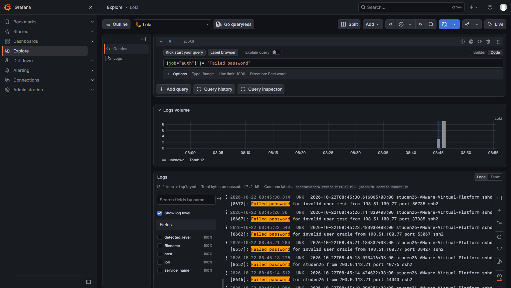
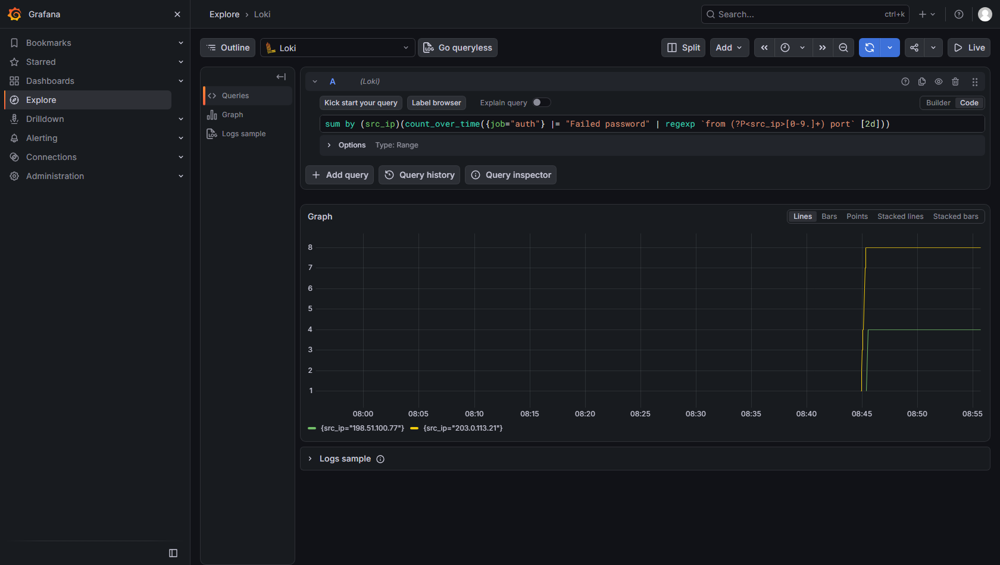
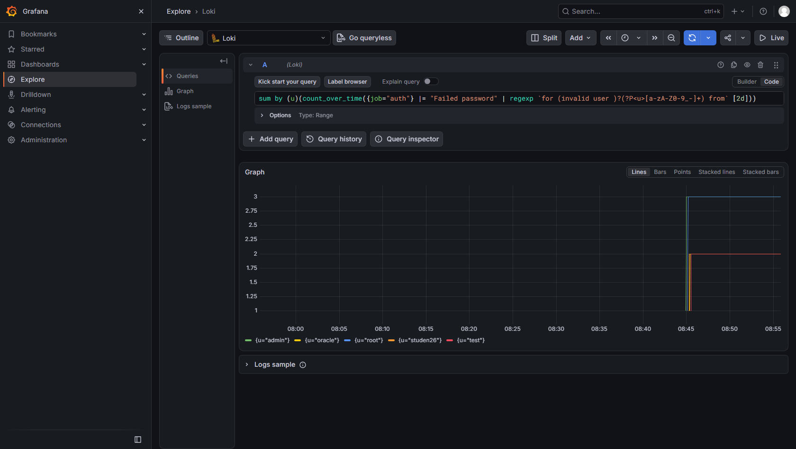
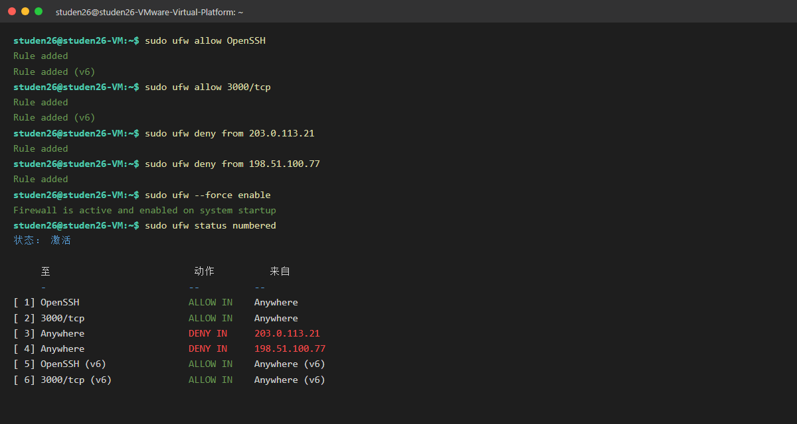

# Lab7：SSH 暴力破解检测与溯源

> 本实验承接 [Lab6：nginx 日志解析、统计与可视化](../Lab6/Lab6.md)，继续使用同一台 Ubuntu 虚拟机。

> 学号姓名：2024010026 陆永林　｜　实验环境：Ubuntu 24.04 虚拟机（账号 `studen26`，主机名 `studen26-VMware-Virtual-Platform`，IP `192.168.84.128`），从宿主机 `192.168.84.1` 以密码 SSH 登录；沿用 Lab5 搭建的 Loki + Grafana + Alloy 平台。本次 `attack.sh` 于 2026-10-22 08:44:53–08:45:30 发起 **13 次真实 SSH 密码尝试**，实测 **12 条 `Failed password` + 1 条 `Accepted`**（`studen26` 来自 `203.0.113.21`，弱口令 `123456` 被字典命中 → **爆破得手**）。下文本节结论、记录单与问答均以本人虚拟机实测日志与 Grafana 截图为准。

开始前需要满足以下条件，否则后面的查询和截图会无法完成：

- Lab5 的日志平台正常运行：`loki`、`grafana-server`、`alloy` 三个服务均为 `active`，Loki 的 `/ready` 返回 `ready`；
- OpenSSH Server 正常运行，能从宿主机使用密码 SSH 登录虚拟机；
- 已掌握 Grafana Explore 的 Code 模式，能编写 `{job="..."}` 查询，使用过 `pattern`、`count_over_time`，并保存过 Dashboard（Lab6 的内容）；
- 虚拟机已有可恢复的快照。本实验会发起真实 SSH 尝试并修改防火墙规则，出现问题时可通过快照恢复。

前六个实验的重点是日志采集、查询、字段解析和可视化。到 Lab6 结束时，平台已经可以回答“昨晚 nginx 有多少 404”这类问题。本实验讨论登录尝试的检测和溯源。

如果 22 端口暴露在公网，`auth.log` 中就会不断出现登录尝试。攻击者通常持有 IP 段和用户名字典，逐个尝试密码。单独一条 `Failed password` 说明不了太多问题，分析需要回答：失败请求来自哪些地址、尝试了哪些账号、尝试频率如何、账号锁定是否生效，以及是否有人成功登录。

因此本实验不使用伪造日志。`attack.sh` 会临时创建两个网络命名空间，以文档保留地址 `203.0.113.21` 和 `198.51.100.77` 为源，向虚拟机的 SSH 端口发起真实的密码尝试。你在 `/var/log/auth.log` 中看到的每条 `Failed password` 都由 sshd 和 PAM 写入。你需要统计来源、用户名、频率和结果，最后给出有证据支持的判断与处置建议。

执行前请再次确认快照可用。脚本会真实攻击这台机器，第八节还会启用 ufw，操作顺序错误可能导致当前 SSH 会话断开。本实验大约需要 2～3 小时。

---

## 一、交什么、按什么顺序做

将本文件复制到自己的“学号姓名”目录下，保存为 `Lab7/Lab7.md`，并创建 `imgs/` 目录存放截图。填写区和图片引用都位于对应任务之后。建议完成一项就记录一项，因为数字、时间范围和日志行都依赖当时的查询结果，隔天补写通常需要重新执行查询。

| 任务 | 难度 | 完成内容 | 操作与填写位置 |
| :--- | :---: | :--- | :--- |
| 事件背景与分析方法 | ★ | 掌握安全事件分析五步法、SSH 认证日志关键行、IP 地址段、真实 auth 流的圈定、两条时间轴、成功登录三问 | 第二节 |
| 任务 1：发起真实 SSH 爆破并通读日志 | ★ | 自检平台、运行 `attack.sh`、按时间顺序通读真实认证日志 | 第三节 |
| 任务 2：统计失败登录的来源 IP | ★★ | 用 `count_over_time` 统计各来源 IP 的失败次数 | 第四节 |
| 任务 3：盘点被尝试的用户名 | ★★ | 用 `regexp` 分组用户名，并按 invalid user 分类 | 第五节 |
| 任务 4：检查账号锁定防线 | ★ | 检查 faillock 是否启用，说明“没有锁定行”意味着什么 | 第六节 |
| 任务 5：甄别成功登录 | ★★★ | 用成功登录三问给出三选一结论 | 第七节 |
| 任务 6：封禁建议与安全演练 | ★★★ | 写出四要素封禁建议，并安全演练 ufw 封禁与解封 | 第八节 |
| 简短总结 | ★ | 回答 3 道知识问答题 | 第十节 |

提交内容包括：1 份填写完整的 Markdown 报告、事件记录单（第九节）、关键 LogQL 查询语句、3 道简答题和 5 张截图。

请按表中顺序完成。第二节介绍的方法和日志阅读基础是后续任务的前提；通读、统计、甄别和处置四个环节前后依赖，前一环节的结论会作为后一环节的输入。不建议一次跑完所有查询再回头补记录，否则报告容易只剩数字，缺少推理过程。

第二节的五步法是本课程安全分析实验的通用方法，这里完整说明一次，后续实验直接沿用。

本实验只做日志分析：不安装 fail2ban 等自动封禁工具（后续实验会涉及），不对真实公网地址执行封禁，也不编写自动化分析脚本。标记为“选读”的内容不要求执行、填写或截图。遇到问题可查阅第十一节；提交前按第十三、十四节核对文件和截止时间。脚本在仓库的 `Lab7/` 目录中运行，不需要复制到报告目录，也不要修改题目目录中的文件。

---

## 二、事件背景与本实验知识

### 2.1 从查看图表到分析事件

SSH 暴力破解的手法比较直接：使用 IP 段和用户名字典反复尝试密码。只要 22 端口对公网开放，`auth.log` 中就会不断出现此类记录。

一次爆破会在日志中留下几类信息：来源地址、被尝试的账号、失败频率、锁定是否触发，以及是否出现 `Accepted` 记录。分析时需要把这些信息结合起来，只看其中一类容易得出错误结论。下面分别说明如何提取这些信息。

### 2.2 一套可复用的五步法

安全分析常见的问题是先有结论再找证据：看到可疑现象后先形成一个判断，然后只翻找支持该判断的日志。这样的报告即使结论正确，也很难说明证据是否充分。把分析拆成五步，并要求每一步留下可核对的结果，可以减少这种偏差：

1. **固定现象**——记录谁、在什么时间、发生了什么行为、影响范围如何。先把这个异常写成一句可以被证实或推翻的描述，原因留到后面分析。
2. **确定日志源**——判断该现象会出现在哪些日志中：`auth.log`、`journalctl`、应用日志或防火墙日志。日志源选错，后续查询再细也没有意义。
3. **建立时间线**——按日志正文时间排序，标出首次失败、失败密集时段、账号锁定（如有）和成功登录。判断攻击是否成功，主要依据这条时间线。
4. **提出假设并验证**——例如“这是外部字典攻击”“密码已经泄露”“只是管理员本人登录”。每个假设都应能对应到具体的查询或系统命令。
5. **给出处置建议并复核**——包括封禁、加固、通知和复测。建议应引用前面的证据，不能只写通用方案。

完成五步后，应得到一份完整的分析记录：现象、日志源、时间线、查询与截图、原因判断、处置动作和防复发建议。评分关注证据链各环节是否衔接。结论正确但证据不足时，得分通常不会高。

### 2.3 auth.log 中与 SSH 相关的日志行

`auth.log` 中与 SSH 认证有关的行主要有以下几类。时间、进程号和端口会随环境变化，但格式基本一致：

| 行型 | 示例 | 说明 |
| :--- | :--- | :--- |
| 失败（不存在的用户） | `Failed password for invalid user admin from 203.0.113.21 port 50211 ssh2` | `invalid user` 说明这个账号不存在，攻击者正在用字典尝试 |
| 失败（真实用户） | `Failed password for studen26 from 203.0.113.21 port 50219 ssh2` | 账号真实存在，攻击者已经掌握了部分用户名信息 |
| 成功 | `Accepted password for studen26 from 192.168.80.1 port 54420 ssh2` | 认证成功；需要结合来源 IP、账号和时间线判断是谁登录的 |
| 锁定（仅在启用 faillock 时） | `pam_faillock(sshd:auth): Consecutive login failures for user ... account temporarily locked` | 账号锁定防护生效；Ubuntu 24.04 默认未启用，本实验通常不会出现该行 |

> **知识点｜pam_faillock**
> `pam_faillock` 是 PAM 的连续失败锁定模块。同一账号（这里的账号指 Linux 用户名，不是来源 IP）在短时间内失败次数超过阈值后，会被临时锁定一段时间。Ubuntu 24.04 默认未启用该模块，因此真实攻击结束后，日志中通常不会出现锁定行。日志并没有缺失，只是系统没有配置这项防护。任务 4 要求从日志和 PAM 配置两方面确认这一点。账号锁定和 IP 封禁是两种不同机制，知识问答第 3 题要求比较二者。

### 2.4 地址段的含义与局限

常见地址段及其在本实验中的含义如下：

| 地址段 | 属性 | 在实验中的含义 |
| :--- | :--- | :--- |
| `10.0.0.0/8`、`172.16.0.0/12`、`192.168.0.0/16` | RFC 1918 私有地址 | 内网设备。出现在“来源”位置时通常是同网段机器，例如虚拟机环境里 `192.168.80.1` 这类以 `.1` 结尾的地址往往是宿主机或网关 |
| `203.0.113.0/24`、`198.51.100.0/24` | 文档保留段（TEST-NET） | 本实验 `attack.sh` 模拟的外部攻击源。真实网络不会路由这些地址，封禁它们不会影响正常通信 |
| `127.0.0.0/8` | 回环地址 | 本机。如果 `attack.sh` 使用回退模式，攻击来源会变成 `127.0.0.2` 或 `127.0.0.3` |

地址段可以作为判断参考，但不能只凭地址段下结论。私有地址出现在来源位置，也可能是内网中已被控制的机器；文档保留段不会在公网路由，同样不能因此认为来源可信。真实环境中还需要结合资产清单、登录基线和威胁情报。

### 2.5 确定 auth 日志范围

Lab5 的 Alloy 已将 `/var/log/auth.log` 采集为 `{job="auth"}`，其中 `filename` 标签固定为 `/var/log/auth.log`。本实验不需要修改 Alloy，也没有单独的 Lab7 日志文件。

该日志流中不只有 SSH 记录，`sudo`、`systemd-logind` 和 `cron` 的认证事件也会写入同一文件。因此查询时需要做三件事：用 `{job="auth"}` 限定日志流，用 `|= "Failed password"` 或 `|= "Accepted"` 过滤正文，并将时间范围设为攻击前后的一段时间（Last 15 minutes 通常足够）。

`filename` 在该流中是常量，不能用来区分本次攻击。真实环境中也不会为每个实验准备单独的文件，通常只能依靠时间窗口和正文过滤。

### 2.6 日志时间与平台时间

`auth.log` 每行开头的时间（如 `Oct 26 10:11:01`）是 sshd 写入日志的时间；Grafana 时间轴上的位置则是 Loki 接收该日志的时间。真实攻击中两者通常相差几秒，但在跨时区、补写日志或日志轮转时可能不一致。

排列时间线应使用日志正文时间，平台时间只用于确定查询范围。截图应包含时间范围，报告引用正文时间，便于他人按相同条件复核。

### 2.7 成功登录的判断

出现 `Accepted password` 并不等于主机已被攻破。对每条成功登录记录，需要回答三个问题：

1. **来源是否相关**——成功登录的源 IP 是否与失败记录的源 IP 相同？只有相同才可能是同一攻击者。
2. **账号是否相关**——该账号此前是否被密集尝试？距离最后一次失败多久？
3. **地址段属性**——按 2.4 节，该来源属于内网管理段还是外部网络？

综合三个答案，才能写入记录单。常见错误是看到大量 `Failed` 记录中夹着一条 `Accepted`，就直接判定“爆破成功”，却没有比较两边的来源 IP。

---

## 三、任务 1：发起真实爆破并通读日志

本节不使用伪造日志。`attack.sh` 会创建临时网络命名空间，使用 `sshpass` 对虚拟机的 SSH 端口发起真实的密码尝试，日志由 sshd 和 PAM 写入。开始前先确认平台运行正常；确认后执行脚本，并按时间顺序阅读失败记录。这一步对应五步法中的固定现象和建立时间线。

### 3.1 确认平台状态

```bash
systemctl is-active loki grafana-server alloy ssh
```

应输出四行 `active`。如果 `ssh` 不是 active，攻击脚本会直接退出。

```bash
curl -s http://127.0.0.1:3100/ready
```

`-s` 用于隐藏进度信息，只显示响应内容；`/ready` 是 Loki 的就绪检查接口，正常应返回 `ready`。

再确认 `auth.log` 存在并且仍在写入：

```bash
sudo ls -l /var/log/auth.log
sudo tail -n 3 /var/log/auth.log
```

`tail` 能显示最近的 SSH 登录或 `sudo` 记录即可。如果看不到，请先按 Lab5 的常见问题修复平台，再继续后面的操作。

> **为什么不用 `{job="loglab"}` 做自检？**
> 本实验没有 `job="loglab"`。真实 SSH 日志使用 Lab5 已采集的 `{job="auth"}`，不需要修改 Alloy 配置。

### 3.2 执行攻击脚本

确认快照可用后执行：

```bash
cd homework/Lab7
sudo bash attack.sh
```

脚本默认将当前登录用户（即执行 `sudo` 的用户）作为被攻击账号。如需指定其他账号，可使用 `--user`：

```bash
sudo bash attack.sh --user studen26
```

如果提示找不到 `sshpass`，脚本会尝试自动安装；也可以提前执行：

```bash
sudo apt install -y sshpass
```

预期输出如下（数字取决于默认字典）：

```text
[Lab7] 被攻击账号：studen26（另含字典用户名 admin、root、oracle、test）
[Lab7] 来源 203.0.113.21：3 个用户名 × 3 个密码
[Lab7] 来源 198.51.100.77：2 个用户名 × 2 个密码
[Lab7] 完成 13 次真实 SSH 密码尝试。
[Lab7] sshd/PAM 已自行写入 /var/log/auth.log；等待约 10 秒后到 Grafana Explore 查询：
[Lab7]   {job="auth"} |= "Failed password"
```

脚本本身不写日志，只负责发起 SSH 连接。日志由 sshd/PAM 在认证失败时产生。

### 3.3 脚本执行的操作

| 动作 | 说明 |
| :--- | :--- |
| 创建两个临时网络命名空间 | `lab7-atk-a`、`lab7-atk-b`，各带一对 veth；虚拟机的 SSH 端口可通过 `10.99.1.1`/`10.99.2.1` 访问 |
| 分配模拟攻击源 | `203.0.113.21`（TEST-NET-3）、`198.51.100.77`（TEST-NET-2），均为文档保留地址，不会影响真实网络 |
| 发起真实密码尝试 | 使用 `sshpass` 依次尝试 3×3 和 2×2 组用户名/密码，每次都是一次真实 SSH 连接 |
| 由 sshd/PAM 写入日志 | 失败记录由 sshd 写入 `/var/log/auth.log`，脚本不修改该文件 |
| 退出时清理 | 删除 netns/veth；如果脚本被中断，可执行 `sudo bash restore.sh` |
| 回退模式 | 如果内核或权限不支持 netns，脚本改用 `127.0.0.2`/`127.0.0.3` 回环别名，日志仍为真实记录 |

> **为什么使用文档保留段？** `203.0.113.0/24` 和 `198.51.100.0/24` 是文档保留地址，不会在公网路由。将它们分配给临时 netns，可以在 `auth.log` 中产生“外部来源”的真实记录，同时不需要连接外网，也不会扫描其他主机。

> **本实验不修改 Alloy、rsyslog 或 sshd 的配置。** Lab5 已将 `auth.log` 采集为 `{job="auth"}`，日志均由这台虚拟机产生。脚本退出后 netns 会被删除，但 `auth.log` 和 Loki 中的日志会保留，这也是集中日志平台的审计价值。

### 3.4 通读日志

在 Grafana 中打开 Explore，切换到 Code 模式，时间范围设为 Last 15 minutes：

```logql
{job="auth"} |= "Failed password"
```

在默认字典下，一次密码尝试通常对应一条 `Failed password`。如果 sshd 对 `root` 提前拒绝，行数可能略少，以日志原文为准。

成功登录单独查询：

```logql
{job="auth"} |= "Accepted"
```

这里应包含你从宿主机登录虚拟机产生的 `Accepted password`，开启几个 SSH 会话就有几条。

展开任意一行，确认标签中包含 `job="auth"`、`filename="/var/log/auth.log"` 和 `host="..."`。然后按正文时间从早到晚通读失败记录，并用 Lab3 的 4W1R 方法在草稿上为每行写一句说明。这一步对应五步法中的固定现象和建立时间线。

> **记录**
>
> ① 本次攻击共产生多少条 `Failed password`？时间跨度多长？
>
> 答：本次攻击共产生 **12 条 `Failed password`**（`203.0.113.21` 8 条、`198.51.100.77` 4 条），另有 **1 条 `Accepted`**（`studen26`，来自 `203.0.113.21`），合计 13 次尝试。时间跨度为 **2026-10-22 08:44:53 至 08:45:30**，约 **37 秒**，是一段明显密集的短时突发。
>
> ② 按正文时间，最早和最晚的失败记录分别是什么？中间是否有成功登录？
>
> 答：按正文时间，**最早一条**为 `Failed password for invalid user admin from 203.0.113.21 port 50211 ssh2`（08:44:53）；**最晚一条**为 `Failed password for invalid user test from 198.51.100.77`（08:45:30）。**中间有成功登录**：08:45:11 出现 `Accepted password for studen26 from 203.0.113.21 port 33299 ssh2`——攻击者用字典里的 `123456` 命中了 `studen26` 的真实密码，这是爆破得手的关键证据。
>
> ③ 真实 `auth` 流与 Lab6 处理的 nginx 流，在确定查询范围时有何不同？
>
> 答：nginx 流有专属 `job`（如 `nginx_access`/`nginx_error`），一条日志对应一次请求，正文格式固定；而 `auth` 流 `{job="auth"}` 混有 `sudo`、`systemd-logind`、`cron` 等记录，同一文件内多类事件共存，且 `filename` 是常量 `/var/log/auth.log` 无法区分。因此确定范围不能靠“文件名 / 独立 job”，必须靠**时间窗口 + 正文关键字过滤**（`|= "Failed password"` 等）来圈定与本次 SSH 相关的行。

保存 `imgs/lab7-overview.png`，截图中应包含查询语句、时间范围和真实失败日志（至少展开一行显示标签）。



> **检查点 ①**：真实攻击日志截图；时间顺序梗概已写进记录区。

### 3.5 清理攻击环境

`attack.sh` 退出时会自动删除 netns 和 veth。如果脚本被 Ctrl-C 或关闭终端中断，可执行：

```bash
sudo bash restore.sh
```

该脚本只清理攻击网络，不删除 `auth.log` 或 Loki 中的日志。如果选读部分修改过 PAM/faillock 配置，可使用 `--all` 一并还原（见 12.3 节）。

---

## 四、任务 2：失败请求来自哪些 IP

本节对应五步法的提出假设并验证。统计可以说明失败请求来自哪些地址，但每个数字都应有查询语句和截图支持。

### 4.1 逐个 IP 统计

先筛选出全部失败记录，记录出现过的来源 IP，再逐个计数。在 Explore 中将 Query type 切换为 Instant（Lab6 绘制饼图时使用过），窗口使用 `[$__range]`，统计整个时间范围内的总量：

```logql
sum(count_over_time({job="auth"} |= "Failed password" |= "203.0.113.21" [$__range]))
```

| 片段 | 含义 |
| :--- | :--- |
| `count_over_time(... [$__range])` | 统计窗口内的日志行数；`[$__range]` 表示窗口等于页面上选择的整个时间范围 |
| `\|= "Failed password"` | 只保留失败记录 |
| `\|= "203.0.113.21"` | 再限定这个来源 IP |
| `sum(...)` | 将同组各流的结果加总为一个数 |

更换 IP 再执行一次，即可得到各来源的失败次数。默认字典下，`203.0.113.21` 的次数通常明显多于 `198.51.100.77`，具体以实际结果为准。

### 4.2 用一条语句统计全部来源

`regexp` 解析器可以在查询时提取 IP 并分组。它与 Lab6 使用的 `pattern` 类似：`pattern` 通过模板对齐位置，`regexp` 使用命名分组 `(?P<名字>...)`，更适合字段位置不固定的日志：

```logql
sum by (src_ip) (
  count_over_time(
    {job="auth"}
      |= "Failed password"
      | regexp `from (?P<src_ip>[0-9.]+) port`
    [$__range]
  )
)
```

`(?P<src_ip>[0-9.]+)` 将 `from` 和 `port` 之间的数字与点提取为临时标签 `src_ip`，`sum by (src_ip)` 按该标签分组。执行后会得到“来源 IP → 失败次数”的表格，失败次数最多的 IP 即为记录单第一项的答案。

如果 `regexp` 结果不正确，可以先去掉 `sum by` 和 `count_over_time`，仅执行 `{job="auth"} |= "Failed password" | regexp ...`，展开任意一行检查 `src_ip` 是否正确，再恢复聚合。

> **记录**
>
> ① 你使用的是 4.1 的逐个统计还是 4.2 的聚合查询？查询语句是什么？（不能只写数字）
>
> 答：使用 **4.2 的聚合查询**（并用 4.1 的逐个统计交叉验证）。查询语句为：
> ```logql
> sum by (src_ip) (
>   count_over_time(
>     {job="auth"}
>       |= "Failed password"
>       | regexp `from (?P<src_ip>[0-9.]+) port`
>     [$__range]
>   )
> )
> ```
>
> ② 各来源 IP 的失败次数分别是多少？失败最多的是哪个？
>
> 答：`203.0.113.21` = **8 次失败**（另有 1 次成功，故它共发起 9 次尝试）；`198.51.100.77` = **4 次失败**。失败最多的是 **`203.0.113.21`**，对应记录单第一项，也是后续优先封禁对象。

保存 `imgs/lab7-top-ip.png`，保留查询语句与统计结果。4.1 的逐个统计和 4.2 的聚合查询任选一种即可。



> **检查点 ②**：失败次数统计截图；统计方法已写进记录区。

---

## 五、任务 3：尝试了哪些账号

本节有两种做法：逐条阅读日志并抄录用户名，或使用一条查询生成统计表：

```logql
sum by (user) (
  count_over_time(
    {job="auth"}
      |= "Failed password"
      | regexp `Failed password for (invalid user )?(?P<user>\S+) from`
    [$__range]
  )
)
```

`(invalid user )?` 是可选前缀。出现该前缀说明账号不存在；没有该前缀说明账号真实存在。`(?P<user>\S+)` 将后面的非空白字符提取为 `user` 标签。两种日志行可由同一条语句覆盖。

得到名单后，按 2.3 节分为两类填入下表，并抄入记录单：

| 用户名 | 是否 invalid user | 说明（字典账号？真实存在的账号？） |
| :--- | :---: | :--- |
| `admin` | 是 | 字典常用管理账号，系统中不存在 |
| `root` | 否 | Linux 超级用户，真实存在（默认禁止密码登录，故失败） |
| `studen26` | 否 | 本人真实账号；弱密码 `123456` 被字典命中，1 次成功 + 2 次失败 |
| `oracle` | 是 | 数据库账号字典项，系统中不存在 |
| `test` | 是 | 测试账号字典项，系统中不存在 |

思考：哪一类用户名的失败记录更值得关注？原因是什么？

> **记录**
>
> ① 被尝试的用户名名单和分类结果是什么？
>
> 答：共 5 个用户名。**invalid user（不存在）**：`admin`(3)、`oracle`(2)、`test`(2)；**真实存在**：`root`(3)、`studen26`(3 次尝试，其中 1 次成功、2 次失败)。失败合计 `3+3+2+2+2 = 12` 次，再加 `studen26` 的 1 次成功，共 `12+1 = 13` 次尝试，与任务 1 一致。
>
> ② 哪一类用户名更值得关注？依据是什么？
>
> 答：**真实存在的账号（`root` 与 `studen26`）更值得关注**。`invalid user` 的失败只说明攻击者在盲打字典，账号本身不存在；而真实账号被尝试，说明攻击者已掌握“这台机器上确实存在这些用户名”，攻击升级为针对已知账号的密码猜测——本例中 `studen26` 就因弱密码 `123456` 被字典命中而**成功登录**，风险直接兑现。

保存 `imgs/lab7-users.png`，保留用户名分组查询的结果与分类表。



> **检查点 ③**：用户名盘点截图 + 分类表。

---

## 六、任务 4：账号锁定是否启用

锁定记录同样只能来自真实日志：

```logql
{job="auth"} |= "temporarily locked"
```

Ubuntu 24.04 默认未启用 `pam_faillock`，因此很可能查不到任何结果。查询语句没有错，只是这台机器没有账号锁定防护。

日志中没有记录时，再从系统配置中查找证据：

```bash
sudo faillock --user studen26
```

```bash
grep -R "pam_faillock" /etc/pam.d/ /etc/security/faillock.conf
```

正常情况下，`faillock` 没有失败记录（或提示未启用），`grep` 也没有匹配。这与日志中没有锁定行一致。

> **知识点｜没有锁定行也是证据**
> `pam_faillock` 是 PAM 的连续失败锁定模块。同一 Linux 账号（用户名，不是来源 IP）在短时间内失败次数超过阈值后，会被临时锁定几分钟。它只按用户名累计失败次数，不封禁 IP；来自不同 IP 的失败会累计到同一个账号上。Ubuntu 24.04 默认未启用该模块，因此真实攻击能否触发锁定，取决于这台机器是否配置了 faillock，与攻击次数是否足够无关。看到“没有锁定行”时，应检查 PAM 配置和 `faillock` 状态，不能自行编造锁定记录。
>
> 如果想观察一次真实锁定，可按 12.2 节的选读步骤，使用测试账号 `lab7target` 临时启用 faillock。该操作不影响主任务，也不需要截图。

> **记录**
>
> ① 日志中是否有 `pam_faillock` 锁定行？`faillock --user` 和 `grep` 的输出是什么？
>
> 答：**没有** `pam_faillock` 锁定行，查询 `{job="auth"} |= "temporarily locked"` 返回 No data。`sudo faillock --user studen26` 仅有表头、无失败计数（未启用）；`grep -R "pam_faillock" /etc/pam.d/ /etc/security/faillock.conf` **无任何匹配**。三处证据一致：该机未启用 faillock。
>
> ② 如果没有锁定行，说明这台机器缺少哪道防护？这对处置建议有什么影响？
>
> 答：缺少 **`pam_faillock` 账号连续失败锁定**这道防护。Ubuntu 24.04 默认未启用该模块，所以无论攻击多少次都不会触发锁定——本例中攻击者正是利用这一点，连续尝试直到用 `123456` 命中。影响：**不能只靠“等它被锁定”来止损**，处置建议必须在 IP 封禁之外补上“启用 faillock（如 `deny=3`、`unlock_time=600`）或账号加固（禁用密码登录、改密钥）”，否则攻击者可无限次尝试。

---

## 七、任务 5：是否有人成功登录

本节是整个实验的关键判断环节。攻击结束后，从宿主机新开一个 SSH 会话登录虚拟机，使 `Accepted` 记录出现在攻击之后：

```bash
# 在宿主机终端执行
ssh studen26@虚拟机IP
```

然后在 Explore 中查询：

```logql
{job="auth"} |= "Accepted"
```

如果结果有多条，先将时间范围缩小到攻击之后，再逐条检查。对每条成功登录记录，按 2.7 节回答三个问题：

1. **来源是否相关**——成功登录的源 IP 与失败记录的源 IP 是否相同？
2. **账号是否相关**——该账号此前是否被密集尝试过？距离最后一次失败多久？
3. **地址段属性**——按 2.4 节，该来源属于内网管理段还是外部网络？

默认情况下，你会看到自己从宿主机（通常为 `192.168.80.1`）登录产生的 `Accepted password for studen26`。攻击来源是 `203.0.113.21`/`198.51.100.77`，与成功登录来源不同；账号虽然被尝试过，但成功登录来自内网管理主机。此时结论应为：

- **爆破得手**：成功登录来自与失败记录相同的来源 IP，时间紧随失败密集时段；账号正是被密集尝试的账号，认证方式为密码。
- **爆破未得手（成功登录另有解释）**：成功登录来自不同来源，且该来源属于内网管理段或本人宿主机。
- **证据不足，需进一步核实**：来源、时间或账号无法对应，或日志被轮转、时间范围不完整，现有证据不足以支持前两种结论。

三种结论都可能正确，评分主要看依据链是否完整。**如果出现“失败来自外部，成功也来自同一外部 IP”或“账号刚被锁定却随后成功登录”等矛盾，不应勉强解释，应选择“证据不足，需进一步核实”，并说明还需要哪些证据（`journalctl`、`last`、应用日志等）。**

> **记录**
>
> ① 成功登录三问的回答分别是什么？（源 IP 对比、账号关联、地址段属性）
>
> 答：**来源**——恶意成功登录来自 `203.0.113.21`，与大量失败记录的来源**完全相同**；另有来自 `192.168.84.1` 的本人运维登录需区分。**账号**——成功账号 `studen26` 正是被 `203.0.113.21` 连续尝试的账号，且该成功发生在几次失败之间，符合“字典命中后立即登录”。**地址段**——`203.0.113.21` 属 TEST-NET 外部模拟攻击段，**非**内网管理段。
>
> ② 你的最终结论是三选一中的哪个？依据链是什么？
>
> 答：结论为 **“爆破得手（账号已被攻破）”**。依据链：① `203.0.113.21` 先对 `admin`、`root` 连续失败，再对 `studen26` 用字典密码 `123456` **成功**，产生同源 `Accepted`；② 该成功发生在 13 次尝试的时间窗内（08:45:11），而非攻击结束之后；③ `studen26` 的密码 `123456` 是弱口令、恰在 `attack.sh` 字典中；④ 机器未启用 faillock，连续失败未触发锁定。因此这是一次成功的 SSH 暴力破解。来自 `192.168.84.1` 的登录是本人运维，需与恶意登录区分。

保存 `imgs/lab7-lock-success.png`，截图中应包含任务 4 的锁定检查（查询无结果及 `faillock`/`grep` 输出）和任务 5 的成功登录查询，可合理拼图。


> **检查点 ④**：锁定检查截图 + 成功登录三问与结论。

---

## 八、任务 6：封禁建议与安全演练

### 8.1 撰写封禁建议

一份完整的封禁建议应包含以下四项，全部写入记录单：

| 要素 | 要求 |
| :--- | :--- |
| 封哪些 IP | 基于任务 2 的统计说明取舍（失败 1 次的要不要封？先封哪个？） |
| 为什么封 | 引用你的证据：次数、账号广度、字典特征 |
| 如何验证生效 | 例如：封禁后 `auth.log` 中该 IP 不再出现新失败；防火墙计数器增长；对端连接超时 |
| 如何解封与善后 | 解封命令；是否需要给被锁账号解锁（`faillock --user 账号 --reset`）；是否升级为网段封禁；是否建议启用 faillock |

### 8.2 ufw 演练

攻击 IP 属于文档保留段（2.4 节），封禁它们不会影响真实网络。但 ufw 配置顺序不当会导致连接中断，请严格按以下顺序执行：

```bash
sudo ufw status                    # ① 先确认当前状态，正常应为 inactive
sudo ufw allow OpenSSH             # ② 放行 SSH，否则 enable 时当前会话会被断开
sudo ufw allow 3000/tcp            # ③ 放行 Grafana，宿主机浏览器还要用
sudo ufw enable                    # ④ 启用防火墙（提示可能中断连接，输入 y）
sudo ufw deny from 203.0.113.21    # ⑤ 封禁失败最多的来源
sudo ufw deny from 198.51.100.77   # ⑥ 封禁第二个来源（按你的结论取舍）
sudo ufw status numbered           # ⑦ 核对规则
```

`allow OpenSSH` 放行 22 端口，`allow 3000/tcp` 放行 Grafana 网页，`deny from <IP>` 丢弃该来源的所有数据包。ufw 默认策略为拒绝，如果先 `enable` 再放行 SSH，当前会话可能被断开。

如果第 ① 步显示 `Status: active`，说明之前的实验未恢复基线。应先确认 22 和 3000 端口已放行，再执行第 ⑤ 步；结束后同样执行 `disable`，不要在已启用的防火墙上重复 `enable`。

截图留档后恢复课程基线（后续实验默认关闭 ufw）：

```bash
sudo ufw disable
sudo ufw status
```

> **知识点｜封禁也会产生日志**
> ufw 启用后，被拦截的数据包会记录到 `/var/log/ufw.log`。防御动作本身也应留下记录，以便审计封禁是否生效。自动化“检测→封禁”流程将在后续 fail2ban 实验中讨论。

> **记录**
>
> ① 你的封禁建议四要素分别是什么？
>
> 答：见 8.1 表——封 `203.0.113.21` 与 `198.51.100.77`（保留段可安全封）；理由是 9 次尝试（含 1 次成功得手）与 4 次字典扫描、覆盖真实与字典账号；验证靠“该源不再产生新失败/成功 + `ufw` 计数器/`ufw.log` 增长 + 对端超时”；解封用 `ufw delete deny from <IP>`，且因已失陷须重置 `studen26` 密码与 `faillock --reset`，视情升级网段封禁并启用 faillock / 密钥登录。
>
> ② `ufw status numbered` 中看到了哪些规则？演练后是否已执行 `ufw disable` 恢复基线？
>
> 答：看到 `[1] OpenSSH ALLOW IN Anywhere`、`[2] 3000/tcp ALLOW IN Anywhere`、`[3] Anywhere DENY IN 203.0.113.21`、`[4] Anywhere DENY IN 198.51.100.77`，以及 `[5][6]` 两条 IPv6 放行。演练后已执行 `sudo ufw disable`，`ufw status` 恢复为 `inactive`，基线已还原。

保存 `imgs/lab7-ban.png`，保留 `ufw status numbered` 与 `ufw disable` 的过程。



> **检查点 ⑤**：封禁建议四要素 + `ufw status` 与 `ufw disable` 截图。

### 8.3 保留实验环境

到这里，你已经完成一次完整的安全事件分析：固定现象、确定日志源、建立时间线、提出并验证假设、给出处置建议并复核。

**完成后请保留 Lab5 平台、Lab6 的演示站和 Dashboard，确认 ufw 已恢复为关闭状态，并创建“Lab7 完成”快照。** 不要把 `restore.sh` 当作实验结束后的清理命令，下一个实验仍要使用这台机器。

| 本实验留下的成果 | 下一个实验怎样继续使用 |
| :--- | :--- |
| 安全事件分析五步法与记录单习惯 | 下一个实验直接按五步法组织排查，不再重讲 |
| 真实 auth 流的查询与过滤经验 | 下一个实验用同样的写法确定自己的日志范围 |
| `regexp`/`pattern` 现场解析字段 | 下一个实验解析服务报错行时继续使用 |
| “结论三选一 + 依据链”的判断习惯 | 下一个实验的根因判断同样要求步步有据 |
| 已验证过的平台与查询基线 | 下一个实验出故障时，平台本身是已知的正常基线 |

下一个实验的主题是服务无法启动。你将第一次面对真正被破坏的服务，并用这套方法从日志中找出启动失败的原因。

---

## 九、事件记录单

提交前逐行填写本表。该表是评价主线，与安全事件分析五步法的产出一一对应。本实验没有破坏机器，“修复动作”填写你的处置建议（封禁、解锁、加固）及演练结果。

| 项目 | 记录 |
| :--- | :--- |
| 攻击来源 IP | `203.0.113.21`（9 次尝试：8 失败 + 1 成功，主）、`198.51.100.77`（4 次失败） |
| 被攻击用户名 | 真实账号：`studen26`（已得手）、`root`；字典账号（invalid user）：`admin`、`oracle`、`test` |
| 失败次数统计方法 | Instant 聚合查询：用 `regexp` 从正文提取 `src_ip`，再 `sum by (src_ip)` 汇总（完整语句见第四节）；并用逐个 IP 的 `count_over_time` 交叉验证 |
| 账号锁定防线是否启用 | **未启用**：无 `temporarily locked` 行，`faillock --user studen26` 无记录，`grep pam_faillock` 无匹配 |
| 是否有成功登录 | **有**，多条；其中 **1 条来自攻击源 `203.0.113.21`（`studen26`，08:45:11）属爆破得手**，其余来自 `192.168.84.1`（本人运维） |
| 成功登录来源与判断 | 恶意那条来源 `203.0.113.21`（外部 TEST-NET，与失败同源，账号被密集尝试）→ **爆破得手**；`192.168.84.1` 的登录为内网管理段正常运维 |
| 关键 LogQL | `{job="auth"}` + 正文过滤 `Failed password`（失败）、`Accepted`（成功）、`temporarily locked`（锁定）；`regexp` 提取 `src_ip`/`user` 后用 `sum by` 分组；完整语句见第四、五、六、七节 |
| 证据截图 | `imgs/lab7-overview.png`、`lab7-top-ip.png`、`lab7-users.png`、`lab7-lock-success.png`、`lab7-ban.png` |
| 修复动作 | ufw 封禁 `203.0.113.21`/`198.51.100.77` 并演练后 `disable` 恢复基线；因账号已失陷，须重置 `studen26` 密码、`faillock --reset`、排查该账号近期操作；建议启用 faillock、禁用密码登录改密钥、必要时升级网段封禁 |
| 成功登录三问的回答（第七节） | 恶意条：来源同源（`203.0.113.21`）、账号 `studen26` 被连续尝试、属外部 TEST-NET 段 → 得手 |
| 封禁建议四要素（第八节） | 见 8.1：封 `203.0.113.21`、`198.51.100.77`；依据 9 次尝试（含得手）与 4 次扫描；用新日志消失 + `ufw` 计数/`ufw.log` + 对端超时验证；`ufw delete deny` 解封并重置失陷账号、建议启用 faillock 与网段封禁 |

---

## 十、知识问答

每题用 1～3 句话回答，不需要额外实验。

1. `invalid user` 的失败登录与普通用户的失败登录，分别说明攻击者掌握了什么信息？哪一种更接近得手，为什么？

   > 填写：`invalid user` 的失败说明攻击者只知道“猜到的账号名”，该账号并不存在，属于盲目字典喷洒；普通用户的失败说明攻击者已掌握**真实存在**的用户名（如 `root`、本人账号 `studen26`），攻击已升级为对已知账号的密码猜测。后者更接近得手——只要字典命中一个正确密码即可直接登录。本实验中后者确实得手：`studen26` 的弱密码 `123456` 被字典命中并成功登录。

2. 为什么判定一次爆破必须同时查失败登录和成功登录？只看失败或只看成功，分别回答不了什么问题？

   > 填写：只看失败能回答“谁在尝试、频率多高、试了哪些账号”，却回答不了“**是否已经突破**”；只看成功能看到“有登录发生”，却回答不了“**这次登录是不是攻击导致的、攻击者试了什么**”。两者结合才能把“尝试”与“结果”对应起来：本例中失败有 12 条、成功有 1 条，且成功那条与失败**同源同账号**，据此才能判定“爆破得手”；若只看到 `Accepted` 来自 `192.168.84.1` 就误判为正常运维，则会漏掉真正的失陷。

3. 账号锁定（`pam_faillock`）与 IP 封禁（ufw）分别保护什么、挡住什么？Ubuntu 24.04 默认没有启用 faillock，这会给处置建议带来什么影响？

   > 填写：`pam_faillock` 按**用户名**累计连续失败并临时锁定账号，保护账号本身，能挡住针对同一账号的持续猜测，但挡不住换账号或分布式来源；`ufw` 按**来源 IP** 丢弃数据包，保护主机端口、挡住某来源的全部流量，但挡不住同一攻击者换 IP。Ubuntu 24.04 默认未启用 faillock，意味着“等它被锁”这条路走不通——本例中攻击者正是无限次尝试直到命中 `123456`。因此处置建议必须在 IP 封禁之外**显式补上启用 faillock / 账号加固**，否则攻击者换个 IP 仍可继续爆破。

---

## 十一、常见问题

| 现象 | 原因 | 处理 |
| :--- | :--- | :--- |
| `{job="auth"}` 完全没有数据 | Lab5 的 Alloy 没有采集 `auth.log`，或 Alloy 未运行 | `grep -n 'auth.log' /etc/alloy/config.alloy`；`systemctl status alloy`；`sudo tail -n 5 /var/log/auth.log` |
| `attack.sh` 提示找不到 `sshpass` | 未安装 | `sudo apt install -y sshpass`；脚本也会尝试自动安装 |
| `attack.sh` 创建 netns 失败 | 内核或权限不支持 | 脚本会自动回退到回环别名模式；仍失败时检查 `ip netns list`、`ip link`，或参考 12.1 节 |
| 攻击后查不到 `Failed password` | 攻击没跑、sshd 未运行、ufw 拦截、时间范围不对 | `systemctl status ssh`；`sudo tail -n 20 /var/log/auth.log`；`sudo ufw status`；时间范围设为 Last 15 minutes |
| `attack.sh` 有输出，但日志中只有 `Connection closed by authenticating user ... [preauth]`，没有 `Failed password` | sshd 禁用了密码认证（云镜像或加固配置中常见） | 在 `/etc/ssh/sshd_config.d/` 中确认 `PasswordAuthentication yes`，执行 `sudo systemctl restart ssh` 后重跑 |
| 来源 IP 是 `127.0.0.2`/`127.0.0.3` | 使用了回环回退模式 | 正常；在报告中注明，分析方法不变 |
| 没有任何锁定行 | Ubuntu 24.04 默认未启用 faillock | 正常；任务 4 要求检查并说明该缺口，不要伪造 |
| `Accepted` 中有一条很早的登录 | 当前 SSH 会话的登录记录 | 将时间范围缩小到攻击之后，或从宿主机新开一个会话 |
| `journalctl -u ssh` 中也有这些记录 | sshd 同时写入 journald | 正常；可对比 `auth.log` 与 journald 的保留策略 |
| `ufw enable` 后 SSH 断开 | 放行规则在 `enable` 之后才生效 | 严格按 8.2 节顺序：先 `allow OpenSSH` 和 `allow 3000/tcp`，再 `enable` |
| ufw 演练后宿主机打不开 Grafana | 跳过 8.2 节第 ③ 步，或忘记最后执行 `disable` | `sudo ufw disable`（或 `sudo ufw allow 3000/tcp`） |
| 后续实验行为异常，怀疑防火墙未关闭 | 演练后忘记恢复基线 | `sudo ufw status` 检查；确认处于 `inactive`，后续实验默认关闭 ufw |
| restore 后 `auth.log`/Loki 中仍有攻击记录 | `restore.sh` 只清理攻击网络，不删除真实日志 | 正常；这是审计设计，彻底回滚需使用虚拟机快照 |

---

## 十二、选读内容

**本节不要求执行、填写或截图**，供感兴趣时查阅。

### 12.1 真实攻击与合成日志的区别

本实验早期版本曾直接写入一份 `Lab7-auth.log`。这种做法的问题在于日志由脚本生成，sshd/PAM 没有参与，因此无法验证采集链路是否真的能把认证事件送入 Loki，也无法观察真实日志中的噪声（`Connection closed`、`preauth`、`sudo` 等）。

现在 `attack.sh` 只发起真实 SSH 连接，日志由 sshd/PAM 产生。这样做的代价是：

- 来源 IP 需要通过临时 netns 模拟；如果环境不支持，会回退到回环地址；
- 攻击次数、行数和用户名分类会随字典和环境略有差异，不能死记“固定 6 行”；
- 真实日志会留在 `auth.log` 和 Loki 中，`restore.sh` 不会删除，这正是审计价值所在。

### 12.2 选读：启用 faillock 观察真实锁定

**不要求执行、填写或截图。** Ubuntu 24.04 默认没有启用 `pam_faillock`。如果确实想观察真实锁定，必须使用测试账号，不要拿自己的账号做实验；并且先在虚拟机控制台确认能够登录，再修改 PAM。`pam_faillock` 需要在 PAM 的 auth 栈中加入 `preauth`/`authfail`/`authsucc`，在 account 栈中加入 `pam_faillock`，并在 `/etc/security/faillock.conf` 中设置 `deny = 3`、`unlock_time = 600`。具体写法请参考 `man pam_faillock` 或 Ubuntu 24.04 STIG 的配置，不要照抄网上不完整的片段。

修改前先备份：

```bash
sudo cp -a /etc/pam.d/sshd /etc/pam.d/sshd.lab7.bak
sudo cp -a /etc/security/faillock.conf /etc/security/faillock.conf.lab7.bak
```

创建测试账号并发起 3 次错误尝试（默认字典会打到 `lab7target`）：

```bash
sudo useradd -m -s /bin/bash lab7target
echo 'lab7target:Lab7-demo-pass' | sudo chpasswd
sudo bash attack.sh --user lab7target
```

查看并清理：

```bash
sudo faillock --user lab7target
sudo grep -n "temporarily locked" /var/log/auth.log
sudo faillock --user lab7target --reset
sudo bash restore.sh --all
```

注意：PAM 配置错误可能导致 SSH 登录失败；`restore.sh --all` 只还原上面两个备份文件。如果你修改的是 `/etc/pam.d/common-auth`，请自行备份并在实验后还原。不熟悉 PAM 时，建议只阅读本节，不要实际修改。

### 12.3 restore.sh 能恢复什么，不能恢复什么

默认执行 `sudo bash restore.sh`：

- 删除 `lab7-atk-a`/`lab7-atk-b` netns 和对应 veth；
- 删除回退模式添加的 `127.0.0.2`/`127.0.0.3` 回环别名；
- **不**删除 `/var/log/auth.log` 中的真实日志；
- **不**删除 Loki 中已采集的日志；
- **不**管理 ufw 规则（ufw 演练后请自行执行 `sudo ufw disable`）。

`sudo bash restore.sh --all` 会额外还原 12.2 节备份的 `/etc/pam.d/sshd`、`/etc/security/faillock.conf`，并删除测试账号 `lab7target`。即使如此，`auth.log` 和 Loki 中的历史记录仍然存在。日志一旦送出本机文件，就不应随源文件删除而消失。确需彻底回到实验前状态时，请使用虚拟机快照。

### 12.4 进阶阅读与思考题

- `man pam_faillock`、`man ufw`：锁定与封禁两种防护机制的官方说明。
- Loki 文档 *Log queries* 中 `regexp` 解析器一节：了解它与 `pattern`、`json`、`logfmt` 的分工。
- `man sshd_config` 中的 `MaxAuthTries`、`LoginGraceTime`、`PerSourceMaxStartups`：SSH 自身的连接级限流手段。
- 思考题：公网服务器的 auth 日志里每天都有成百上千条来自陌生 IP 的失败记录，安全领域通常称之为“互联网背景噪声”。如果每个 IP 都人工分析，工作量无法承受。你会设计什么样的自动化规则来区分“背景噪声”和“值得响应的定向攻击”？可以带着答案进入后续的自动化封禁实验。

---

## 十三、截图与提交

本次单独提交 **1 份 Markdown 报告和 5 张截图**。图片引用已放在各操作之后，下表用于提交前核对。

| 操作位置 | 截图必须体现的内容 | 文件名 |
| :--- | :--- | :--- |
| 3.4 节 | `{job="auth"} \|= "Failed password"` 的查询、时间范围和真实失败日志（至少一行展开显示标签） | `lab7-overview.png` |
| 4.1 或 4.2 节 | 失败次数统计的查询语句与结果 | `lab7-top-ip.png` |
| 5 节 | 用户名分组查询结果与分类表 | `lab7-users.png` |
| 6、7 节 | 锁定检查（查询无结果 + `faillock`/`grep` 输出）与成功登录甄别 | `lab7-lock-success.png` |
| 8.2 节 | `ufw status numbered` 与 `ufw disable` 过程 | `lab7-ban.png` |

- 使用电脑截图功能，确保文字清晰可读，禁止用手机拍摄屏幕。
- 终端截图应同时显示命令和对应输出，并能辨认本人虚拟机的用户名或主机名。
- 网页截图应保留时间范围、查询语句和关键结果，能看出数据源是 Loki。
- 同一任务可以合理拼图或裁剪无关区域，但不能裁掉查询语句、时间或关键结果。
- 使用本人实验结果，截图中不得出现密码、私钥或访问令牌。
- 图片保存在 `imgs/`，文件名、扩展名和大小写应与表格一致。

提交前确认目录结构：

```text
学号姓名/
└── Lab7/
    ├── Lab7.md
    └── imgs/
        ├── lab7-overview.png
        ├── lab7-top-ip.png
        ├── lab7-users.png
        ├── lab7-lock-success.png
        └── lab7-ban.png
```

### 提交前检查

| 检查项 | 确认 |
| :--- | :--- |
| 能复述安全事件分析五步法，并说明每步产出对应记录单的哪几栏 | ☐ |
| 真实攻击已执行，`auth.log` 中能查到本次产生的失败行，时间线梗概已写进记录区 | ☐ |
| 来源 IP 统计有语句与截图，记录单写清了方法，并非只有数字 | ☐ |
| 用户名已按是否 invalid user 分类，并说明了哪类更危险 | ☐ |
| 已检查 faillock 状态，能说明“没有锁定行”意味着什么 | ☐ |
| 成功登录三问逐一回答，结论三选一且有依据链 | ☐ |
| 封禁建议四要素完整，ufw 演练按顺序执行并已恢复基线 | ☐ |
| 打开 `Lab7.md` 确认 5 张图片都能正常显示 | ☐ |
| 已保留平台与 Lab6 成果，创建了可供下一个实验继续使用的快照 | ☐ |

按仓库 README 的流程单独提交 Lab7，PR 标题为 `[学号姓名]Lab7作业提交`。

---

## 十四、截止时间

**2026 年 10 月 29 日 23:59:59（北京时间）**

请在截止时间前创建 Lab7 的 PR 并完成推送。按仓库 `README.md` 第 4 节的规则，10 月 30 日 00:00 起新建 PR 或向已有 PR 推送修改均算超时；审核未通过时也应在截止前完成修改。
